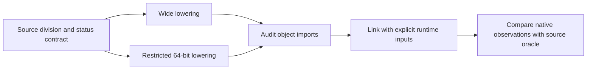

# RT-13 — Native and runtime-supported wide division

- **Date** — 2026-11-25
- **Tracking** — [PLAN §6.1](../../../PLAN.md#61-translation-architecture) · [#327](https://github.com/aivibeflow/LLMLang/issues/327)
- **Status** — Reproduced source observations and freestanding link audit on x86-64 Linux

## Question and source contract

When does compiling a typed operation establish that the selected target can realize it? The fixture divides an unsigned 128-bit dividend, represented by two 64-bit words, by an unsigned 64-bit divisor. The source contract distinguishes zero divisor, quotient overflow and success. Error returns preserve a caller slot. Two realizations are compared. The wide route accepts the full source domain. The native restricted route supports a zero high word and reports an explicit restriction for other nonzero-divisor inputs. Both check zero divisor first. [Target backends](../TRANSLATION-AND-TARGET-BACKENDS.md)

GCC and Clang compile both routes at O0 and O3 in freestanding mode. The harness audits undefined object symbols and attempts to link the objects as shared ELF artifacts using a no-default-library link that rejects unresolved symbols. The separately named runtime-supported attempt supplies the exact static `libgcc.a` archive. A hosted Python harness then calls each linked artifact and compares statuses and slots with a Python integer oracle.



## Results

| Capability | Restricted native route | Wide route |
|---|---|---|
| Compile as a freestanding object | Four profiles succeed | Four profiles succeed |
| Unresolved object symbols | None | Exactly `__udivti3` |
| Link with no default or supplied runtime library | Four succeed | Four refuse the unresolved helper |
| Link with the selected static runtime | Unnecessary | Four succeed |
| Dynamic ELF library requirements after successful link | None | None |
| Observation per profile | 90 success, 100 zero divisor, 1,066 explicit restrictions | 595 success, 100 zero divisor, 561 overflow |

All 10,048 compared calls match the oracle, covering 1,256 vectors per realization and compiler profile. A deliberately weakened lowering that drops the high word returns success with zero for the witness `(high=1, low=2, divisor=8)`. The full implementation returns success with 2⁶¹ and the restricted implementation refuses without storing. This distinguishes support within a declared input domain, runtime-assisted support, and silent narrowing. [Exact evidence](WIDE-DIVISION-CAPABILITY-01/evidence.json)

## Implications and limits

The translation receipt should bind its input domain, object dependencies, exact linked runtime inputs and selected toolchain. Compiler success or the final dynamic dependency table alone leaves the static helper obligation unaccounted for. The link audit gives artifact closure for the tested shared objects. The call matrix gives finite behavioral evidence for those objects and no independent proof of the helper. The fixture uses a hosted loader for the native observations. Non-ELF targets, other CPU profiles, freestanding deployment, complete runtime trust policy and general capability declaration syntax remain open.

## Reproduction

Run on x86-64 Linux with Debian GCC 14.2.0-19, Clang 19.1.7 (3+b1), GNU binutils 2.44, CPython 3.12.14 and the GCC runtime archive fingerprint in the receipt. The runner creates all objects in a temporary directory. [Lowering fixture](WIDE-DIVISION-CAPABILITY-01/lowering.c) · [Runner](WIDE-DIVISION-CAPABILITY-01/run.py)

```sh
set -eu
dir=research/compiler-and-translation/RT-13/WIDE-DIVISION-CAPABILITY-01
observed=$(mktemp)
trap 'rm -f "$observed"' EXIT
python3 -B "$dir/run.py" --gcc gcc --clang clang > "$observed"
cmp "$dir/evidence.json" "$observed"
```
