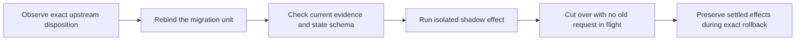

# RT-28 Local contribution replay, shadow and rollback

A migration needs separate records for upstream disposition, current source identity, mirror evidence and the runtime routing decision. A locally accepted patch can be an exact revision, while a modified patch needs new evidence before cutover. Deferred and rejected contributions have different dispositions and can both retain the original provider.



## Native local workflow

The fixture builds 48 independent Git repositories and SQLite WAL databases. Each repository retains a proposal branch and its exact source history. Accepted patches fast-forward the local upstream branch. Modified patches have different committed bytes, and the old proposal's receipt is stale. Deferred and rejected cases keep the prior upstream ref and record their distinct decisions. All outcome labels are synthetic and local.

The shadow call inserts one transactional effect then rolls back its savepoint. Every case verifies an empty effect table after shadow. Cutover requires current source evidence, unchanged state schema, an accepted or modified result and no incomplete old request. The two eligible cases independently commit a canary effect, switch back to the original provider and preserve that effect. Repeating the rollback changes zero additional rows. Fresh SQLite reads verify the final provider, effect and contribution receipt.

| Contribution disposition | Cut over then roll back | Keep original routing |
|---|---:|---:|
| Accepted | 1 | 11 |
| Modified | 1 | 11 |
| Deferred | 0 | 12 |
| Rejected | 0 | 12 |

The guarded route makes a source update, effect publication and rollback separately observable within their local scopes. Shadow isolation applies to the modeled transactional database effect. Real external effects, authorization, distributed quiescence, state conversion and multi-writer recovery need separate proofs or evidence.

## Mandatory research crosswalk

| Obligation | Verified scope |
|---|---|
| Frontend occurrence, unit and mirror identity | Fourteen pinned source revisions distinguish formatting, enrolled rename, exact changes and incomplete evidence. [Source occurrence and mirror binding](RT-28-SOURCE-OCCURRENCE-AND-MIRROR-BINDING-2026-11-25.md) |
| Real upstream release reconciliation and differential mirror | Three exact zlib releases retain 848 matched checksums and original rollback. An altered Rust mirror fails 124 rows. [Zlib release mirror](RT-28-ZLIB-RELEASE-MIRROR-2026-11-25.md) |
| Mixed-language execution, output ownership and defect attribution | A scoped C/Python fixture checks 4,356 baseline results and distinguishes source, adapter and mirror controls. [Mixed-language settlement](RT-28-MIXED-LANGUAGE-SETTLEMENT-2026-11-25.md) |
| Build handoff, accepted release and maintained history | The native handoff and current contribution fixture bind the selected provider to exact source and retained evidence. [Native build handoff](RT-28-NATIVE-BUILD-HANDOFF-2026-11-25.md) |
| Orchestration, lifecycle and authority | Workspace changes, caller plans, repository operations, semantic admission, safe Git publication and retained objects supply separate Toolchain/store contracts. [Toolchain research](../../toolchain-and-collaboration/README.md) |

The candidate keeps the migration and contribution workflow in an orchestration and Toolchain layer. Semantic correspondence and foreign effect boundaries remain explicit source and runtime evidence. Maintainer participation, live patch submission, representative workloads and production cutover stay human-gated.

Use Git 2.56.1, SQLite 3.53.1 and CPython 3.12.14. Two hash seeds match the [case ledger](CONTRIBUTION-AND-CUTOVER-01/evidence.json).

```sh
LC_ALL=C PYTHONHASHSEED=37 python -B research/compiler-and-translation/RT-28/CONTRIBUTION-AND-CUTOVER-01/check.py
```
