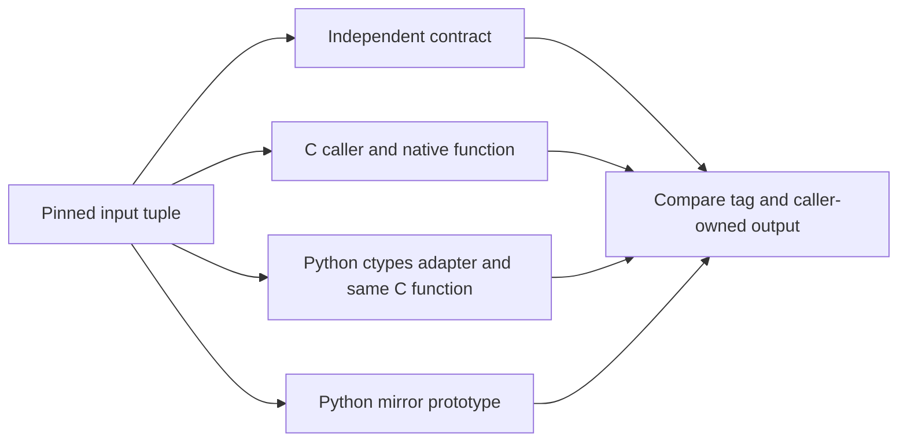

# RT-28 mixed-language output settlement and defect attribution

An isolated C migration unit and a candidate Python mirror agree with an independent contract across 4,356 baseline observations. The checked outcome includes both the return tag and caller-owned output. Three single-fault controls identify divergences in the source build, the Python adapter and the mirror, with the same counts in four compiler profiles.

## Contract and observations

The unit applies an affine update to a signed 32-bit value. It accepts factors from −8 to 8 and uses a widened intermediate for the product and offset. An out-of-range result or invalid factor returns a distinct tag and leaves caller-owned output unchanged. Each case starts with a known output value. The separate contract evaluates membership in the shifted unsigned 32-bit interval. No observation relies on signed overflow.



| Route | Observation |
| --- | --- |
| Native C caller | Validates behavior through a C caller and the original source function. |
| Python adapter | Calls that same source function through a typed `ctypes` boundary and reads the caller-owned output. |
| Mirror prototype | Implements the same finite contract with Python integer arithmetic and explicit admission. |
| Contract | Computes expected tag and output independently of the native executable and adapter. |

## Results

The full Cartesian input set covers 11 input values, 11 factors and 9 offsets. Per compiler profile it yields 500 successes, 391 range refusals and 198 policy refusals. GCC 14.2.0 and Clang 23.1.1 each match all 1,089 cases at both `-O0` and `-O3`.

| Injected defect | Divergences per profile | Earliest affected observation |
| --- | ---: | --- |
| C writes to caller storage before returning the range error | 391 | Native return tags still match the contract. The output check detects the write. |
| Adapter discards the C output and returns the unchanged value | 500 | Native C matches the contract. Successful adapter observations lose the output. |
| Mirror omits the signed range gate | 391 | The two source routes match the contract. The mirror accepts out-of-range results. |

The classification is valid for these controlled single-fault profiles with trusted fixture inputs. One divergent pair in an active repository can also arise from a wrong contract, multiple faults or environment drift. Such cases need provenance and independent evidence before attribution. The Python mirror is a prototype for the fixture. Executable LLMLang bindings, asynchronous effects, ownership transfer and production cutover remain open. [Source and binding reconciliation](RT-28-SOURCE-OCCURRENCE-AND-MIRROR-BINDING-2026-11-25.md)

## Reproduce

Use Linux x86-64, CPython 3.12.14, GCC 14.2.0-19 and Clang 23.1.1 at `6dfe1677ab8dffbc6ec13d53a1e0215d75147689`. Runs with Python hash seeds 37 and 71 at the same repository path produced evidence SHA-256 `2f4a0f3970b29518c3b58b39c4f038c317491e8461a4f403ecda5488e172bdef`. The ledger pins the source and built ELF hashes and includes the first divergent input for each control and profile. [Evidence ledger](MIXED-SETTLEMENT-01/evidence.json)

```sh
LC_ALL=C PYTHONHASHSEED=37 python research/compiler-and-translation/RT-28/MIXED-SETTLEMENT-01/check.py \
  --cc /path/to/gcc --cc /path/to/clang > /tmp/rt28-mixed-settlement.json
```
