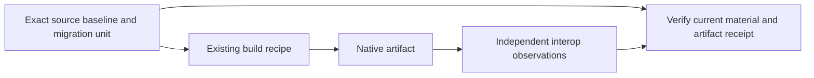

# RT-28 migration and native build interoperability

A migration tool can retain the existing build system and validate the exact artifact at the language boundary. In the fixture, GNU Make can consider a target current when an input's bytes change without a modification-time change. A content-bound receipt detects that stale artifact before the isolated Python consumer admits it.

## Candidate requirements

| Boundary | Required subject |
| --- | --- |
| Source migration | Exact upstream baseline, immutable source occurrences, stable unit and reviewed mirror binding |
| Existing build system | Declared target, complete relevant input closure, toolchain and configuration |
| Native interoperability | Exact shared artifact, ABI types, error and ownership contract, and checked observations |
| Handoff | Current material hashes and produced artifact must match the verified receipt before adoption |

The fixture uses a C shared library, GNU Make and a typed Python `ctypes` consumer. The build key binds source, header, Makefile, declared option file, compiler fingerprint and target. The local receipt also binds the output digest and 17 observed results. [Source reconciliation](RT-28-SOURCE-OCCURRENCE-AND-MIRROR-BINDING-2026-11-25.md) · [Mixed-language settlement](RT-28-MIXED-LANGUAGE-SETTLEMENT-2026-11-25.md)



## Checked cases

| Change | Native build and handoff |
| --- | --- |
| Unrelated documentation | Make stays current and the exact key is unchanged. |
| Changed header with preserved mtime | Make stays current and the native observations still reflect the old header. The current content key refuses the old receipt. |
| Explicit rebuild | The exact new artifact produces the new contract observations. |
| Declared option file changes | Make rebuilds the target and both artifact and input key change. The former receipt is refused. |
| Different target profile | The exact current artifact still requires a receipt for that target. |

All 51 typed observations across the three built revisions match their expected affine result. The receipt assumes an already trusted issuer and a complete fixture input list. Production build discovery needs transitive headers, tool and environment closure, generated and external dependencies, and broader ABI evidence. The replay does not select a production migration or cutover policy.

## Reproduce

Use CPython 3.12.14, GCC 14.2.0-19 and GNU Make 4.4.1 on Linux x86-64. Runs with hash seeds 37 and 71 produce evidence SHA-256 `28e136e4e1b7847c2bead721dcdcf8beb358a45374b9797781793de4c59ea27d`. [Evidence ledger](NATIVE-BUILD-HANDOFF-01/evidence.json)

```sh
LC_ALL=C PYTHONHASHSEED=37 PYTHONDONTWRITEBYTECODE=1 \
  python research/compiler-and-translation/RT-28/NATIVE-BUILD-HANDOFF-01/check.py \
  --cc /path/to/gcc --make /path/to/make > /tmp/rt28-native-build.json
```
