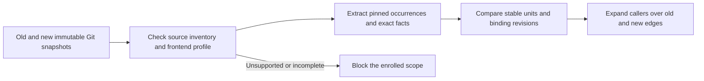

# RT-28 source occurrences and mirror bindings

Fourteen synthetic Git revisions distinguish exact source occurrences, stable migration unit identity and mirror binding revisions. The replay finds one trivia-only change, five changes that require scoped reconciliation and eight cases that block the fixture's full three-unit scope.

## Reconciliation model

| Record | Bound inputs | Purpose |
| --- | --- | --- |
| Source occurrence | Commit, path, compiler symbol and exact Git blob object | Reproduce the frontend input for one baseline. |
| Migration unit | Stable unit identifier in a declared correspondence table | Identify a governed unit across source changes. |
| Mirror binding revision | Unit, source language, path, symbol, interface and named mirror endpoint | Track correspondence changes separately from the exact source occurrence. |
| Extracted facts | Language, normalized interface, supported body and resolved dependency unit IDs | Plan re-analysis over old and new reverse dependencies. |

The fixture uses three approved, synthetic unit IDs. Its C profile checks one scalar function with Clang 23.1.1's AST dump and a closed input grammar. Its Python profile checks one undecorated function with the CPython 3.12.14 AST. Supported Python calls resolve directly to the fixture's declared symbols, including the C leaf. That correspondence is an input to analysis. The fixture does not execute the call or establish an ABI. Reflection, locally shadowed calls, preprocessor changes and build-profile changes leave the supported fragment. An incomplete inventory or duplicate binding also blocks the fixture.



## Checked outcomes

| Input change | Reconciliation disposition | Binding revision |
| --- | --- | --- |
| C formatting | Trivia. All exact occurrences change because they include the new commit. | None |
| C increment changes from one to two | Recheck the leaf and its Python caller. | None |
| Approved C move and rename, with Python call updated | Keep the leaf unit and its extracted facts. Recheck the leaf and its caller. | Leaf |
| Python switches dependency from C leaf to another Python unit | Recheck the caller. | None |
| Python changes its signature or changes signature and referenced operand | Recheck the affected Python unit. | Python unit |
| Missing or untracked source, uncorrelated rename, duplicate binding, reflection, shadowed call, macro, or build-profile change | Block all three units. | None issued |

The C rename preserves the extracted leaf fact hash and changes its binding hash. The implementation-only change preserves its binding hash and requires new verification evidence. The trivia revision preserves both hashes for each unit. These are comparisons of explicitly bounded frontend facts. Signed C arithmetic, Python's arbitrary-precision arithmetic and cross-language effects are outside the tested equivalence scope. Real repository tracking also needs complete build and generated-source discovery, explicit split/merge review, cross-language execution, and authoritative publication gates. [RT-28 research brief](RT-28-INCREMENTAL-POLYGLOT-MIGRATION-AND-SEMANTIC-MIRRORING.md)

## Reproduce

The replay builds a disposable Git SHA-256 repository and reads every frontend source from the selected commit. It records Git 2.56.1, CPython 3.12.14 and Clang 23.1.1 at `6dfe1677ab8dffbc6ec13d53a1e0215d75147689`, including the compiler binary hash. The synthetic baseline commit is `35b5d7c4e9e11e91fc9b6e4d1b60222996080c2e4d65e441c7f0ce19302320d7`. Replays with Python hash seeds 37 and 71 produce ledger SHA-256 `0b5caf16619021e71a077d978b3ab20c1422fb4050b7f8b21422e07761a6656c`. [Evidence ledger](SOURCE-BINDING-01/evidence.json)

```sh
LC_ALL=C PYTHONHASHSEED=37 python research/compiler-and-translation/RT-28/SOURCE-BINDING-01/check.py \
  --clang /path/to/clang > /tmp/rt28-source-binding.json
```
