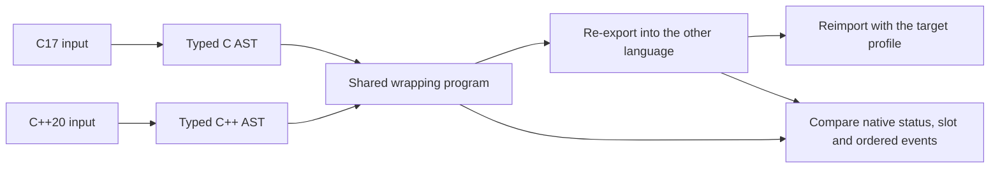

# RT-30 — Typed C and C++ import and cross-target wrapping translation

- **Date** — 2026-11-25
- **Tracking** — [PLAN §6.1](../../../PLAN.md#required-bidirectional-translation-study-rt-30) · [#328](https://github.com/aivibeflow/LLMLang/issues/328)
- **Status** — Reproduced for a closed C17 and C++20 profile on x86-64 Linux

## Question and boundary

Can a typed C-family importer preserve unsigned word arithmetic and ordered effects when exporting the same semantic program into another language? The experiment uses the same 12 wrapping programs and input vectors as the Go import study. Each selected function accepts two 32-bit words, an enable word, a returning callback and a writable output slot. It observes the first word and computed value in that order before storing the slot and returning success. The fixture establishes eight-bit bytes and four-byte `unsigned` on the pinned target. C++ input and output explicitly use C linkage at this boundary. [Go wrapping round trip](RT-30-GO-WRAPPING-ROUNDTRIP-2026-11-25.md) · [Bidirectional translation brief](RT-30-BIDIRECTIONAL-SEMANTIC-TRANSLATION.md)

The importer parses selected closed source with Clang and compares the typed AST to a profile of admitted forms. It normalizes source locations, compiler-generated AST identifiers and the declared function name. It checks exact declaration inventory, types, expressions, branches, callbacks and stores. It emits the operation and ordered parameters as a checked scalar program. A separate C or C++ emitter realizes that program, and the target importer independently checks the emitted declaration under its own language mode.



## Results

Twelve inputs from each language import to the expected operation and ordered operands. All 24 reimports through the opposite language preserve those records. Clang builds original and re-exported modules at O0 and O2. Each of the eight profiles matches the source evaluator on all 37,020 records, including status, written slot and event sequence. All 296,160 observations match, and the resulting trace digest is identical across the profiles.

| Native route | O0 records matched | O2 records matched |
|---|---:|---:|
| Original C | 37,020 | 37,020 |
| C input re-exported as C++ | 37,020 | 37,020 |
| Original C++ | 37,020 | 37,020 |
| C++ input re-exported as C | 37,020 | 37,020 |

Seventeen refusal controls cover preprocessing directives, invalid syntax, extra declarations, wider words, signed arithmetic, a changed operator, different callback input, reversed slot-write order and unadapted C++ linkage. The admitted arithmetic is unsigned and uses word wrapping. The signed form is outside the declared source profile, so the experiment makes no signed-overflow preservation claim. [Evidence ledger](C-FAMILY-ROUNDTRIP-01/evidence.json)

## Limits

Typed AST matching is a restricted importer. It can refuse another source expression with equivalent behavior. Inputs are individual selected translation-unit fragments without preprocessing. Multi-file build configuration, macros, provenance tracking, templates, overloads, aliasing, callback failure and ABI portability need separate evidence. This fixture uses Clang's AST and native compiler together, so it has a common toolchain dependency alongside the independent scalar evaluator. [Typed AST runner](C-FAMILY-ROUNDTRIP-01/roundtrip.py)

## Reproduction

Run from the repository root with CPython 3.12.14, Debian Clang 19.1.7 (3+b1) and the matching x86-64 Linux linker. Both the emitted observations and the linked artifact hashes are compared by the exact receipt. [Original source fixture](C-FAMILY-ROUNDTRIP-01/original.c.in)

```sh
set -eu
dir=research/compiler-and-translation/RT-30/C-FAMILY-ROUNDTRIP-01
observed=$(mktemp)
trap 'rm -f "$observed"' EXIT
python3 -B "$dir/roundtrip.py" --clang clang > "$observed"
cmp "$dir/evidence.json" "$observed"
```
