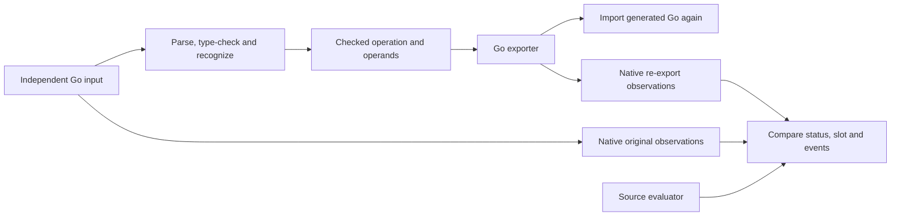

# RT-30 — Import and re-export a closed Go wrapping operation

- **Date** — 2026-11-25
- **Tracking** — [PLAN §6.1](../../../PLAN.md#required-bidirectional-translation-study-rt-30) · [#328](https://github.com/aivibeflow/LLMLang/issues/328)
- **Status** — Reproduced native observations for one restricted Go profile

## Question and boundary

Can a bounded Go importer preserve the source operation, operand order and effects through an independent semantic representation and re-export? The input is one selected standalone Go function with a fixed public signature. It uses three wrapping `uint32` arithmetic operators with four operand arrangements. It emits the first argument, evaluates the selected expression when the enable word is nonzero, emits the resulting word and stores it in the output slot. The hosted adapter supplies a returning callback, a valid writable slot and complete input words. [Bidirectional translation brief](RT-30-BIDIRECTIONAL-SEMANTIC-TRANSLATION.md) · [Existing Go exporter](../RT-13/RT-13-GENERATED-GO-INTEGER-LOWERING-2026-11-24.md)

The importer uses Go's standard parser and type checker, then matches the complete declaration against the admitted AST forms. Function name, comments without directives and source positions may vary. Package inventory, signature, behavior-bearing syntax and effect order are checked. The importer emits an operation and ordered operand references, which are checked by the existing scalar source boundary. The existing Go exporter consumes that semantic program. Both directions admit only the declared fixture profile.



## Results

All 12 source inputs import to the independently enumerated bounded programs, and all 12 reimports preserve the operation and operand order. The original and re-exported Go programs compile into different executable bytes. Each executable matches all 37,020 source observations over 12 programs and 3,085 input vectors per program, covering status, the written slot and ordered callback words.

Ten refusal cases distinguish malformed source, a Go type error, a changed declaration inventory, compiler and build directives, and five typed shapes outside the profile. Two refusal witnesses also run natively. A guard that accepts only enable word 1 changes the slot and second callback for enable word 2. A changed initial callback leaves the status and slot unchanged and alters the event sequence. [Evidence ledger](GO-ROUNDTRIP-01/evidence.json)

## Limits

The checker recognizes a closed syntax profile, so other provably equivalent Go programs may be refused. The experiment uses selected inputs supplied to the importer. General Go build selection, package and module resolution, aliases, control flow, effects outside the callback and slot, and callback behavior under aliasing or failure remain unstudied here. The evidence covers hosted Go on Linux x86-64. It leaves cross-language translation and runtime support policy open.

## Reproduction

Run from the root with CPython 3.12.14 and Go 1.27.4 for Linux amd64. The recorded Go archive SHA-256 identifies the toolchain used. The runner builds offline with cgo disabled and verifies the native traces. [Importer](GO-ROUNDTRIP-01/import.go) · [Original Go fixture](GO-ROUNDTRIP-01/original.go.in) · [Runner](GO-ROUNDTRIP-01/roundtrip.py)

```sh
set -eu
dir=research/compiler-and-translation/RT-30/GO-ROUNDTRIP-01
scratch=$(mktemp -d)
trap 'rm -rf "$scratch"' EXIT
python3 -B "$dir/roundtrip.py" --go go --cache "$scratch/cache" > "$scratch/evidence.json"
cmp "$dir/evidence.json" "$scratch/evidence.json"
```
