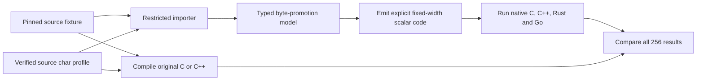

# RT-30 Profile-bound translation of C-family plain char

**Issue** [#328](https://github.com/aivibeflow/LLMLang/issues/328)

Plain `char` has implementation-dependent signedness in C and C++. The same bytes can therefore define different operations under different compilation profiles. This study checks how a restricted importer can bind that source behavior before re-exporting to C, C++, Rust and Go. It uses a single known source fixture rather than a general parser. [Bidirectional translation study](RT-30-BIDIRECTIONAL-SEMANTIC-TRANSLATION.md)

## Source and lowering

The fixture copies one byte into a plain `char` object, promotes its value to a signed 32-bit integer, and adds 256 if the value is nonnegative. The native launcher prints the source compilation profile's `CHAR_BIT` and `CHAR_MIN` before observing all 256 input bytes. Source profiles are restricted to 8-bit chars and native Linux x86-64, with signed minimum −128 or unsigned minimum 0. The importer admits the exact source file digest and supplied supported profile. Its semantic model stores width, high-bit interpretation and the nonnegative bias. The experiment checks the model against the intact source compiled as C17 and C++20 with both plain-char modes.

Generated code operates on exact-width integers. A signed source profile treats bytes 128–255 as numbers −128 through −1. The unsigned profile reads the same bytes as 128–255. The generated C and C++ programs are compiled with the opposite plain-char flag of their respective source profiles. The fixed-width lowering still matches the original trace. The Rust and Go emitters encode the same selected interpretation explicitly. A host-default strategy would be simpler but can silently apply the wrong interpretation on a migration target.



The diagram shows that the source profile is established before lowering. Target compiler options may differ because generated code describes the selected source behavior in fixed-width arithmetic.

## Results and limits

| Check | Observation |
| --- | --- |
| Original C17 and C++20 under signed and unsigned modes | All 1,024 observations agree with the corresponding typed model. |
| Re-export both profiles to C17, C++20, Rust 2021 and Go | All 2,048 observations agree. C and C++ re-export preserve the source result with the opposite target char mode. |
| Reuse the other profile's model for the same source bytes | All 128 high-byte results differ. The first, input 128, yields −128 under signed interpretation and 384 under unsigned interpretation. |
| Missing profile, unsupported width, or out-of-scope source bytes | Import refuses all three cases. |

The [ledger](PLAIN-CHAR-TRANSLATION-01/evidence.json) preserves all 3,072 native values, source profiles, emit artifacts, tool versions and refusal messages. Results are exact finite observations, with no timing or resource measurements. The source file digest alone cannot identify the imported semantics for this fixture. It must be paired with the applicable source profile; regenerated code faithfully retaining the original bytes of a trace still leaves provenance and target verification as separate concerns.

The experiment does not establish a general ABI contract, compiler-independent object representation, parser correctness, translation for wider chars, interpretation of undefined behavior, mixed-language linking or incremental regeneration. The source and output range are both restricted. It adds an implementation-defined behavior case to the [separate wrapping arithmetic slice](RT-30-WRAPPING-TRANSLATION-MATRIX-2026-11-25.md).

## Reproduction

Use Debian GCC and G++ 14.2.0-19, Rust 1.85.1 at `4eb161250e340c8f48f66e2b929ef4a5bed7c181`, Go 1.27.4, and CPython 3.12.14 on Linux x86-64. The [Go release archive](https://go.dev/dl/go1.27.4.linux-amd64.tar.gz) was verified against SHA-256 `7226736c2339719cda28fbf3a54d71aa63bcefe376e98cef00034268dab24840`. The source baseline is `50c9e9182df585a32ee89145405c25682971ecd2`. The runner records source hashes, uses isolated native builds and disables Go network dependency resolution. Hash seeds 1 and 2 gave byte-identical ledgers. Local references and Mermaid source structure were checked. GitHub visual rendering was not manually verified.

```sh
study=research/compiler-and-translation/RT-30/PLAIN-CHAR-TRANSLATION-01
PYTHONHASHSEED=1 python -B "$study/run.py" --rustc "$RUSTC" --go "$GO" >/tmp/llmlang-plain-char.json
cmp "$study/evidence.json" /tmp/llmlang-plain-char.json
```
