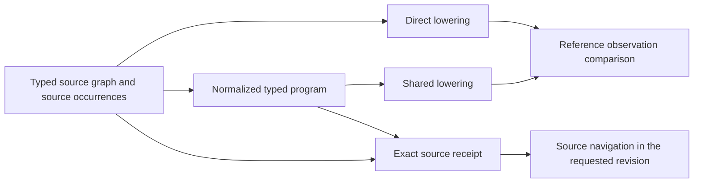

# RT-30 — Direct graphs, normalized IR and source provenance

- **Date** — 2026-11-25
- **Tracking** — [PLAN §6.1](../../../PLAN.md#required-bidirectional-translation-study-rt-30) · [#328](https://github.com/aivibeflow/LLMLang/issues/328)
- **Status** — Reproduced comparison for restricted scalar graphs

## Question and candidate routes

How can two source graphs share generated code while diagnostics retain the correct source occurrence? The fixture generates four source presentations for each of the 12 wrapping programs. It varies parameter spelling, document and line coordinates while holding operation and ordered operands fixed. Every graph supplies separate occurrences for the first observable callback, calculation, result callback and write. The current source presentation and occurrence map are trusted inputs for this experiment. [Translation matrix](RT-30-WRAPPING-TRANSLATION-MATRIX-2026-11-25.md) · [Bidirectional translation brief](RT-30-BIDIRECTIONAL-SEMANTIC-TRANSLATION.md)

| Route | Code generation | Source navigation |
|---|---|---|
| Direct graph | Lowers the named parameters and checked operand references from the graph | Uses the source-bound graph |
| Normalized scalar IR | Projects parameter occurrences to ordered input roles and feeds the existing Python emitter | Shared executable shape alone cannot select a source occurrence |
| Hybrid | Uses that normalized lowering | Checks a separate receipt with semantic key, source document, revision and role locations |



## Observations

Every route matches 148,080 observations across 48 source graphs and 3,085 inputs per graph. Comparisons include status, the written slot and ordered callbacks. Reversing the two callbacks in a control preserves status and slot and changes the event sequence. The direct emitter produces 48 distinct source artifacts because it preserves the parameter spellings. The normalized and hybrid routes use the same 12 generated artifacts. This count describes the chosen emitters. Other direct emitters can choose to erase presentation differences too.

The runner attempts all 2,304 pairings of requested graphs and available source receipts. Semantic-key-only lookup accepts 192 pairs, of which 144 point to a different source presentation. The hybrid check admits the 48 receipts for their actual graphs and refuses all other pairings. A changed location under the same source and semantic labels also fails the exact check. [Evidence ledger](PROVENANCE-ROUTES-01/evidence.json)

## Implications and limits

Source identity and navigation facts can change while the normalized code remains reusable. A direct route can preserve presentation naturally, and a normalized route supports shared code in the tested cases. The hybrid attempt makes source navigation a separate check over the exact requested source and role map. The fixture leaves complete provenance production, source-map formats, macro expansion, multi-file lowering, build provenance and general SPG versus IR selection open.

## Reproduction

Run from the repository root with CPython 3.12.14. The runner executes generated functions against the shared integer observations and checks all source-receipt pairings. [Runner](PROVENANCE-ROUTES-01/run.py)

```sh
set -eu
dir=research/compiler-and-translation/RT-30/PROVENANCE-ROUTES-01
observed=$(mktemp)
trap 'rm -f "$observed"' EXIT
python3 -B "$dir/run.py" > "$observed"
cmp "$dir/evidence.json" "$observed"
```
