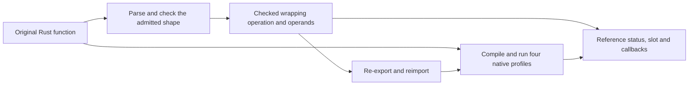

# RT-30 — Rust wrapping import and re-export across overflow profiles

- **Date** — 2026-11-25
- **Tracking** — [PLAN §6.1](../../../PLAN.md#required-bidirectional-translation-study-rt-30) · [#328](https://github.com/aivibeflow/LLMLang/issues/328)
- **Status** — Reproduced for one closed Rust 2021 source profile on x86-64 Linux

## Question and boundary

Can a Rust importer recognize wrapping arithmetic whose meaning is stable across compiler overflow-check settings? The profile consists of one selected safe Rust function. It accepts two words, a word-sized condition, a mutable callback and a mutable output slot. The function can select `wrapping_add`, `wrapping_sub` or `wrapping_mul` with either operand in either position. It emits the first word and the computed or default word in order, stores the result and returns success. The hosted harness supplies a returning callback and a separately borrowed writable slot. [Bidirectional translation brief](RT-30-BIDIRECTIONAL-SEMANTIC-TRANSLATION.md)

The importer parses Rust syntax using pinned Syn and compares the entire admitted function shape. It allows another function name and ordinary comments or formatting. The accepted form has a fixed signature, the explicit wrapping primitive and the ordered callback and slot effects. It emits a checked semantic program with an operation and operands. A separate Rust emitter produces source from that program. The runner checks both original and generated functions with rustc under `forbid(unsafe_code)` before executing the shared request corpus.



## Results

All 12 original functions import to the independently enumerated programs. All reimports preserve those programs. Each original and generated build uses one of four combinations of O0 or O3 and overflow checks on or off. Across all eight builds, 296,160 observations match the source evaluator, with 37,020 cases per build. The exact status, slot and callback stream digest also matches the C and C++ wrapping comparison. [Evidence ledger](RUST-WRAPPING-ROUNDTRIP-01/evidence.json) · [C and C++ wrapping translation](RT-30-C-FAMILY-WRAPPING-CROSS-TARGET-2026-11-25.md) · [Go wrapping round trip](RT-30-GO-WRAPPING-ROUNDTRIP-2026-11-25.md)

Ten refusal controls cover parse failure, extra items, attributes, ordinary addition, checked and saturating addition, and changed control or effects. The ordinary addition control is compiled separately at O0. Adding one to the largest `u32` panics with overflow checking enabled and returns zero with checking disabled. The explicit wrapping method preserves the shared semantics in both settings. [Native overflow control](RUST-WRAPPING-ROUNDTRIP-01/bare-add.rs)

## Limits

The importer recognizes a restricted syntax profile. Whole-crate resolution, macros, traits, generic inference, ownership adaptation across languages, ABI interoperability and callback failure remain open. The parser does not supply native Rust type checking on its own, so acceptance here includes compilation of all admitted fixtures. The wrapped arithmetic comparison supplies the fourth direction into and out of the bounded semantic subset. Broader cross-target coverage and runtime policy still need independent evidence.

## Reproduction

Run from the repository root on x86-64 Linux with CPython 3.12.14 and Rust/Cargo 1.85.1. Cargo fetches the parser dependencies listed with checksums in the lock file. All subsequent parser builds in the runner use the exact lock file offline. [Runner](RUST-WRAPPING-ROUNDTRIP-01/roundtrip.py) · [Parser](RUST-WRAPPING-ROUNDTRIP-01/src/main.rs) · [Cargo lock file](RUST-WRAPPING-ROUNDTRIP-01/Cargo.lock)

```sh
set -eu
dir=research/compiler-and-translation/RT-30/RUST-WRAPPING-ROUNDTRIP-01
observed=$(mktemp)
trap 'rm -f "$observed"' EXIT
cargo fetch --locked --manifest-path "$dir/Cargo.toml"
python3 -B "$dir/roundtrip.py" > "$observed"
cmp "$dir/evidence.json" "$observed"
```
