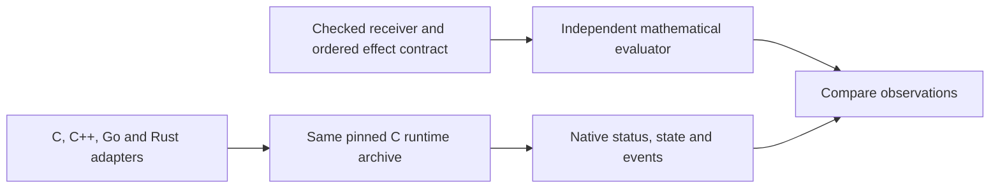

# RT-30 — Shared C runtime for checked receiver dispatch

- **Date** — 2026-11-25
- **Tracking** — [PLAN §6.1](../../../PLAN.md#required-bidirectional-translation-study-rt-30) · [#328](https://github.com/aivibeflow/LLMLang/issues/328)
- **Status** — Reproduced native observations and linked footprint across four adapters

## Question and contract

Can a single C runtime supply the same checked receiver dispatch for C, C++, Go and Rust adapters? The reference contract defines two receiver classes, each with its own capability bit and bounded state transition. The operation validates the receiver and state, checks the grant, dispatches to the selected method and commits the new state only if it remains in range. The observation includes status, final state and ordered events for the checks, method and commit. A separate mathematical evaluator defines the expected results. [Bidirectional translation brief](RT-30-BIDIRECTIONAL-SEMANTIC-TRANSLATION.md) · [Implementation fallback](../RT-13/RT-13-IMPLEMENTATION-FALLBACK-2026-11-25.md)

The provider uses a fixed table of C function pointers with typed arguments. Its C ABI exposes fixed-width integer fields and returns a packed status, state and trace. C and C++ link the runtime directly. Rust uses an explicit C ABI call and Go invokes the same archive through cgo. Each linked module supplies the same probe ABI to the comparison runner. The native symbol audit confirms that the runtime dispatch definition is linked into every module.



## Results

Each adapter matches all 1,680 cases covering valid and invalid receiver tags, state extremes, capability combinations and signed changes. Removing debug sections preserves all results. The original and debug-stripped builds match 13,440 observations in total and share the exact observation digest. All four missing-runtime controls refuse to link. The same static provider archive occupies 2,068 bytes. [Evidence ledger](SHARED-C-RUNTIME-01/evidence.json)

| Adapter | ELF bytes | ELF bytes after debug stripping | .text bytes | Dynamic dependencies |
|---|---:|---:|---:|---|
| C17 | 15,344 | 15,192 | 446 | None |
| C++20 | 15,344 | 15,192 | 446 | None |
| Go 1.27 cgo | 2,035,112 | 1,499,648 | 525,502 | libc |
| Rust 1.85 shared library | 3,554,528 | 15,616 | 471 | libgcc_s, libc and the Linux dynamic loader |

The raw ELF size captures metadata and bundled support as well as instructions. The selected Rust build's raw size is largely debug information, while the Go cgo build retains a larger text section after that packaging distinction. These are deployment footprint measurements for the tested build modes. The runtime's behavior is checked against the source contract, and its C implementation is one realization of that contract.

## Limits

The fixture covers receiver selection, capability checks and explicit failure in a serialized bounded state transition. Object ownership, virtual inheritance, interface evolution, allocator behavior, exceptions, concurrency, runtime versioning, per-dispatch latency and non-ELF targets remain separate research. The measurements also do not select a production runtime or one artifact packaging policy for all languages.

## Reproduction

Run from the repository root on Linux x86-64 with CPython 3.12.14, GCC and G++ 14.2.0 (Debian 14.2.0-19), GNU binutils 2.44, Go 1.27.4 and Rust 1.85.1. The Go build uses only its standard library and cgo. [C provider](SHARED-C-RUNTIME-01/runtime.c) · [C ABI header](SHARED-C-RUNTIME-01/runtime.h) · [Runner](SHARED-C-RUNTIME-01/run.py)

```sh
set -eu
dir=research/compiler-and-translation/RT-30/SHARED-C-RUNTIME-01
scratch=$(mktemp -d)
trap 'rm -rf "$scratch"' EXIT
python3 -B "$dir/run.py" --go-cache "$scratch/go-cache" > "$scratch/evidence.json"
cmp "$dir/evidence.json" "$scratch/evidence.json"
```
