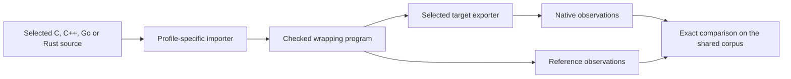

# RT-30 — Source and target matrix for the wrapping scalar profile

- **Date** — 2026-11-25
- **Tracking** — [PLAN §6.1](../../../PLAN.md#required-bidirectional-translation-study-rt-30) · [#328](https://github.com/aivibeflow/LLMLang/issues/328)
- **Status** — Reproduced restricted candidate matrix on x86-64 Linux

## Observation contract

This matrix composes the C, C++, Go and Rust importers and exporters for the same closed set of 12 scalar programs. The central node is the checked LLMLang scalar fixture. Each program accepts two 32-bit words and a word-sized condition. A zero condition selects the second word. A nonzero condition selects the checked operation and ordered operands. Addition, subtraction and multiplication produce their mathematical result modulo 2³². Each invocation emits the first word, emits the selected value, stores it in the output slot and returns success. The hosted adapter provides a returning callback and a valid writable, noninterfering slot. [Research brief](RT-30-BIDIRECTIONAL-SEMANTIC-TRANSLATION.md) · [Shared reference fixture](../PROTOTYPES/LLVM-PRESERVATION-01/integer_fixture.py)

Imports compare the operation and ordered operands exactly. Native observations include the status, final slot and ordered callback words. The test corpus contains 3,085 boundary and generated vectors per program. Source text, host memory layout and native binary identity are outside the behavioral observation contract. The individual native studies check that original C, C++, Go and Rust programs meet the same observation contract before composing the routes. [C and C++](RT-30-C-FAMILY-WRAPPING-CROSS-TARGET-2026-11-25.md) · [Go](RT-30-GO-WRAPPING-ROUNDTRIP-2026-11-25.md) · [Rust](RT-30-RUST-WRAPPING-ROUNDTRIP-2026-11-25.md)



## Matrix

Each native entry passed all 37,020 differential observations. Each checked import preserves all 12 semantic programs. The diagonal entries for C, C++, Go and Rust regenerate the same source language from the checked program.

| Source ↓ / target → | LLMLang scalar fixture | C17 | C++20 | Go 1.27 | Rust 2021 |
|---|---|---|---|---|---|
| LLMLang scalar fixture | Identity | Native pass | Native pass | Native pass | Native pass |
| C17 | Checked import | Native pass | Native pass | Native pass | Native pass |
| C++20 | Checked import | Native pass | Native pass | Native pass | Native pass |
| Go 1.27 | Checked import | Native pass | Native pass | Native pass | Native pass |
| Rust 2021 | Checked import | Native pass | Native pass | Native pass | Native pass |

The 20 native routes produce 740,400 observations and one response digest. The matrix also records four direct imports into the checked fixture. Distinct language inputs intentionally converge on the same checked program when operation and operands match. The pass establishes the reported finite evidence under the pinned contract. The matrix leaves effects beyond this contract and broader language pairs as open research. [Machine-readable matrix](WRAPPING-TRANSLATION-MATRIX-01/evidence.json)

## Candidate outcome contract

| Outcome | Evidence required before reporting it |
|---|---|
| Exact under assumptions | Identify the source fragment, target, observation model and assumptions, and justify preservation for every admitted execution covered by the claim. |
| Runtime-supported | Bind the required runtime interface and selected implementation artifact, check the link closure and justify the modeled observations under the declared assumptions. |
| Restricted | Identify the supported domain or syntax profile, reject other inputs with a reason and record whether the current support is tested or proved. Each experimentally exercised matrix route uses this outcome with its finite evidence. |
| Partial | Identify each imported or emitted region, list unsupported or unverified gaps, and preserve cross-boundary obligations so the result cannot be used as a total equivalence claim. |
| Unverified | Identify any artifact and missing evidence. Preserve the distinction between successful emission or compilation and checked preservation. |
| Unsupported | Report the source region, target profile and unsupported construct or condition. Withhold a compatible translation claim for that input. |

A checked finite observation is evidence within a result, while a preservation outcome describes the scope of the result. The wide-division experiment shows why a runtime-supported profile needs the selected static dependency, even when the linked ELF reports no dynamic library requirement. [Wide division capability](../RT-13/RT-13-WIDE-DIVISION-CAPABILITY-2026-11-25.md)

## Reproduction

Run from the repository root with CPython 3.12.14, Clang 19.1.7 (3+b1), Go 1.27.4, Rust and Cargo 1.85.1, and the pinned Syn dependencies. C and C++ use O2. Rust uses O3 with overflow checks enabled. Go uses the existing offline standalone build profile. The runner records the toolchain versions, source hashes, shared request digest and each exact result. [Matrix runner](WRAPPING-TRANSLATION-MATRIX-01/matrix.py)

```sh
set -eu
dir=research/compiler-and-translation/RT-30
scratch=$(mktemp -d)
trap 'rm -rf "$scratch"' EXIT
cargo fetch --locked --manifest-path "$dir/RUST-WRAPPING-ROUNDTRIP-01/Cargo.toml"
python3 -B "$dir/WRAPPING-TRANSLATION-MATRIX-01/matrix.py" --cache "$scratch/go-cache" > "$scratch/matrix.json"
cmp "$dir/WRAPPING-TRANSLATION-MATRIX-01/evidence.json" "$scratch/matrix.json"
```
