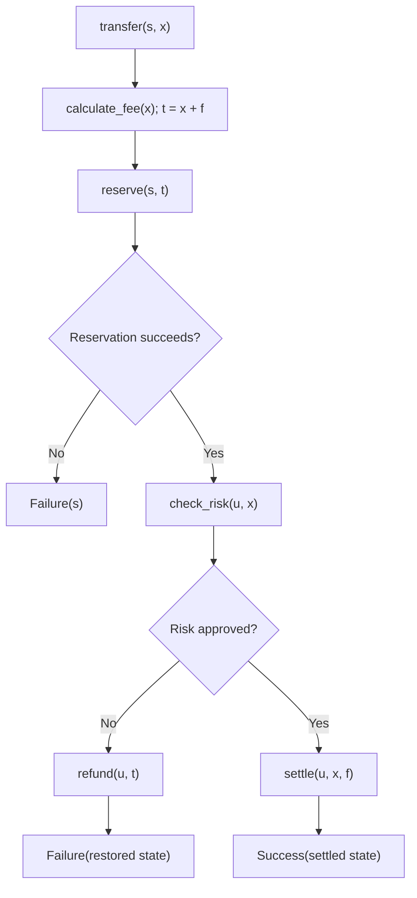
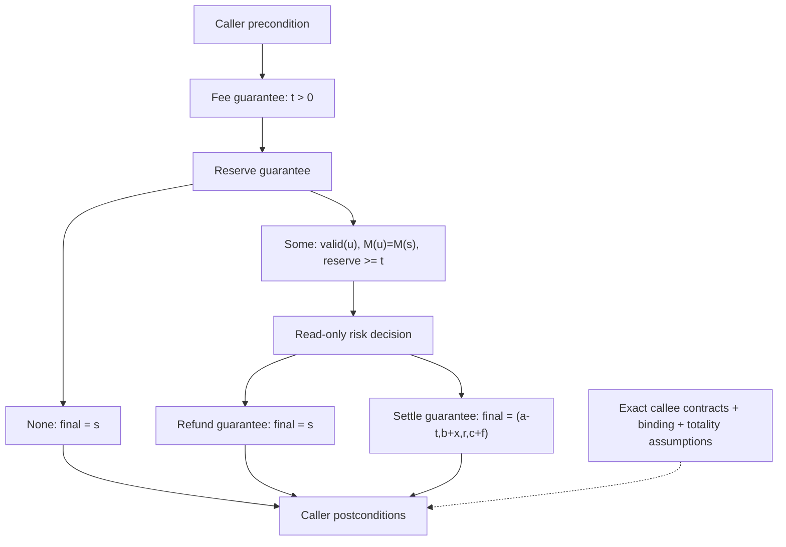

# CF-007 — Compositional bank transfer with fee, reservation and rollback

**Case ID:** CF-007  
**Title:** Compositional bank transfer  
**Revision:** 1  
**Status:** Proposed evaluation case; illustrative analytical proof, not machine-checked evidence  
**Focus:** Multi-call assume-guarantee composition, call preconditions, conservation, rollback, frame conditions, policy separation, and conditional proof closure  
**Related research:** [CF-006](CF-006-bank-withdrawal.md), [Scenario 15](../../../language-design/RT-02/RESEARCH-SCENARIO-15-BUSINESS-INTENT-TO-FORMAL-CONTRACT.md), [Formal verification](../../RT-07/LLMLang-FORMAL-VERIFICATION.md), [Proof Obligation Benchmark](../../RT-33/PROOF-OBLIGATION-BENCHMARK.md), [RT-36](../../RT-36/RT-36-FORMAL-VERIFICATION-ASSUMPTIONS-AND-TRUST.md), [Public interfaces](../../../semantic-representation/RT-05/PUBLIC-INTERFACES-AND-CONTRACT-REFINEMENT.md).

## 1. Source request

> Transfer money between two accounts, charging a fee. Calculate the fee, reserve the required funds and check the risk of the operation before settlement. On success the recipient must receive exactly the requested amount, the sender must pay the amount and fee, and the bank must receive exactly the fee. On any specified refusal, restore the initial financial state. No balance may become negative, and money must neither be created nor destroyed.

This request is the unclarified track. The order and purpose of calls are stated; the exact fee policy, risk predicate, failure model and concurrency model require clarification. A proof of a weak or invented interpretation does not validate the request.

## 2. Clarifications

The following are explicit proposed oracle choices for this fixture, not claims about real banking policy or adopted LLMLang semantics.

- Amounts are positive integer minor currency units; all four initial balances are nonnegative. Mathematical integers are unbounded. A zero/negative requested amount is outside the precondition, not a specified refusal.
- Fee is one percent rounded upward to a whole minor unit, capped at 50 minor units: `f(x) = min(50, (x+99) div 100)`. Here div is integer floor division for nonnegative integers.
- Insufficient funds and a negative risk decision are the only specified refusal paths. Reserve succeeds exactly when sufficient funds exist. If reservation succeeds, transfer succeeds exactly when the risk decision for that invocation is true.
- Risk is a read-only, terminating Boolean decision on the reserved state and amount; its business-policy correctness is deliberately unspecified. For a fixed invocation, let q be that decision, not an independently recomputed result. An execution that skips the risk call violates the stated protocol even if its financial state satisfies the weaker financial oracle.
- States are immutable values; the four fields exhaust the financial observation model. No hidden side effects, exceptions, concurrent updates, crashes, timeouts or arithmetic overflow. All callees terminate normally on their preconditions. Settlement and refund are total on those preconditions.
- The initial reserve may be nonzero. This is an aggregate sequential model, not a multi-owner reservation-token or durable transaction model. Failure atomicity concerns final financial state, not isolation or crash atomicity.

## 3. Interface and semantic domain

Let `s = (a,b,r,c)` denote sender, receiver, reserve and bank balances. Define `valid(s) = a>=0 AND b>=0 AND r>=0 AND c>=0` and `M(s) = a+b+r+c`. The input is `(s,x)`, with `valid(s) AND x>0`; the output is `(success, final_state)`. The fee is `f=f(x)`, total `t=x+f`.

The example uses Python-like pseudocode and language-neutral contract notation, not adopted LLMLang surface syntax.

```python
def transfer(s, x):
    f = calculate_fee(x)
    t = x + f
    u = reserve(s, t)
    if u is None:
        return False, s
    if not check_risk(u, x):
        return False, refund(u, t)
    return True, settle(u, x, f)
```

The bodies of the five called functions are intentionally unavailable to the caller proof.



*Figure 1. Illustrative control flow: one success path and two refusal paths. Each call is checked against its own contract; the caller's postcondition is checked independently.*

### 3.1 Callee contracts (language-neutral)

All five interfaces have no hidden effects and terminate on their preconditions. State transformers return immutable values. Tuple equalities specify every financial field.

```text
calculate_fee(x) -> f
  requires x > 0
  ensures f = min(50, (x+99) div 100)

reserve(s=(a,b,r,c), t) -> Option<State>
  requires valid(s) AND t > 0
  ensures (result is Some) IFF a >= t
  ensures result is Some -> result.value = (a-t,b,r+t,c)

check_risk(u, x) -> Bool
  requires valid(u) AND x > 0
  ensures result is Boolean
  effects read-only; no hidden state changes

refund(u=(a,b,r,c), t) -> State
  requires valid(u) AND t > 0 AND r >= t
  ensures result = (a+t,b,r-t,c)

settle(u=(a,b,r,c), x, f) -> State
  requires valid(u) AND x > 0 AND f >= 0 AND r >= x+f
  ensures result = (a,b+x,r-x-f,c+f)
```

The risk contract intentionally does not specify how a correct risk policy is determined. The caller must branch on the actual decision. This separation permits independent policy specification and verification later. An alternative would be to add a formally specified risk predicate; that is not justified by the initial wording alone.

## 4. Accepted semantic oracle

For all valid inputs and both possible risk decisions after successful reservation:

```text
t = x + f(x)
if a < t:
    success = false
    final = s
else:
    u = (a-t,b,r+t,c)
    q = the decision of check_risk(u,x) for this invocation
    success IFF q
    if q:
        final = (a-t,b+x,r,c+f(x))
    else:
        final = s
```

In addition to this outcome relation, the specified protocol requires fee calculation, reservation, and (only after successful reservation) risk evaluation before either settlement or refund. Outcome equivalence alone does not establish call ordering or occurrence; those need source-level or trace obligations. All permitted intermediate financial states must be valid and preserve M. On completion, `final.reserved = s.reserved`.

### 4.1 FRETish-style observation requirements

The following are illustrative FRETish-inspired sketches, consistent in presentation with CF-006, **not parser-validated native FRETish or a proof of arbitrary source code**. A binding must capture the pre-state and post-state of the same invocation, amount, fee, and decision; `completed` identifies a normal completion. The fee formula and typed arithmetic semantics belong to the mathematical oracle. For a risk refusal, q is sampled at its actual call; q is not read on reservation failure.

```text
Transfer shall always satisfy
    completed -> (sender_after + receiver_after +
                  reserved_after + bank_after =
                  sender_before + receiver_before +
                  reserved_before + bank_before)

Transfer shall always satisfy
    completed -> (sender_after >= 0 & receiver_after >= 0 &
                  reserved_after >= 0 & bank_after >= 0)

Transfer shall always satisfy
    (completed & !success) ->
    (sender_after = sender_before &
     receiver_after = receiver_before &
     reserved_after = reserved_before &
     bank_after = bank_before)

Transfer shall always satisfy
    (completed & success) ->
    (sender_after = sender_before - amount - fee &
     receiver_after = receiver_before + amount &
     bank_after = bank_before + fee)

Transfer shall always satisfy
    completed -> (reserved_after = reserved_before)

Transfer shall always satisfy
    (completed & reservation_succeeded) ->
    (success <-> risk_approved)

Transfer shall always satisfy
    (completed & !reservation_succeeded) -> !success
```

These sketches do not encode the entire protocol, fee calculation, intermediate safety, or completion guarantee by themselves. A trace that never completes could satisfy every completion-guarded clause vacuously. Check progress and observation adequacy separately; do not treat the sketches as a complete standalone contract. See [NASA FRET](https://github.com/NASA-SW-VnV/fret) and Scenario 15 for structured requirements and validation.

## 5. Required contract properties and analytical proof

The caller obligations include exact fee, callee preconditions, nonnegative balances, conservation, exact delivery and commission, no residual reservation, complete failure frame, success/decision correspondence, call protocol and (under total callee contracts) termination.

Proof over mathematical integers, by exhaustive analysis of the three feasible control paths:

1. Fee: x>0 implies 1<=f<=50, hence t>0. Reserve is callable because valid(s).
2. Insufficient funds: a<t implies None by reserve's biconditional. Return s unchanged. No risk, refund or settle call occurs.
3. Successful reservation: a>=t and u=(a-t,b,r+t,c). Each component of u is nonnegative and M(u)=M(s), so risk is callable. Also u.reserved=r+t>=t.
4. Risk denial: the refund precondition follows from the previous step. Its postcondition yields (a-t+t,b,r+t-t,c)=(a,b,r,c)=s. Exact rollback follows without inspecting refund's implementation.
5. Risk approval: settle's precondition follows from x>0, f>=0, valid(u), and u.reserved>=x+f. Its postcondition yields (a-x-f,b+x,r,c+f). Every balance is nonnegative. Summation cancels x and f, giving M(final)=M(s); the old reserve is restored and exact successful deltas follow.
6. There are no loops or recursive calls; under the explicit totality assumptions all paths terminate normally. Protocol properties follow from the branch structure and the absence of hidden effects.



*Figure 2. Illustrative proof dependency graph, not a serialized LLMLang PDG. Preconditions are discharged before using a callee guarantee. If any required callee guarantee is merely assumed, caller evidence is conditional on that exact assumption and binding; see RT-36.*

### 5.1 Composition counterexample

All callee contracts can hold while their composition fails. Change only the denial branch:

```python
    if not check_risk(u, x):
        return False, refund(u, x)  # BUG: should refund t = x + f
```

Refund's precondition still holds because r+t>=x. The result is (a-f,b,r+f,c), not s. For s=(10000,2000,7,0), x=3000, f=30 and q=false, u=(6970,2000,3037,0) and the mutant returns (9970,2000,37,0). Total remains 12007; all balances are nonnegative, yet the failure frame and reserve restoration are violated. Conservation alone cannot detect this defect.

## 6. Negative controls

| ID | Incorrect candidate contract or behavior | Why it is wrong | Expected detection |
|---|---|---|---|
| NC-01 | Only require M(final)=M(s) | Permits wrong recipient and rollback | Counterexample above |
| NC-02 | Omit reserve restoration and failure frame | Can retain the fee on refusal | MUT-01 |
| NC-03 | Require reserve=0 after every invocation | Invalid strengthening for nonzero initial reserve | Valid nonzero reserve fixture |
| NC-04 | Success implies sufficient funds, but omit risk decision and sufficiency | Permits unwarranted failure or approval | Both approved and denied paths |
| NC-05 | Require fee exactly x/100 | Ignores rounding and cap | x=1 and x=5001 |
| NC-06 | Infer risk-policy correctness from Boolean result | No predicate was supplied | Unresolved policy, not proof |
| NC-07 | Treat completion-guarded observations as termination proof | Vacuously satisfied by no completion | Separate progress obligation |
| NC-08 | Infer complete proof from assumed external guarantees | Erases trust boundary | Conditional evidence required |
| NC-09 | Require a specific internal fee algorithm | Overconstrains equivalent implementations | Permit equivalent integer formula |

## 7. Mutation challenges

| ID | Mutated behavior | Must reject? | Expected obligation |
|---|---|---|---|
| MUT-01 | Refund x instead of x+f | Yes | Failure frame, reserve restoration; conservation still holds |
| MUT-02 | Reserve twice or settle the wrong amount | Yes, on a violating input | Protocol or exact deltas; possibly call preconditions |
| MUT-03 | Credit bank twice | Yes | Fee correctness, conservation |
| MUT-04 | Skip risk check and always settle | Yes | Call protocol and risk-denial behavior; financial-only oracle may miss it |
| MUT-05 | Skip reservation and settle original state | Yes | Protocol; settle precondition can fail when r<t |
| MUT-06 | Risk function modifies financial state | Yes | Callee effect/frame contract; caller proof cannot assume the mutated guarantee is discharged |
| MUT-07 | Return failure without refunding reserved funds | Yes | Failure frame and reserve restoration |
| MUT-08 | Use x instead of t as reservation amount | Yes | Protocol/exact amounts; settle precondition may fail |
| MUT-09 | Compute the same fee by an equivalent formula or implement immutable updates differently | No | Extensional contract equivalence |
| MUT-10 | External settle has a declared but unproved contract | Not a behavioral counterexample by itself | Preserve explicit assumptions; do not mark unconditional proof |

The benchmark should include both local-callee mutations and caller-only mutations, with separate reporting. A rejected precondition, refuted postcondition, unsupported encoding, and conditional proof are distinct outcomes. A permitted alternative must not be rejected just because its internal algorithm differs.

## 8. Boundary scenarios

Tuple order: sender, receiver, reserve, bank. Risk is not evaluated on insufficient funds (dash).

| Initial state | x | Fee | Risk | Success | Expected final |
|---|---:|---:|---|---|---|
| (10000,2000,7,0) | 3000 | 30 | yes | true | (6970,5000,7,30) |
| (10000,2000,7,0) | 3000 | 30 | no | false | (10000,2000,7,0) |
| (3029,0,0,0) | 3000 | 30 | — | false | (3029,0,0,0) |
| (3030,0,7,0) | 3000 | 30 | yes | true | (0,3000,7,30) |
| (2,0,0,0) | 1 | 1 | yes | true | (0,1,0,1) |
| (0,0,0,0) | 1 | 1 | — | false | (0,0,0,0) |
| (5051,0,9,1) | 5001 | 50 | yes | true | (0,5001,9,51) |
| (100,0,0,0) | 0 | — | — | outside domain | no required result |

These are illustrative witnesses, not measured outcomes or exhaustive tests. In particular the nonzero reserve fixture rejects the unjustified requirement that the reserve end at zero.

## 9. Evaluation rubric and evidence boundary

The formalization track supplies the source request first and clarifications separately; compare candidate contracts to the oracle independently of any implementation proof. The downstream composition track supplies the fixed caller and abstract callee contracts, not their bodies. Generate path-sensitive verification conditions for every reachable call and every independent postcondition, including frame, effect, progress and protocol obligations. For example, the fee can be encoded in integer linear arithmetic with auxiliary quotient/remainder: x+99=100*k+d, 0<=d<100, f=min(50,k) expressed by cases; do not silently use floating-point arithmetic.

Record exact input revisions, contract identities, implementation bindings, observation mapping, assumptions, generated obligations, proof or counterexample artifacts, backend/version and checker results. Preserve the distinction between semantic fidelity, conditional proof, checked closed proof, refutation and unknown/unsupported results. If the callee implementations are independently verified against their exact contracts, discharge the corresponding assumptions; otherwise retain them. A test pass or parser success does not prove semantic correspondence.

**Validation and limitations:** the proof above is analytical and conditional on the stated contracts and model; the concrete examples are manually derived. Neither a FRET parser nor an SMT/theorem prover was run for this document. No empirical coverage, formal certification, adopted syntax, production banking safety, risk-policy correctness, concurrency isolation, crash recovery, or exception behavior is claimed. Future experiments should separately compare a Hoare/SMT encoding with FRET observation semantics and add token ownership, arithmetic overflow, concurrent calls and durable recovery as distinct fixtures. The corpus case is proposed pending independent adjudication.

## 10. Revision history

| Revision | Change | Reason |
|---|---|---|
| 1 | Initial compositional transfer case | Connect human intent, structured observations, callee contracts, caller proof and mutation controls without conflating their evidence |
