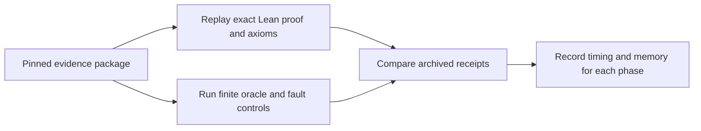
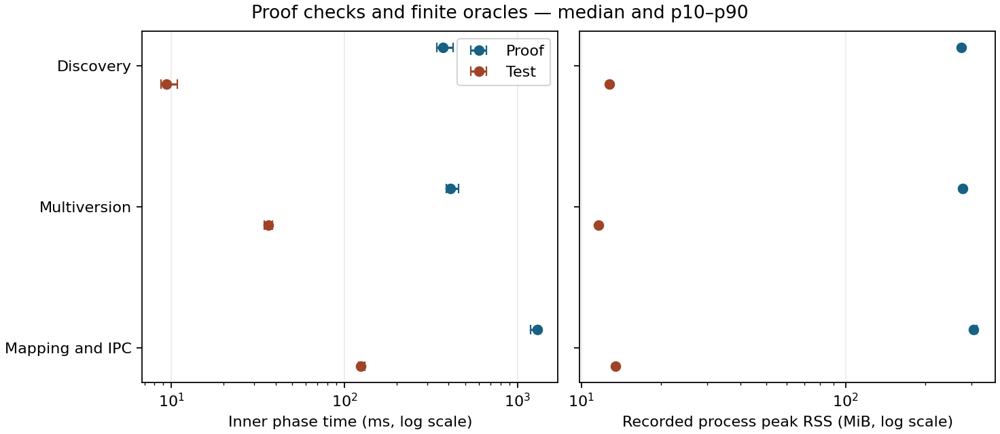

# Execution costs for proof replay and finite tests

Build planning needs separate cost estimates for checking a proof and executing a finite test corpus. This pilot measures three existing evidence packages. Each contains Lean theorems over its abstract model and a separately executable Python oracle. The phases have different coverage and work units. The experiment compares their execution budgets and checks the resulting evidence against exact archived receipts.



| Package | Proof work | Finite oracle work |
| --- | --- | --- |
| Catalog discovery and binding | 3 recorded theorem checks | 2,400 comparisons |
| Specialized implementation guards | 4 recorded theorem checks | 19,602 decisions |
| RV64 mapping and IPC composition | 5 recorded composition theorems plus embedded component proof checking | 20,976 reachable transitions |

The timed inner phase calls the original proof or test entry point unchanged. Proof time includes its subprocesses, source preparation and version checks where the original harness performs them. Test time includes generation and comparison of bounded cases and fault witnesses. The parent also records elapsed time for launching and running the fresh Python process through exit. Exact receipt comparison is outside the inner timer and inside the full process boundary. Linux peak RSS for proofs measures the maximum Lean child high-water as reported by `RUSAGE_CHILDREN`. Test RSS is the finite-test Python process high-water. Combined process-tree memory remains outside these measurements.

## Results

Each cell has ten fresh processes. The six cells run in randomized order per block on logical CPU 4, AMD EPYC 9V74, Linux 6.18.57. The observed cgroup CPU counters report zero throttled periods. The table reports medians. The ledger also records p10–p90 and exact receipt, archive and harness hashes.

| Package | Proof inner time / peak RSS | Test inner time / peak RSS | Proof / test full process |
| --- | ---: | ---: | ---: |
| Discovery | 370.31 ms / 273.41 MiB | 9.34 ms / 12.75 MiB | 415.64 / 53.20 ms |
| Multiversion | 408.88 ms / 276.70 MiB | 36.27 ms / 11.63 MiB | 443.43 / 72.72 ms |
| Mapping and IPC | 1,306.24 ms / 305.05 MiB | 123.79 ms / 13.50 MiB | 1,355.07 / 171.59 ms |



Every one of the 60 processes reproduces its archived semantic result. Within the measured packages the proof replay takes more elapsed time and peak process RSS than the finite oracle. The proof results cover their stated symbolic models. The concrete comparisons cover the recorded cases and test projections. A cost estimate should preserve the evidence obligations required by a change, then use the relevant measured phase and workload profile. This pilot leaves proof generation at project scale, incremental reuse, solver orchestration, CI contention and representative production test suites open. [Raw data](PROOF-AND-TEST-COST-01/evidence/samples.csv) · [Distributions](PROOF-AND-TEST-COST-01/evidence/summary.json) · [Run configuration](PROOF-AND-TEST-COST-01/evidence/config.json)

## Reproduction

Use Lean 4.36.0 at revision `611c117bfaf7b7ae1cfcf246ce6fba31e8f509e9`, CPython 3.12.14 and Matplotlib 3.10.8. Choose a CPU in the runner's allowed affinity. Timing samples vary across runs.

```sh
study=research/formal-verification/PROOF-OBLIGATION-BENCHMARK/PROOF-AND-TEST-COST-01
build=$(mktemp -d)
LC_ALL=C PYTHONHASHSEED=37 PYTHONDONTWRITEBYTECODE=1 python "$study/measure.py" \
  --cpu 4 --trials 10 --seed 20261125 --lean /path/to/lean --output "$build/evidence"
LC_ALL=C MPLBACKEND=Agg MPLCONFIGDIR="$build/plot-cache" python "$study/summarize.py" \
  --evidence-dir "$build/evidence"
```

[Collector](PROOF-AND-TEST-COST-01/measure.py) · [Summarizer](PROOF-AND-TEST-COST-01/summarize.py)
