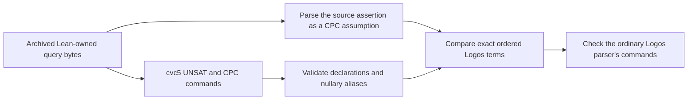

# RT-33 source-bound CPC certificates for two symbolic queries

The Lean-owned symbolic SMT study sent two queries that returned `unsat` in cvc5. This follow-up obtains the actual CPC proof for each returned verdict and checks it against the exact archived source assertion using the pinned Logos implementation. The two claims have different observation scopes. [Lean-owned query artifacts](https://github.com/aivibeflow/LLMLang/pull/431) · [RT-33 adapter issue](https://github.com/aivibeflow/LLMLang/issues/395)

## Binding the proof to the query



The runner checks the SHA-256 of each input and sends its original bytes to cvc5. It retains the raw solver output. The adapter unwraps one `unsat` result and CPC command list, verifies its declarations and nullary aliases, and compares the ordinary parser's complete assumption list with the expected source assumption. Lean's `ordinary_correct` theorem connects a successful witness to that exact ordinary Logos verdict. The checker consumes the same ordered assumptions and proof commands.

The archived queries declare `v0` and `v1`. Both assertions refer only to `v0`, and cvc5 declares only `v0` in the certificates. The adapter explicitly checks that the source assertion has no occurrence of `v1` before constructing the expected one-declaration CPC assumption. An input that uses the omitted variable is outside this two-input profile. The exact parser-state binding admits the proof's disjoint nullary aliases while comparing their expanded assumption terms. The profile fixes one source assertion and one retained declaration.

Standalone certificate acceptance verifies the assumptions supplied by the proof. Matching against the source assertion adds a provenance check that detects a correct proof of a different claim. A more general profile would need a typed proof of permitted declaration projection or another source representation that makes the exact active declaration set explicit.

## Results

| Source query | Scope | Bound Logos verdict |
| --- | --- | --- |
| Absolute value followed by reset | Every action boundary | `correct` |
| Second register zero | Final boundary only | `correct` |

The certificate for the final-only query is rejected when presented for the all-boundary query. A standalone `sat` reply is rejected before certificate parsing, and using `v1` in the source assertion is rejected before binding a proof with only one declaration. The table records both results, with proof bytes and input identities available for exact inspection. [Machine-readable summary](symbolic-cpc-results/summary.json) · [Absolute-value proof](symbolic-cpc-results/absolute-cvc5.txt) · [Final-boundary proof](symbolic-cpc-results/zero-final-cvc5.txt)

The result supports a source-bound certificate route for these two QF_LIA inputs. It records an executable checker verdict and a kernel-checked binding to its ordinary parser input. The complete upstream Logos rule-proof build and the general semantics of SMT-LIB printing and parsing remain separate dependencies. No performance measurements were taken. [Logos soundness work](https://github.com/aivibeflow/LLMLang/pull/430)

## Reproduce

Use CPython 3.9+, cvc5 1.4.2 commit `282d5e0`, Lean 4.36.0 commit `611c117bfaf7b7ae1cfcf246ce6fba31e8f509e9`, and Logos commit `cf18742973861b3718d04c5f25775448098ff474`. The runner checks the selected query hashes and uses cvc5's default macro proof granularity.

```sh
(
  cd research/PROTOTYPES/DEPENDENCY-GRAPH-01/logos_binding
  lake update --keep-toolchain
  lake build --fail-fast LLMLangLogosBinding
)
transition=research/formal-verification/PROOF-OBLIGATION-BENCHMARK/generative/transition
expected=research/formal-verification/PROOF-OBLIGATION-BENCHMARK/symbolic-cpc-results
scratch=$(mktemp -d)
python3 "$transition/symbolic_cpc_check.py" --lake /path/to/lake --cvc5 /path/to/cvc5 \
  --queries /path/to/symbolic-smt-results --output "$scratch/cpc"
for file in absolute-cvc5.txt zero-final-cvc5.txt summary.json axioms.txt \
  wrong-certificate-diagnostic.txt sat-without-certificate-diagnostic.txt \
  used-omitted-declaration-diagnostic.txt; do
  cmp "$expected/$file" "$scratch/cpc/$file"
done
```

The source files `absolute.smt2` and `zero-final.smt2` come from the symbolic SMT experiment above. The theorem audit lists only the standard Lean axioms. Mermaid rendering was not checked locally. [Axiom audit](symbolic-cpc-results/axioms.txt)
