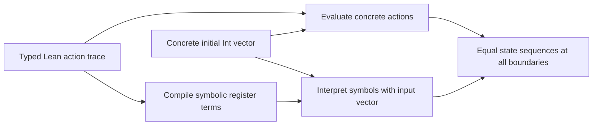

# Symbolic transition correspondence inside Lean

The [finite state comparison](LEAN-TRANSITION-STATE.md) can find discrepancies between backends for enumerated cases. To strengthen the correspondence evidence for [RT-33 / #395](https://github.com/aivibeflow/LLMLang/issues/395), this study checks a theorem about every program and every initial register vector in the existing Lean state projection. The symbolic compiler and its target evaluation both live in Lean.

## Semantics and proof



The proof compares the two routes in the diagram for the same concrete input vector. The compiler starts with one input symbol per register. Integer expressions use addition and subtraction. Boolean guards compare integer terms or combine guard values. A symbolic assignment replaces one term in the current environment. A branch compiles both actions in the same input environment, then joins registers pointwise with conditional terms. The next action uses the resulting environment. Every completed action contributes a vector to the observation.

The theorem holds for Lean mathematical integers, arbitrary finite action lists, and all initial vectors in the state model. It quantifies over the entire vector and list rather than asserting one theorem per fixture. The source and target preserve vector length. This lets the conditional join pair the registers exactly. For a missing index, both evaluators use the existing model's zero-valued read convention, and a write outside the vector has the existing list-update semantics. Real fixture inputs are separately checked by the Python validator before being translated into the Lean model. Event emission is outside this register-state projection.

The proof proceeds through expression interpretation, matching assignment and conditional evaluation, and induction over the action list. The main theorem is `TransitionState.Symbolic.correspondence`. The [axiom audit](symbolic-transition-results/axioms.txt) lists only `propext`, `Classical.choice` and `Quot.sound`.

## Control and implementation implications

An example conditionally writes the absolute value of the first register to the second, then restores the second register to zero. The example kernel-checks the complete two-step symbolic result for arbitrary values of both initial registers. With input `[-3, 17]`, the resulting states are `[-3, 3]` and `[-3, 0]`. A separate control checks that observing only the last state admits the same final equality while the full two-step sequence refutes the zero-at-both-boundaries claim.

This proves the semantics of a candidate symbolic translation within Lean. The symbolic route constructs a tree, which makes the correspondence proof local and permits subterm duplication. A shared term graph or single-assignment encoding could reduce duplication. Such encodings need a proof that evaluates their bindings with the same input and preserves the ordered observation vectors. The study has no performance measurements. Architecture and proof structure are shown as a flowchart, and the two-state control is reported directly.

The theorem stops at the interpreted symbolic AST. Production evidence still needs a trusted link from LLMLang or SPG through the fixture/Lean representation, correspondence for concrete cvc5 SMT-LIB bytes and the solver's model or proof input, and coverage of effects and richer execution models. The theorem does not change the evidence status of earlier Python-generated solver queries.

## Reproduce

The concrete Lean evaluator entered `main` at `53f7823`. Use Lean 4.36.0 commit `611c117bfaf7b7ae1cfcf246ce6fba31e8f509e9` and run from the repository root.

```sh
set -euo pipefail
transition=research/formal-verification/PROOF-OBLIGATION-BENCHMARK/generative/transition
proof=research/formal-verification/PROOF-OBLIGATION-BENCHMARK/symbolic-transition-results
build=$(mktemp -d)
lean --version
lean -DwarningAsError=true -o "$build/TransitionState.olean" "$transition/TransitionState.lean"
LEAN_PATH="$build" lean -DwarningAsError=true -o "$build/SymbolicState.olean" \
  "$transition/SymbolicState.lean" | tee "$build/axioms.txt"
LEAN_PATH="$build" lean -DwarningAsError=true "$transition/SymbolicStateExamples.lean"
cmp "$proof/axioms.txt" "$build/axioms.txt"
```

The [manifest](symbolic-transition-results/SHA256SUMS) records the checked source and audit digests. The command treats warnings as errors and checks both the theorem and the examples. Mermaid rendering was not checked locally.
