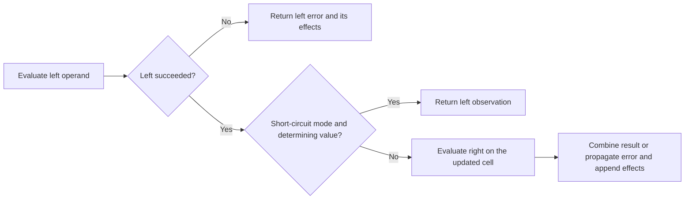

# RT-07 — Boolean evaluation order with state, effects and errors

## Question and semantics

When can short-circuit and eager Boolean evaluation be treated as equivalent if an operand reads or writes state, emits events, or fails? [Scenario 59](../../language-design/RT-03/RESEARCH-SCENARIO-59-BOOLEAN-SHORT-CIRCUIT-AND-EVALUATION-ORDER.md) distinguishes conditional execution from strict value combination. The [three-semantics pilot](RT-07-THREE-SEMANTICS-STATE-RESULT-2026-11-25.md) checks sequencing and constant guards. This study uses effectful Boolean operands, independently runs a native C route, and checks the exact condition for skipping a determining right branch in a Lean observation model. [PLAN §2.1](../../../PLAN.md#21-formal-semantics-of-the-language) · [#293](https://github.com/aivibeflow/LLMLang/issues/293)

Each operand produces a Boolean success or an error, a final cell and an ordered trace. A left error stops both modes. After a successful left value, the eager mode evaluates the right operand on the new cell before combining. The short-circuit mode skips it for false conjunction or true disjunction. In both modes a right error is propagated whenever the right operand executes, preserving effects already performed.



## Native comparison

The finite fixture enumerates three initial cells, two operators and all ordered pairs of seven operands. The operands are false, true, a state read, a write, two writes that restore the original cell, an error, and a write followed by an error. The Python oracle compares the two modes on 294 cases. The independently implemented C probe uses native `&&` and `||` for the short-circuit path. Its eager path evaluates the right operand explicitly after left success. The C harness preserves the explicit error tag before reporting the logical result. GCC O0 and O2 each agree with all 588 oracle observations.

| Comparison | Cases |
| --- | ---: |
| Complete observation equal | 219 |
| Result or error differs | 30 |
| Same result, different final state | 8 |
| Same result and state, different ordered trace | 37 |

At cell zero, false conjunction with a reading right operand still returns false and leaves the cell unchanged in both modes. Only eager evaluation records the read. A right write changes the final cell, while a right error distinguishes a normal Boolean from an error. The restoring-write control shows why a final-state comparison cannot establish the same ordered effects.

## Checked proof and limits

For a determining successful left operand, [Lean](BOOLEAN-EFFECT-ORDER-01/Order.lean) proves equality of the complete observations exactly when the right operand succeeds, preserves the post-left cell, and contributes an empty trace. When the left operand fails or its value does not determine the Boolean result, the two definitions agree by construction. The finite oracle also checks this equality criterion on every pair. The two general Lean statements use `propext`. The explicit restored-write and error counterexamples have empty axiom lists. [Exact axiom output](BOOLEAN-EFFECT-ORDER-01/axioms.txt)

This supports preserving order and error propagation in the candidate semantics and using a scoped no-effect, no-failure condition for transformations that remove evaluation. The proof reasons about deterministic terminating operand observations. It excludes divergence, asynchronous cancellation, general resource ownership, concurrent interleavings and a verified compiler translation. The two native profiles give correspondence evidence for this C harness only.

## Reproduce

The baseline was `af19222126bcbfad62907e6dc16bb980f06cc59b` on `research/all`. The run used Debian 13 x86-64 Linux 6.18.57, CPython 3.12.14, Debian GCC 14.2.0-19 and Lean 4.36.0 at `611c117bfaf7b7ae1cfcf246ce6fba31e8f509e9`. From the repository root:

```sh
fixture=research/formal-verification/RT-07/BOOLEAN-EFFECT-ORDER-01
out=$(mktemp)
axioms=$(mktemp)
lean -DwarningAsError=true "$fixture/Order.lean" > "$axioms" &&
  cmp "$fixture/axioms.txt" "$axioms" &&
  python3 -B "$fixture/run.py" > "$out" &&
  cmp "$fixture/evidence.json" "$out" &&
  python3 -B "$fixture/chart.py"
```

The [ledger](BOOLEAN-EFFECT-ORDER-01/evidence.json) preserves the reference rows, exact native output hashes and distinguishing witnesses. Each row uses input cell, operator, mode and operand tags followed by result, final cell and ordered event codes. The [table generator](BOOLEAN-EFFECT-ORDER-01/chart.py) reproduces the categorical counts. [C probe](BOOLEAN-EFFECT-ORDER-01/probe.c) · [Runner](BOOLEAN-EFFECT-ORDER-01/run.py)
