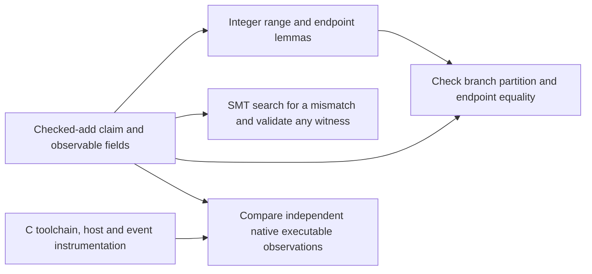

# Evidence roles for checked signed-byte addition

## Question and common subject

Which assurance claims can be routed to a theorem prover, SMT, a specialized checker or native tests? The common subject adds signed-byte inputs widened to integers, reports overflow, and observes an output cell and ordered events. On success it stores the sum and records a callback marker after the store. On overflow it keeps the old cell and emits no events. The C probe uses integer inputs in the byte range and an output cell initialized to `-999`. Its instrumentation records local store and callback markers. The markers declare the observation boundary in the fixture. [Related checked-add LLVM study](../../compiler-and-translation/RT-13/RT-13-LLVM-CHECKED-ADD-OBSERVATIONS-2026-11-24.md)



| Route | Supported claim in this experiment | Required scope |
| --- | --- | --- |
| Lean | Every admitted sum lies in the interval from −256 to 254, every integer in that interval is reachable, and equality at both endpoints implies equality throughout a single fixed branch region. | Branch observation has constant status and trace and a cell equal to either the initial value or the sum. The axiom ledger records the three kernel checks. |
| SMT with independent witness validation | Two engines report UNSAT for a defined mismatch query over the base variant and return a validated counterexample for each of five controls. | The QF_LIA query compares exact status, output cell and encoded ordered trace. A bare UNSAT report remains an engine answer. |
| Specialized checker | A certificate of branch boundaries and endpoint comparisons checks the base model and refutes all five controls. The base needs six sum endpoints across three regions. | A region can use the Lean endpoint rule only if all candidate and reference branch changes are in the partition. The Python checker validates that condition for its fixed model. |
| Native testing and trusted runtime | Each compiled C profile emits all 393,216 expected rows across six variants. The native traces distinguish omission, reordering and a store that preserves the cell value. | This execution evidence depends on the pinned compiler, host and event instrumentation. General C lowering, actual external callbacks and hidden runtime effects remain outside it. |

The specialized checker refuses a coarse partition that contains only the global endpoints. Both global endpoints agree when the implementation incorrectly admits the sum 128. The missing threshold matters even with a proved endpoint rule. A witness at 128 distinguishes that case, and Lean checks the general reachability of every sum in the interval. [Lean source](CHECKED-BYTE-PROOF-ROUTES-01/Regions.lean) · [Axiom ledger](CHECKED-BYTE-PROOF-ROUTES-01/axioms.txt)

## Native and solver discriminators

The table counts differing input pairs out of 65,536 for each variant. GCC `-O0` and `-O2` match the independent typed variant model on every row. The two SMT engines independently supply ten SAT models total, all checked against the exact input ranges and differing observation. [Evidence ledger](CHECKED-BYTE-PROOF-ROUTES-01/evidence.json) · [Table generator](CHECKED-BYTE-PROOF-ROUTES-01/chart.py)

| Control | Status | Status and cell | Ordered observation |
| --- | ---: | ---: | ---: |
| `base` | 0 | 0 | 0 |
| `inclusive_overflow` | 127 | 127 | 127 |
| `restored_error_store` | 0 | 0 | 16384 |
| `omitted_callback` | 0 | 0 | 49152 |
| `reordered_callback` | 0 | 0 | 49152 |
| `sum_stored_on_error` | 0 | 16384 | 16384 |

The experiment supports the candidate routing rule of using Lean for reusable mathematics, exact SMT queries for counterexample search, specialized validation when model side conditions are checkable, and native testing for concrete artifact observations. A production source-to-runtime claim also needs correspondence with the actual lowering and instrumentation or an explicit trusted implementation premise. The experiment selects no general backend and measures no timing.

## Reproduction

From repository root, use CPython 3.12.14, GCC Debian 14.2.0-19, Lean 4.36.0 revision `611c117bfaf7b7ae1cfcf246ce6fba31e8f509e9`, Z3 4.13.3 and cvc5 1.4.2 at `282d5e0`.

```sh
set -eu
fixture=research/formal-verification/RT-07/CHECKED-BYTE-PROOF-ROUTES-01
out=$(mktemp -d)
trap 'rm -rf "$out"' EXIT
lean -DwarningAsError=true "$fixture/Regions.lean" > "$out/axioms.txt"
cmp "$fixture/axioms.txt" "$out/axioms.txt"
python3 -B "$fixture/run.py" > "$out/evidence.json"
cmp "$fixture/evidence.json" "$out/evidence.json"
python3 -B "$fixture/chart.py"
```

[PLAN §2.2](../../../PLAN.md#22-proof-architecture-and-proof-boundary) · [Issue #294](https://github.com/aivibeflow/LLMLang/issues/294)
