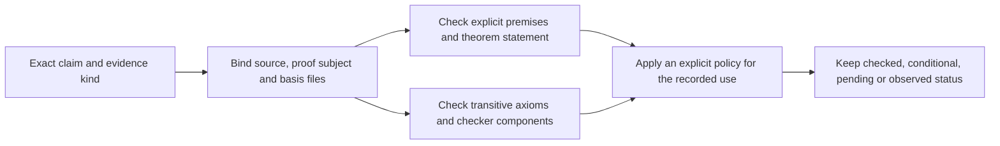

# Trust bases for different verification claims

## Claim-level basis

A claim record identifies the subject, evidence kind, exact source ledgers, checker and interpretation used, explicit premises and transitive axiom dependencies. These fields matter even where proof artifacts concern the same source observation. This crosswalk covers seven claims from the exact `research/all` revision `7efdcd1dc4dc3b25ef0c257d4f346530e168a509`. It reruns the prior per-claim Lean fixture and checked-byte experiment, then checks the archived receipt and upstream source-refutation ledgers. [Per-claim Lean trust](RT-07-PER-CLAIM-LEAN-TRUST-2026-11-25.md) · [Checked-byte routes](RT-07-CHECKED-BYTE-PROOF-ROUTES-2026-11-25.md) · [Proof receipts](RT-07-PROOF-FORMAT-RECEIPTS-2026-11-25.md)



| Claim | Native axioms | Explicit open premises | Recorded result |
| --- | ---: | ---: | --- |
| `kernel_reduction` | 0 | 0 | closed-model-proof |
| `kernel_open_premise` | 0 | 1 | conditional-proof |
| `conditional_source_refutation` | 0 | 5 | conditional-proof |
| `pinned_source_refutation` | 2118 | 3 | native-trust-pending |
| `cpc_runtime` | 0 | 0 | runtime-verdict |
| `smt_witness` | 0 | 0 | validated-witness |
| `native_correspondence` | 0 | 0 | native-test |

Zero axioms for a runtime, witness or native test means the record makes no Lean theorem claim. These routes still list their trusted execution, interpretation and comparison components. For the bounded source refutation, the conditional theorem needs the exact admitted compilation, certificate and validated table, along with a well-formed base and verdict soundness. The archived pinned composition derives the last two from upstream material and introduces the 2,118 native axiom declarations. Its first three source predicates remain explicit. The ledger records their names and verifies the complete axiom-set digest, including the standard Lean axioms. [Conditional composition](RT-07-LOGOS-SOURCE-REFUTATION-COMPOSITION-2026-11-24.md) · [Pinned composition](RT-07-LOGOS-VERDICT-PROOF-2026-11-25.md)

The accepted CPC receipt checks the exact parser and checker route. A checked arithmetic witness uses the query and the independent witness evaluator. Native execution instead relies on the two pinned GCC profiles, host execution, event instrumentation and reference comparison. Each route has its own assertion and basis. A successful native or parser result does not establish the universal source theorem.

## Controls

Both archived fixture ledgers reproduce byte for byte. The replay reruns the checked-byte Lean theorem inspection, both SMT engines and both native builds. It independently rechecks the archived cutoff witness and the composed source theorem's axiom-set digest. The full pinned upstream rule build is read from its prior archive. [Evidence ledger](TRUST-CROSSWALK-01/evidence.json) · [Table generator](TRUST-CROSSWALK-01/chart.py)

Eight mutations fail exact comparison against the recorded basis. They omit an explicit premise, omit source verdict soundness, omit upstream context, erase the native count, substitute a qualified axiom name while retaining the count, or relabel runtime, witness or test evidence as a kernel proof. The policy illustrated here withholds the pinned source result pending native trust and keeps the remaining source hypotheses visible. Source correspondence, broader assumption discharge, an accepted production trust policy and independent review remain separate.

## Reproduction

Use Git 2.56.1, CPython 3.12.14, Lean 4.36.0 at `611c117bfaf7b7ae1cfcf246ce6fba31e8f509e9`, GCC Debian 14.2.0-19, Z3 4.13.3 and cvc5 1.4.2 at `282d5e0` on x86-64 Linux. Run from the repository root with the pinned LLMLang commit available.

```sh
set -eu
fixture=research/formal-verification/RT-07/TRUST-CROSSWALK-01
out=$(mktemp)
trap 'rm -f "$out"' EXIT
python3 -B "$fixture/run.py" > "$out"
cmp "$fixture/evidence.json" "$out"
python3 -B "$fixture/chart.py"
```

[PLAN §2.2](../../../PLAN.md#22-proof-architecture-and-proof-boundary) · [Issue #294](https://github.com/aivibeflow/LLMLang/issues/294)
