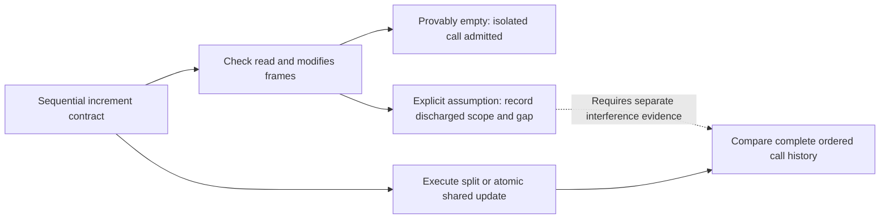

# Compare Dafny concurrent frame checks with shared counter histories

An LLMLang proof receipt needs to say whether it checks a sequential method, established isolation of a call, or a property of interleaved operations. Dafny's `{:concurrent}` discipline can check an isolation condition. This experiment exercises its accepted and rejected frames, then compares two C11 implementations of a counter whose single-call postcondition is the same. [Dafny heap and concurrency boundary](../../DAFNY-TRANSFER-ANALYSIS.md#dafny-heap-and-concurrency-boundary) · [Upstream Dafny 4.11.0 attribute reference](https://github.com/dafny-lang/dafny/blob/fcb2042d6d043a2634f0854338c08feeaaaf4ae2/docs/DafnyRef/Attributes.md#L263-L273)

## Dafny frame obligations

A read frame names the pre-existing heap locations a declaration may read. A modifies frame names the pre-existing locations it may change. With method read frames enabled, `{:concurrent}` requires the relevant frames to be provably empty under the declaration's preconditions. Fresh allocations may be read and written. A function returning an immutable value, a method incrementing a freshly allocated cell, and a conditionally empty frame under an explicit premise all verify.

The ordinary sequential increment verifies a pre-existing cell's final value and return value under declared read and write frames. The same sequential postcondition also verifies in a method that marks both frames `{:assume_concurrent}`. The explicit attributes suppress the corresponding emptiness obligations. Both are separately reported by the Dafny auditor. Its two findings have `False` in the column named `Explicit Assumption`, so interpreting that field alone would miss the concurrency assumptions described by the findings. The function control with an analogous annotation on its read frame is still rejected. [Pinned method emptiness checks](https://github.com/dafny-lang/dafny/blob/fcb2042d6d043a2634f0854338c08feeaaaf4ae2/Source/DafnyCore/Verifier/BoogieGenerator.Methods.cs#L625-L650) · [Pinned function check](https://github.com/dafny-lang/dafny/blob/fcb2042d6d043a2634f0854338c08feeaaaf4ae2/Source/DafnyCore/Verifier/BoogieGenerator.Functions.Wellformedness.cs#L173-L179)



The two pinned Z3 versions agree on nine verified units in the positive file. They reject four frame obligations in the controls. Omitting the method's read clause defaults it to an unrestricted read frame. A premise that two references are distinct does not make the modifies frame empty.

## Native history comparison

The native tests use real POSIX threads and C11 sequentially consistent memory operations. A mutex and condition variable grant one scripted step at a time. Each logical invocation begins at its first gated step and returns at its second. The schedules include overlapping calls without relying on operating-system timing. The split route loads the shared counter at its first step and stores its recorded value plus one at its second. The fetch-add route uses its first slot to establish the interval and reads and increments the counter atomically at its second. The counter and results use unsigned 32-bit values, with a predeclared starting range that excludes overflow.

The harness enumerates all six schedules for two actors and 90 for three while preserving each actor's local step order. Each runs with five starting values, for 480 histories per route and optimization configuration. The checker independently models the two atomic primitives and tests whether the final state and all call returns match some legal sequential ordering. A legal order preserves completed-before-started calls. This is the fixture's linearizability criterion. Each row totals the five starting values for one route, actor count and compiler configuration. GCC O0 and O2 agree on each history.

| Dafny control | Rejected frame |
|---|---|
| Function reads a shared cell | `reads` |
| Concurrent method omits its read frame | `reads` |
| Method writes a cell distinct from another argument | `modifies` |
| Function annotates its nonempty read frame | `reads` |

| Native route | Participants | Histories | Linearizable | Wrong final count |
|---|---:|---:|---:|---:|
| Separate atomic load/store | 2 | 30 | 10 | 20 |
| Separate atomic load/store | 3 | 450 | 30 | 420 |
| Atomic fetch-add | 2 | 30 | 30 | 0 |
| Atomic fetch-add | 3 | 450 | 450 | 0 |

With counter zero and two overlapping calls that both reach the first slot before either reaches the second, the split route returns one to both callers and leaves state one. The fetch-add route returns one and two in the second-slot order and leaves state two. The split route loses increments in 440 of the 480 histories. Fetch-add matches a legal sequential history in all 480. Each individual load or store in the split route is atomic. The hold on the scheduler mutex ends between those operations.

## Transfer boundary

Dafny's empty-frame check can support an isolated LLMLang call profile. An LLMLang ownership rule that gives separate callers exclusive access to disjoint objects would require its own composition evidence. An explicit concurrency assumption at a shared frame needs an identity and a corresponding discharge obligation in the proof record. The sequential postcondition alone does not discharge that obligation. When a contract exposes shared return values or intermediate observations, preserve the specified call history in the synchronization model. A design with private accumulation and a combined result after joining has a different observation interface from the shared counter.

This experiment leaves general source semantics, verified LLMLang-to-C lowering, unbounded histories, weak memory and hardware, scheduler progress, fairness, throughput and independent review open. The mutex is an instrument for exact schedule replay. The results do not measure unscripted scheduling or claim a lock-free implementation.

## Replay

The initial LLMLang baseline is `394b256670919c191173af2828b8d9852a1ceb9d`. The harness pins Dafny 4.11.0 at `fcb2042d6d043a2634f0854338c08feeaaaf4ae2` and its bundled Z3 4.12.1 and 4.14.1, GCC Debian 14.2.0-19 and CPython 3.12.14 on Linux x86-64. It uses the official x64 Ubuntu 22.04 Dafny archive, a single verification worker, method read-frame checking and a 20-second per-batch limit. The evidence preserves both checker outputs, individual histories, serial witnesses where available, source digests and audit findings. [Dafny release](https://github.com/dafny-lang/dafny/releases/tag/v4.11.0)

```bash
fixture=research/formal-verification/RT-07/DAFNY-CONCURRENT-FRAME-HISTORY-01
LC_ALL=C PYTHONHASHSEED=1 python3 -B "$fixture/run.py" \
  --dafny "$DAFNY_ROOT/dafny/dafny" --archive "$DAFNY_RELEASE_ZIP" \
  > /tmp/llmlang-dafny-concurrent-frame.json
cmp "$fixture/evidence.json" /tmp/llmlang-dafny-concurrent-frame.json
python3 "$fixture/chart.py"
```

[Dafny frames and contracts](DAFNY-CONCURRENT-FRAME-HISTORY-01/Frames.dfy) · [Negative frame controls](DAFNY-CONCURRENT-FRAME-HISTORY-01/FrameControls.dfy) · [C11 scheduled counter](DAFNY-CONCURRENT-FRAME-HISTORY-01/counter.c) · [Runner](DAFNY-CONCURRENT-FRAME-HISTORY-01/run.py) · [Evidence ledger](DAFNY-CONCURRENT-FRAME-HISTORY-01/evidence.json) · [Table generator](DAFNY-CONCURRENT-FRAME-HISTORY-01/chart.py)
