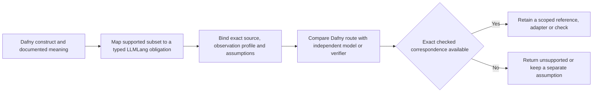

# Dafny construct transfer into LLMLang candidate contracts

This cross-cutting study compares the documented meaning of thirteen Dafny constructs with the corresponding LLMLang research requirements. It distinguishes a construct's value for modeling from the evidence needed to rely on it. The prior [Dafny transfer analysis](../../DAFNY-TRANSFER-ANALYSIS.md) provides the broader comparison. This update binds the claims to the official v4.11.0 reference and the exact repository studies used for the transfer decisions.

## Construct matrix

| Construct | Dafny semantic boundary | LLMLang candidate and remaining mismatch |
|---|---|---|
| `requires` | A caller establishes an entry condition that the callee can use. Ordering can establish definedness of later clauses. | Represent exact typed entry obligations, including ownership and capabilities where required. Define well-formedness and the behavior of an effectful or partial condition before importing a clause. |
| `ensures` | The callee establishes a result or state guarantee and multiple clauses are conjoined with an ordered definedness context. | Preserve exact normal results, typed failure, observed state, effects and coverage. Define outcome-specific guarantees when the public interface exposes more than the modeled successful return. |
| Loop `invariant` | Check a property at loop entry and at the next test after each admitted body step. | Generate separate initiation, preservation and exit-use obligations from the exact typed loop, guard and memory scope. Retain source locations and allow backend-specific proof guidance outside executable semantics. |
| `reads` | A function's read frame bounds the heap state it may depend on. Ordinary methods can have different default read rules. | Treat exact read dependencies and observation scope as different from a content-addressed build input closure. Live environment, aliases, foreign effects and replayed observations need explicit handling. |
| `modifies` | The frame constrains writes to permitted objects or fields. | Encode actual writable roles and ownership, and distinguish a write frame from final-state equality and ordered access observations. A frame supplies no synchronization or cleanup guarantee by itself. |
| `decreases` | A strict well-founded comparison supplies termination for loops and recursive calls. Tuples are ordered. The star form applies to eligible compiled methods and loops. | Represent the exact termination claim and metric domain. Keep permissive divergence and source fuel separate from backend timeout. Use separate progress and resource claims. |
| Ghost state | Ghost reasoning can use non-executable information. Ghost methods and lemmas have different update and allocation restrictions. | Use a typed proof-only store of facts, history or auxiliary state. Require checked noninterference and erasure if the source construct also has executable meaning. |
| Lemmas | An implicitly ghost method proves a reusable fact with checked preconditions, with stricter side-effect constraints than general ghost methods. | Bind a checked lemma to its exact proposition, assumptions, dependencies and checker. Calling a lemma in the proof layer must not silently supply a foreign implementation assumption. |
| Assertions | The verifier attempts a local proof. An assertion can provide subsequent verified facts, and a `by` block can supply local proof steps. Ordinary logical assertions are ignored by the compiler. | Distinguish static proof goals, explicit premises and executable checks that can fail or emit effects. Keep supported evidence outcomes and checker scope in the receipt. |
| Opacity, reveal and hiding | Module and body visibility determine which definitions a proof can use. Opaque blocks expose specified guarantees to subsequent verification. | Track exactly the visible definitions and assertions consulted by a proof. A reveal changes proof scope even when executable semantics and public interface are stable. |
| Modules and export sets | Scoped imports can expose selected declarations. Providing a declaration and revealing its definition are distinct. | Keep qualified names, visibility, exact revision-bound exports and semantic values separate. Package authorizations and immutable binding revisions remain independent. |
| Traits | An abstract superclass can specify members. Checked overriding can supply a stronger specification under Dafny's inheritance rules. | Reuse the contract-refinement idea as a candidate. Exact `OpHash`, provider-owned promise, selection, shared protocol and ABI obligations cannot be inferred from a nominal trait or method signature alone. |
| Proof structuring | `assert by`, `calc`, lemma decomposition and isolated assertion batches can give the verifier smaller or more explicit obligations. | Generate small independently identified proof tasks and preserve their obligation graph and applicability. Solver hints can improve a run without establishing authorization or a checked proof. |

The distinctions in the first eight rows follow the pinned Dafny specification and declaration chapters. The visibility and proof-structuring rows also use the documented module and statement rules. The examined sources are from Dafny v4.11.0 at `fcb2042d6d043a2634f0854338c08feeaaaf4ae2`.

- Specification clauses and their frames, Git blob `0c3159bddc155c6c8cee30b3392f59f42f8e5e8a`. [Requires and termination](https://github.com/dafny-lang/dafny/blob/fcb2042d6d043a2634f0854338c08feeaaaf4ae2/docs/DafnyRef/Specifications.md#L34) · [Frames and invariants](https://github.com/dafny-lang/dafny/blob/fcb2042d6d043a2634f0854338c08feeaaaf4ae2/docs/DafnyRef/Specifications.md#L454)
- Trait and function declarations, Git blob `f28c970e4b395cb30de5bc182e204c22912d61d1`. [Traits and inheritance](https://github.com/dafny-lang/dafny/blob/fcb2042d6d043a2634f0854338c08feeaaaf4ae2/docs/DafnyRef/Types.md#L2092) · [Lemmas and ghost state](https://github.com/dafny-lang/dafny/blob/fcb2042d6d043a2634f0854338c08feeaaaf4ae2/docs/DafnyRef/Types.md#L3937) · [Function hiding](https://github.com/dafny-lang/dafny/blob/fcb2042d6d043a2634f0854338c08feeaaaf4ae2/docs/DafnyRef/Types.md#L4296)
- Statements and proof annotations, Git blobs `a47fc45aa9e77a073220dc0e911f1070cad8b20d` and `3c25e23a039938108fa0f179d5ae433bdf80684b`. [Loop invariants](https://github.com/dafny-lang/dafny/blob/fcb2042d6d043a2634f0854338c08feeaaaf4ae2/docs/DafnyRef/Statements.md#L1472) · [Assertions](https://github.com/dafny-lang/dafny/blob/fcb2042d6d043a2634f0854338c08feeaaaf4ae2/docs/DafnyRef/Statements.md#L1851) · [Isolated assertion batches](https://github.com/dafny-lang/dafny/blob/fcb2042d6d043a2634f0854338c08feeaaaf4ae2/docs/DafnyRef/Attributes.md#L637)
- Export sets, Git blob `31ee26bbfe1617c63965194a1dc44c29c034e6be`. [Modules and visibility](https://github.com/dafny-lang/dafny/blob/fcb2042d6d043a2634f0854338c08feeaaaf4ae2/docs/DafnyRef/Modules.md#L348)

## Candidate transfer decisions

Use Dafny as a reference for explicit contracts, frame discipline, termination metrics and modular proof goals. A compatible typed slice can render a Dafny obligation and retain its exact Boogie/solver context. Use an independent check for a proof receipt where the query and certificate can be connected. Keep the LLMLang typed contract and its execution, effect and authority model as the semantic subject of correspondence. A backend-specific source representation can provide convenient diagnostics but cannot define the full observation boundary by itself.

- The [typed copy and frame study](../../semantic-representation/RT-05/RT-05-DAFNY-SPG-COPY-FRAME-2026-11-25.md) verifies mapped preconditions, final-state framing, invariants and termination. Two routes preserve final arrays while their ordered traces differ. Carry explicit frames into the candidate and preserve a separate ordered trace where the caller observes it.
- The [modular proof closure study](RT-07-DAFNY-MODULAR-PROOF-CLOSURE-2026-11-25.md) observes the same correct caller proof with a deliberately incorrect provider. Exact provider verification, the Lean model and checked CPC certificate answer separately scoped questions. Keep caller proof conditional until its exact premises discharge.
- The [foreign boundary study](RT-07-DAFNY-KERNEL-FOREIGN-BOUNDARY-2026-11-25.md) checks an exact C binding and three mismatches. The unchanged Dafny proof cannot determine the native ABI or the callee's execution. Require separate ABI and implementation correspondence.
- The archived [concurrent framing comparison](RT-07-DAFNY-CONCURRENT-FRAME-HISTORY-2026-11-25.md) distinguishes an empty or fresh frame, explicitly assumed shared concurrency and complete bounded histories. A restricted frame cannot establish a shared-memory algorithm's history rule.

An independent LLMLang verifier remains necessary for unsupported properties or constructs under these candidates. Adapting Dafny accepts the cost of a versioned correspondence and proof dependency model. Making Dafny surface syntax the authority would collapse its checked subset, source grammar and native semantics into one boundary. The transfer matrix leaves syntax, solver selection, broad state/external effects and production verifier policy open.

## Evidence and limits

The documentation and repository evidence were read at exact revisions. The research baseline is `d41fa7c0af7ad2f34bbbb497b1e34d4778283e95` on `research/all`. This study does not replay the archived concurrent-frame experiment or change its status. The candidate decisions concern the constructs and tested subset. Performance, diagnosis, readability and unmodeled ghost, trait and concurrency behavior require separate comparisons or review.
