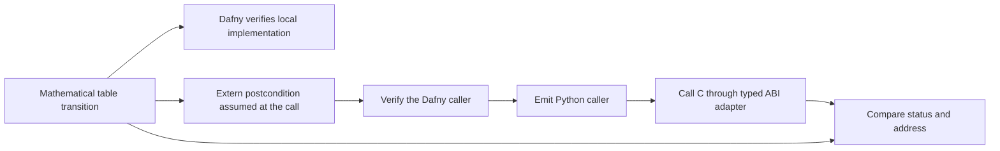

# Check the Dafny contract boundary on a kernel-style table lookup

A verifier can establish a kernel component's source-level lookup contract while its caller still relies on foreign code and ABI assumptions. This experiment compares a mathematical lookup, a verified Dafny implementation, and a C provider invoked through the generated Dafny client's Python interface. It addresses the seL4-inspired case study in the transfer plan with an original, bounded component. [Dafny transfer analysis](../../DAFNY-TRANSFER-ANALYSIS.md#7-sel4-as-a-high-assurance-comparison-case) · [Checked seL4 lookup refinement](../../runtime-and-systems/RT-38/RT-38-SEL4-REFINED-LOOKUP-2026-11-24.md)

## Model, implementation and foreign contract

The abstract table state has a 64-bit unsigned base address and a count of fixed-size entries. An input ordinal selects the starting address of one 16-byte entry. The operation returns a status and an unsigned address without accessing the selected memory or changing the table. It refuses an ordinal greater than or equal to the count before checking overflow. If the ordinal is valid, it computes `base + 16 × ordinal` over mathematical integers and refuses any result at or above `2^64`. Both refusals return zero as the address. Valid address zero remains a distinct success.

Dafny's `Word` newtype constrains values to the unsigned 64-bit interval. The local implementation tests `ordinal <= floor((2^64−1−base)/16)` after the ordinal check, so its executable calculation can fit a word. Dafny verifies its postcondition against the mathematical `Expected` function. The foreign declaration supplies the same postcondition to the generated caller. Dafny verifies the caller conditionally on that declaration. It can prove the expected rejection of a directed overflow through the external declaration even when the selected native provider later returns success.

The generated Python caller invokes an explicit extern module. Its bridge passes three `uint64_t` values and a pointer to unsigned 64-bit output storage, then reads a `uint32_t` status. The result storage starts with a distinct sentinel, so a refusal is observed as zero only if the provider writes zero. The native controls omit the overflow check or reverse refusal priority. A third control uses the correct C provider and decodes the resulting 64 bits as signed. It changes the interpreted address without changing the provider or declaring an incompatible C call.



## Verification and native outcomes

Each Dafny profile ran with both bundled Z3 versions, 4.12.1 and 4.14.1. The table reports their identical results. The default command reports five verified units and returns exit 2 because it treats warnings as a build failure. Allowing warnings keeps the foreign assumption visible, while allowing external contracts explicitly suppresses the warning. Neither policy changes which implementation Dafny verifies. A local mutant that drops the overflow guard and takes the result modulo `2^64` fails its postcondition with either solver revision.

Each native route uses the same verified Dafny declaration and generated caller. The corpus has 1,836 input triples. There are 1,452 directed combinations of position and word boundaries and 384 deterministic cases around the actual overflow threshold, with seed `20261125`. The oracle yields 476 successes, 984 invalid ordinals and 376 address overflows. GCC O0 and O2 agree for all four C/ABI routes. The generated mathematical function and generated local implementation also match the independent Python oracle on all inputs.

| Dafny verification profile | Verified units | Errors | Exit code | Foreign contract warning |
|---|---:|---:|---:|---|
| Default warning policy | 5 | 0 | 2 | shown |
| Warnings allowed and visible | 5 | 0 | 0 | shown |
| External contracts explicitly allowed | 5 | 0 | 0 | absent |
| Local implementation drops overflow check | 4 | 1 | 4 | absent |

| Native route through the generated Dafny caller | Mismatches per configuration |
|---|---:|
| Checked C provider and unsigned bridge | 0 |
| Wrapping C provider | 376 |
| C checks overflow before ordinal | 738 |
| Checked C provider and signed bridge | 286 |

At `base = 2^64−16`, `count = 2`, `ordinal = 1`, the wrapping provider reports success at zero. The verified caller predicts overflow. Reducing the count to one makes the ordinal error take precedence, which the overflow-first provider reverses. With base `2^63` and ordinal zero in a nonempty table, the unsigned bridge returns positive `2^63` while the signed interpretation returns `−2^63`, outside the Dafny newtype. The latter mismatch occurs even though the checked C function wrote the correct unsigned bits.

## What the case supports

The local Dafny route supplies a source-level proof for this lookup. It is a candidate specification and executable baseline for a comparable LLMLang fragment. Using Dafny as a caller-side contract frontend leaves an obligation to link the exact foreign source, ABI and provider binary to that declaration. The fixture's independent native checks can detect precise mismatches in those bindings. Universal C correctness and source-to-binary refinement would require separate evidence.

The pinned seL4 lookup work explicitly separates abstract propositions, refinement to executable and C models, and the scope of each theorem. Published seL4 binary verification adds a distinct correspondence stage for supported configurations. The toy lookup does not use the seL4 C routine or model a capability store, memory permissions, actual memory access, hardware, concurrency, kernel binary behavior or system-wide security. Its results support the distinction between contract expressiveness and foreign implementation coverage. [seL4 verification scope](https://sel4.systems/Verification/proofs) · [RT-38 source decoder study](../../runtime-and-systems/RT-38/RT-38-SEL4-LOOKUP-SOURCE-DECODER-2026-11-25.md)

## Replay

The initial LLMLang baseline is `291d1bd33c3d44891318a861cc40acfc2d6007d5`. The runner uses Dafny 4.11.0 at `fcb2042d6d043a2634f0854338c08feeaaaf4ae2`, bundled Z3 4.12.1 and 4.14.1, GCC Debian 14.2.0-19 and CPython 3.12.14 on Linux x86-64. It requires the exact official x64 Ubuntu 22.04 release archive, SHA-256 `a46a9ff7cdd720f7955854c78e95df13f4cfe6b80691b05f8654fe19e8267179`. Each Dafny proof uses one worker and a 15-second per-batch solver limit. The ledger records source and generated Python hashes, C shared-object hashes, verifier status and each native observation. Independent review and hardware or machine-code correspondence remain open. [Dafny v4.11.0 release](https://github.com/dafny-lang/dafny/releases/tag/v4.11.0)

```bash
fixture=research/formal-verification/RT-07/DAFNY-KERNEL-FOREIGN-BOUNDARY-01
LC_ALL=C PYTHONHASHSEED=1 python3 -B "$fixture/run.py" \
  --dafny "$DAFNY_ROOT/dafny/dafny" --release "$DAFNY_RELEASE_ZIP" \
  > /tmp/llmlang-dafny-kernel-boundary.json
cmp "$fixture/evidence.json" /tmp/llmlang-dafny-kernel-boundary.json
python3 "$fixture/chart.py"
```

[Dafny source](DAFNY-KERNEL-FOREIGN-BOUNDARY-01/Lookup.dfy) · [Native C providers](DAFNY-KERNEL-FOREIGN-BOUNDARY-01/provider.c) · [ABI bridge](DAFNY-KERNEL-FOREIGN-BOUNDARY-01/ffi_bridge.py) · [Runner](DAFNY-KERNEL-FOREIGN-BOUNDARY-01/run.py) · [Evidence ledger](DAFNY-KERNEL-FOREIGN-BOUNDARY-01/evidence.json) · [Table generator](DAFNY-KERNEL-FOREIGN-BOUNDARY-01/chart.py)
