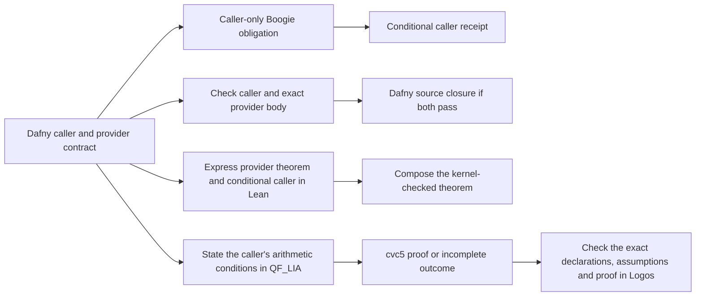

# Compare Dafny modular proof closure with Lean and Logos

A caller can verify against a provider contract before any provider implementation has been verified. LLMLang needs to retain that distinction and keep solver failures separate from resource exhaustion. This experiment compares Dafny's verification scope and Boogie program with an explicit Lean composition and a Logos-checked certificate for the caller's arithmetic implication. [Dafny transfer workflow](../../DAFNY-TRANSFER-ANALYSIS.md#4-verification-workflow-lessons) · [Kernel-style Dafny foreign boundary](RT-07-DAFNY-KERNEL-FOREIGN-BOUNDARY-2026-11-25.md)

## One caller and two provider bodies

For a base address `base` and stride 16, the provider returns the greatest ordinal `last` whose starting address fits in an unsigned 64-bit word. It promises `base + 16 × last ≤ M < base + 16 × (last + 1)`, where `M = 2^64−1`. The caller checks whether `ordinal ≤ last` and promises exactly `base + 16 × ordinal ≤ M`. The Dafny input values are natural numbers, with `base ≤ M`. The good provider uses `floor((M−base)/16)`. A replacement returns zero under the same declaration.

Dafny checks the caller using the provider contract if the provider file is included for declarations only. With `--verify-included-files`, it also checks the provider body. The harness records the named obligation outcomes from the CSV file and inspects the emitted Boogie declarations. It normalizes the temporary working-directory prefix in the printed program before hashing so that identical obligations can be compared across separate invocations. It also hashes the actual source files independently.



The independent Lean model exposes the provider proposition as a parameter to the conditional caller theorem. It proves that the good provider satisfies that proposition and composes the results. The model also refutes the zero provider and exhibits a failing caller outcome at base zero and ordinal one. The five Lean theorems use only the standard reported axioms. The Lean terms establish arithmetic claims. Source-to-model translation is a separate obligation.

## Modular verification and incomplete outcomes

Both bundled Z3 versions produce the same Dafny classifications. The counts come from the verifier summary and the named outcomes from the CSV log.

| Dafny run | Verified units | Errors | Out of resource | Exit | Disposition |
|---|---:|---:|---:|---:|---|
| Caller only, correct provider bytes | 1 | 0 | 0 | 0 | conditional-caller |
| Caller only, wrong provider bytes | 1 | 0 | 0 | 0 | conditional-caller |
| Caller and correct provider | 2 | 0 | 0 | 0 | verified-source-closure |
| Caller and wrong provider | 1 | 1 | 0 | 4 | verification-failure |
| Caller with resource limit 1 | 0 | 0 | 1 | 4 | unknown-resource |

| cvc5 proof granularity | Solver | Trust commands | Logos |
|---|---|---:|---|
| `theory-rewrite` | unsat | 35 | rejected-trust |
| `dsl-rewrite` | unsat | 0 | correct |

The two caller-only Boogie programs have the same normalized digest despite different provider source bytes. Both include the provider's call specification and omit an implementation obligation for it. The wrong body fails only when it enters the requested verification scope. The caller still passes under its declared assumption. A result can support source closure here only when both named obligations pass for the exact provider and caller.

Dafny's resource-exhausted run has zero ordinary verifier errors. Its CSV marks the attempt `Failed`, the summary identifies one `out of resource`, and the process exits four. That differs from the provider error, which also exits four. The direct cvc5 check at resource limit one returns `unknown` with reason `resourceout`. An injected host delay terminates an invocation at the outer 250 ms deadline before a verifier result exists. The control measures the host disposition, with no timing claim about ordinary Dafny verification.

## Exact certificate admission

The QF_LIA query states the caller's arithmetic claim independently of Dafny's generated Boogie program. It asserts the declared interval premises and a difference between the two predicates. Both cvc5 proof granularities return UNSAT for that query. Logos rejects the coarse trace because its proof contains a `trust` command. The fine-grained DSL rewrite proof has zero trust commands and passes the pinned Logos executable.

The bound checker validates the names and integer sorts of the three declarations before aligning constant IDs. It compares the ordinary parser's exact assumptions with the source assertion and then checks that proof. Removing the upper neighbor bound makes the query satisfiable. The returned witness has base `M−16`, last zero and ordinal one. The address fits even though the caller's ordinal test refuses it. The valid original certificate is rejected for the weaker assumptions.

The comparison supports retaining Dafny's modular diagnostics as scoped evidence. Closing the conditional call requires a verified exact provider or a separate attestation for an external one. A Lean proof can make the assumption discharge explicit for a checked source model. A solver result can become certificate-backed evidence only when the admitted certificate and exact query correspond. A solver report, timeout, unresolved dependency, proof with an unsupported command, and wrong bound each produce distinct evidence. [Prior exact CPC binding](../../compiler-and-translation/RT-13/RT-13-LLVM-CHECKED-ADD-CPC-BINDING-2026-11-24.md) · [Logos theorem and axiom audit](RT-07-LOGOS-VERDICT-PROOF-2026-11-25.md)

## Replay and limits

The starting repository baseline is `d1d8cf23e7ef42d919cd7f138aba9edb05a0436e`. Use Dafny 4.11.0 at `fcb2042d6d043a2634f0854338c08feeaaaf4ae2`, its bundled Z3 4.12.1 and 4.14.1, cvc5 1.4.2 at `282d5e0c84baf49c780704c532f87ba66d8b513d`, Lean 4.36.0 at `611c117bfaf7b7ae1cfcf246ce6fba31e8f509e9`, and Logos `cf18742973861b3718d04c5f25775448098ff474` with Lean 4.34.0 at `293d5d0c0c3f3dded4688b3ccd6a33939ac5102b`. The harness runs CPython 3.12.14 on Linux x86-64 and preserves source, query, checker, proof and normalized Boogie identities. [Dafny release](https://github.com/dafny-lang/dafny/releases/tag/v4.11.0) · [Logos build and replay notes](../../compiler-and-translation/RT-13/RT-13-LLVM-CHECKED-ADD-CPC-BINDING-2026-11-24.md#reproduce-and-scope)

The Dafny-to-Boogie translation and correspondence to the independently stated Lean and CPC claims require separate validation. The CPC binding code and pinned runtime are additional trust boundaries. Full Logos trust policy, higher-order or mutable source models, solver coverage and performance, generated code correspondence, and independent review remain open.

```bash
fixture=research/formal-verification/RT-07/DAFNY-MODULAR-PROOF-CLOSURE-01
LC_ALL=C PYTHONHASHSEED=1 python3 -B "$fixture/run.py" \
  --dafny "$DAFNY_ROOT/dafny/dafny" --archive "$DAFNY_RELEASE_ZIP" \
  --lean "$LEAN_436/bin/lean" --logos "$LOGOS_CHECKOUT" \
  --logos-lean "$LEAN_434/bin/lean" --cvc5 "$CVC5" \
  > /tmp/llmlang-dafny-modular-proof.json
cmp "$fixture/evidence.json" /tmp/llmlang-dafny-modular-proof.json
python3 "$fixture/chart.py"
```

[Dafny caller](DAFNY-MODULAR-PROOF-CLOSURE-01/Client.dfy) · [Dafny provider](DAFNY-MODULAR-PROOF-CLOSURE-01/Provider.dfy) · [Lean composition](DAFNY-MODULAR-PROOF-CLOSURE-01/Threshold.lean) · [Exact SMT query](DAFNY-MODULAR-PROOF-CLOSURE-01/Caller.smt2) · [CPC binding checker](DAFNY-MODULAR-PROOF-CLOSURE-01/BoundCpc.lean) · [Fine-grained certificate](DAFNY-MODULAR-PROOF-CLOSURE-01/dsl-rewrite.cpc) · [Certificate with trust commands](DAFNY-MODULAR-PROOF-CLOSURE-01/theory-rewrite.cpc) · [Runner](DAFNY-MODULAR-PROOF-CLOSURE-01/run.py) · [Ledger](DAFNY-MODULAR-PROOF-CLOSURE-01/evidence.json) · [Table generator](DAFNY-MODULAR-PROOF-CLOSURE-01/chart.py)
