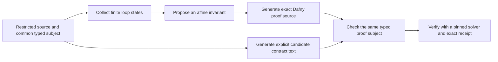

# Dafny and LLMLang candidate syntax for an affine loop

This study compares an illustrative typed LLMLang contract rendering and a restricted Dafny source rendering for one affine loop. It reconstructs an identical typed proof subject from both surfaces, checks inferred invariants using the actual Dafny verifier, and tests an exact receipt cache. The contract syntax is a candidate. Assessment by people and models requires a separate controlled study.

## Common subject and syntax

The loop starts with accumulator `seed`, advances `index` from zero to a nonnegative integer `n`, and adds a fixed constant on each iteration. The public result relation is `seed + factor * n`. This fixture uses mathematical integers and admits pure operations with no modeled failure on the required inputs. The invariant records the accumulator as an affine function of the loop index. The termination measure is `n - index`.

| Coordination point | Dafny rendering | Typed LLMLang candidate |
|---|---|---|
| Domain | `requires 0 <= n` | Explicit nonnegative input obligation |
| Result | `ensures sum == seed + factor * n` | Typed output relation |
| Body facts | Range and affine `invariant` clauses | Separate typed proof hints tied to exact loop and state |
| Effects and failure | In this strictly checked subset, local operations and no externally observable failures | Explicit empty effect and failure declarations |
| Termination | `decreases n - i` | Typed natural progress measure |

The [runner](DAFNY-INVARIANT-SCOPE-01/check.py) provides both exact templates and two restricted parsers. Both recognize only the declared affine loop grammar and recover its postcondition factor, update increment and optional invariant coefficient. The fixed grammar binds type, input, effect, failure and termination semantics as part of the typed representation. The correspondence check covers this template family. A general Dafny or LLMLang AST translation, permission for arbitrary effects and proof of frontend correctness remain separate.



## Invariant discovery and verification

The finite candidate proposer uses state observations from nine sizes and three seeds. There are 108 intermediate states for each update body. Their differences propose a coefficient of one or two, respectively. This samples a simple hypothesis. Dafny independently checks whether the invariant initializes and is preserved and whether the postcondition follows on all admitted integer inputs in the fixture.

| Variant | Dafny result under both Z3 versions |
|---|---|
| Exact proposed invariant | Verified |
| Rename the generated verifier entry | Verified |
| Omit the affine invariant but keep the range | Postcondition failure |
| Change only the body increment | Invariant failure |
| Strengthen the result coefficient with the same body and invariant | Postcondition failure |
| Align changed body and contract with the newly sampled invariant | Verified |
| Exact source under work limit one | Unknown due to exhausted resources |

The 14 verifier invocations produce six verified results, two invariant failures, four postcondition failures and two incomplete resource outcomes. Both bundled solver versions agree on these observations. Resource exhaustion remains an incomplete result. This corpus does not estimate failure rates or timing variation across solvers.

Each verification key binds the typed proof subject, exact emitted source, relevant verifier component and solver identities, and resource and invocation profile. An exact repeat hits a positive cache entry with no additional native verification for each of the two solver profiles. Changing source spelling alone preserves the typed subject and changes its exact receipt under this policy. This preserves source applicability without assuming a correspondence rule for proof reuse across source changes. Contract and body edits also invalidate their scoped receipts. Failure and resource exhaustion supply no positive result. The cache is in memory and the study measures no incremental speedup.

The existing [copy-frame mapping](../../semantic-representation/RT-05/RT-05-DAFNY-SPG-COPY-FRAME-2026-11-25.md) supplies a second artifact family with explicit memory framing and ordered effects. The [construct matrix](RT-07-DAFNY-CONSTRUCT-TRANSFER-2026-11-25.md) documents syntax and proof boundaries. The present experiment adds a compact example of inferring a candidate invariant, provoking distinct failure classes and refreshing exact evidence.

## Verify and limits

Use CPython 3.12.14 and Dafny 4.11.0 at `fcb2042d6d043a2634f0854338c08feeaaaf4ae2` with bundled Z3 4.12.1 and 4.14.1. The [ledger](DAFNY-INVARIANT-SCOPE-01/evidence.json) pins both solver executables, selected Dafny/Boogie components, exact rendered sources and typed subjects. Run from the repository root with paths to the official distribution. The study baseline is `97c373cf8c67156e13a03161787b3d7153f3908c`.

```bash
fixture=research/formal-verification/RT-07/DAFNY-INVARIANT-SCOPE-01
LC_ALL=C PYTHONHASHSEED=37 python3 -B "$fixture/check.py" \
  --dafny "$DAFNY" --solver "$Z3_4121" --solver "$Z3_4141" > /tmp/llmlang-dafny-invariants.json
cmp "$fixture/evidence.json" /tmp/llmlang-dafny-invariants.json
```

The checks do not evaluate human or model readability, arbitrary invariant discovery, persistent proof artifacts or whole-language source correspondence. Those activities remain scoped separately. Recorded dispositions characterize only the tested obligations and configured verification environment.
