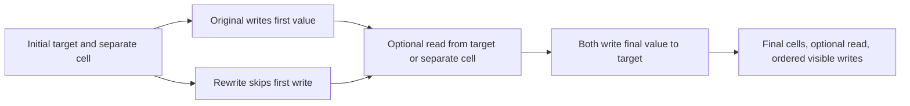

# Dead-store removal with an intervening read

## Question and model

When can a compiler remove a store whose destination is immediately overwritten after an optional read? The earlier RT-13 rule removes a hidden first write in a fragment without an intervening read. This experiment adds a read through either an alias of the target or a separate cell. It also checks the ordered write trace when writes are declared observable. [Earlier RT-13 rule proof](../../compiler-and-translation/RT-13/RT-13-RULE-PROOF-AND-TRANSLATION-VALIDATION-2026-11-25.md)



The complete observation comprises both final cells, the optional read value and the ordered trace of visible writes. Store operations are total. Values are natural numbers in Lean. The C probe uses two local cells and chooses the pointer at runtime. Its ordered trace is explicit instrumentation for declared visibility.

## Results

Lean proves that the complete observations agree exactly when the writes are hidden and either there is no intervening target read or the first value equals the initial target value. It also proves unconditional equality of final cells. The first theorem uses `propext`, and the second uses no axioms. [Lean source](DEAD-STORE-BOUNDARY-01/Store.lean) · [Axiom ledger](DEAD-STORE-BOUNDARY-01/axioms.txt)

GCC `-O0` and `-O2` each match all 972 oracle rows byte for byte. The corpus crosses both visibility flags and all three read routes with four independently chosen values from `{0, 1, 255}`. Each of the 486 profiles executes both the original and the edited program. [Machine-readable evidence](DEAD-STORE-BOUNDARY-01/evidence.json) · [Table generator](DEAD-STORE-BOUNDARY-01/chart.py)

| Guard | Admitted | False admissions | False refusals |
| --- | ---: | ---: | ---: |
| Matching final cells | 486 | 297 | 0 |
| Hidden store | 243 | 54 | 0 |
| Exact criterion | 189 | 0 | 0 |

With hidden writes, an initial target of zero and a first write of one, the intervening alias reads one in the original and zero in the rewrite. Both end with zero. With visible writes, two zero-valued stores produce a two-entry trace, while removal leaves a one-entry trace. The native check covers execution of both harness variants under the recorded GCC profiles. The result is limited to two local cells, infallible operations, the specified observations and an explicit visibility flag. General alias analysis, asynchronous observers, synchronization, memory-mapped I/O and correspondence to a compiler's generated code require additional evidence.

## Reproduction

From repository root, use Python 3.12.14, GCC Debian 14.2.0-19, and Lean 4.36.0 revision `611c117bfaf7b7ae1cfcf246ce6fba31e8f509e9`.

```sh
set -eu
fixture=research/formal-verification/RT-07/DEAD-STORE-BOUNDARY-01
out=$(mktemp -d)
trap 'rm -rf "$out"' EXIT
lean -DwarningAsError=true "$fixture/Store.lean" > "$out/axioms.txt"
cmp "$fixture/axioms.txt" "$out/axioms.txt"
python3 -B "$fixture/run.py" > "$out/evidence.json"
cmp "$fixture/evidence.json" "$out/evidence.json"
python3 -B "$fixture/chart.py"
```

[PLAN §2.1](../../../PLAN.md#21-formal-semantics-of-the-language) · [Issue #293](https://github.com/aivibeflow/LLMLang/issues/293)
