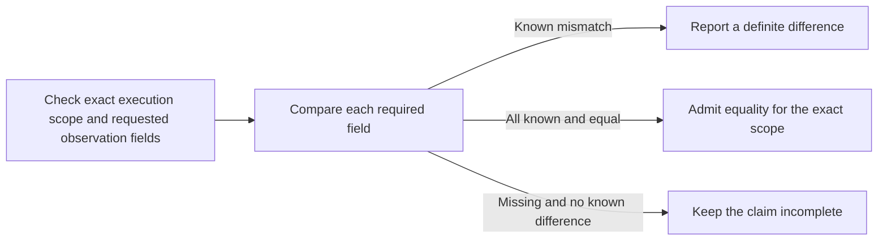

# Declared observations for scoped semantics

## Profile and comparison

An observation profile specifies the exact execution scope and the fields a claim can observe. Each required field has declared type, meaning and completion conditions. A complete observation may contain a typed empty or absent event. An unavailable field records that the check cannot establish its value. Profiles can restrict a comparison to a smaller declared projection. Such a comparison supports the smaller claim.



| Field | Candidate meaning in this profile | Replayed evidence |
| --- | --- | --- |
| Return | Exact tagged return payload for an admitted terminating scope. | The state/Result reference agrees with both existing interpreters. [Executable reference](RT-07-STATE-RESULT-REFERENCE-ENTRY-2026-11-25.md) |
| Error | Exact failure tag and returned payload, with cancellation and modeled nontermination classified separately. A projection covering several cases records their tags explicitly. | The finite graph oracle distinguishes deadlock, divergence and returns. [Nondeterministic refinement](RT-07-NONDETERMINISTIC-REFINEMENT-2026-11-25.md) |
| State | Required final cells and any states exposed at declared observation points. | An observer can see an invalid intermediate bound even after successful finalization or rollback. [Callback contract invariant](../../language-design/RT-04/RT-04-CALLBACK-CONTRACT-INVARIANT-2026-11-25.md) |
| I/O | Accepted bytes and completion or failure status for the declared channel. Optional adapter traces preserve call order and results when required. | Coalescing preserves accepted prefix and status while changing the write-attempt trace. [Partial-output observations](RT-07-PARTIAL-OUTPUT-OBSERVATIONS-2026-11-25.md) |
| Resources | Typed accounting unit, consumed or unsettled quantities, and any requested live-resource disposition. | The quota fixture distinguishes confirmed consumption from reservation and checks reclamation. [Delegated quota reclamation](../../runtime-and-systems/RT-26/RT-26-DELEGATED-QUOTA-RECLAMATION-2026-11-25.md) |
| Concurrency | Execution histories or their declared projections, tied to the relevant order, read-from identities and rule profile. State whether the check covers a fixed set of histories or every allowed one. | Equal numeric reads can derive different synchronization edges across two rule profiles. [Release sequence membership](../../runtime-and-systems/RT-10/RT-10-RELEASE-SEQUENCE-MEMBERSHIP-2026-11-25.md) |
| Declared effects | Ordered events with their typed payloads, according to the boundary named by the contract. | The reference distinguishes a restoring write sequence from an unchanged observation with an empty event log. [State/Result effect observations](RT-07-STATE-RESULT-REFERENCE-ENTRY-2026-11-25.md) |

Lean proves that matching requires a present equal value for each requested field, equality projects to any subset, and matching is transitive within the same projection. All three theorems in the ledger are axiom-free. [Lean model](DECLARED-OBSERVATIONS-01/Profile.lean) · [Axiom ledger](DECLARED-OBSERVATIONS-01/axioms.txt)

## Replay and controls

The runner builds a scratch tree from `research/all` at `078704760dd2434923c73ac34aaa8973fa57c64f`. All six supporting ledgers reproduce byte for byte, and four Lean axiom transcripts match. The results document distinct existing fixtures and assumptions.

The projection test independently exercises every subset of the seven fields and every pattern of equality, difference and unavailable data. These patterns are controls for the comparison procedure. They need no assumption that all combinations represent one executable program. The runner also refuses a wrong profile and a missing field on the source side. [Evidence ledger](DECLARED-OBSERVATIONS-01/evidence.json) · [Table generator](DECLARED-OBSERVATIONS-01/chart.py)

| Decision | Count |
| --- | ---: |
| Profile/observation comparisons | 279936 |
| Matches of all required fields | 16384 |
| Definite difference | 201811 |
| Incomplete observations | 61741 |
| False admissions from checking shared fields only | 61741 |
| Definite differences missed by return/error only | 211 |

A final result and error comparison misses 211 definite differences under the full requested profile in the controlled product, including state, resource and effect mismatches. Dropping unestablished fields makes all 61,741 incomplete cases appear to match. Known evidence can support an exact narrower profile, with the claim and context recorded accordingly. Production representation, source-to-observation correspondence, clocks and resource attribution, fairness, and integration of these component models remain open.

## Reproduction

Use Git 2.56.1, CPython 3.12.14, GCC Debian 14.2.0-19 on x86-64 Linux and Lean 4.36.0 at `611c117bfaf7b7ae1cfcf246ce6fba31e8f509e9`. Run from repository root with the archived commit available.

```sh
set -eu
fixture=research/formal-verification/RT-07/DECLARED-OBSERVATIONS-01
out=$(mktemp -d)
trap 'rm -rf "$out"' EXIT
lean -DwarningAsError=true "$fixture/Profile.lean" > "$out/axioms.txt"
cmp "$fixture/axioms.txt" "$out/axioms.txt"
python3 -B "$fixture/run.py" > "$out/evidence.json"
cmp "$fixture/evidence.json" "$out/evidence.json"
python3 -B "$fixture/chart.py"
```

[PLAN §2.1](../../../PLAN.md#21-formal-semantics-of-the-language) · [Issue #293](https://github.com/aivibeflow/LLMLang/issues/293)
