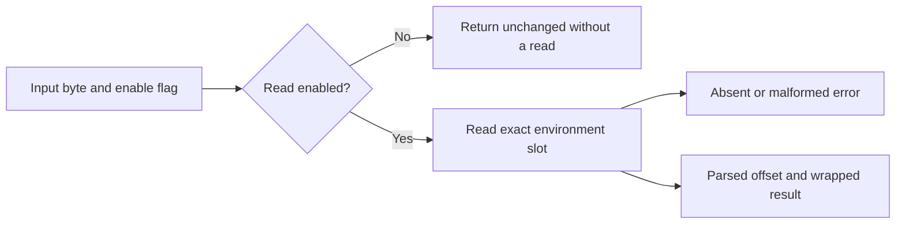

# RT-07 — Explicit environment inputs and conditional observations

## Question and model

Which host assumptions enter a semantic claim or execution key when a program consults the environment only on some paths? The [core semantics survey](../../language-design/RT-03/CORE-LANGUAGE-SEMANTICS.md) treats the environment as an explicit possible input. The [typed dependency evidence study](../../semantic-representation/RT-06/RT-06-DEPENDENCY-EVIDENCE-CLASSES-2026-11-25.md) distinguishes observed reads from absence and coverage. This fixture checks a native POSIX lookup and a closed observation model. [PLAN §2.1](../../../PLAN.md#21-formal-semantics-of-the-language) · [#293](https://github.com/aivibeflow/LLMLang/issues/293)

A request contains an unsigned byte and an enable flag. The disabled path returns the byte without accessing the selected variable. The enabled path reads one synthetic environment variable with `getenv`. Absence is one error, while any present value other than one ASCII digit from zero to three is a distinct malformed-value error. A valid input adds the offset modulo 256. The output contains the tagged result and whether the fixture took the observed read path. Neither the borrowed pointer identity nor the raw bytes of an invalid value are declared observable in this model.



The child process receives a controlled environment and no host values for the two fixture variables. It varies presence, valid offsets, empty and malformed text, and an unrelated variable. The C harness gives native correspondence for the POSIX boundary. The Lean model takes an already classified abstract value. This separation makes parsing and environmental correspondence explicit obligations.

## Results

GCC O0 and O2 agree with all 144 expected native observations per profile. The Python oracle compares 1,224 unordered environment pairs within otherwise equal requests. Each request already fixes its input byte and enable flag.

| Projection | Safe reuse | Stale reuse | Missed reuse |
| --- | ---: | ---: | ---: |
| Source subject and request | 744 | 480 | 0 |
| Successful reads only | 744 | 64 | 0 |
| Exact consulted input | 648 | 0 | 96 |
| Checked parsed observation | 744 | 0 | 0 |
| Whole captured environment | 0 | 0 | 744 |

The successful-only footprint omits both absence and malformed reads. It merges different error outcomes. Binding the exact consulted value covers them and excludes state on the disabled path, but distinguishes malformed spellings with the same observation. The parsed projection preserves every observed result in this fixture, including absence as a separate value. Whole-environment identity also covers the observations while invalidating reuse for the unrelated variable and skipped reads.

[Lean](ENVIRONMENT-BOUNDARY-01/Boundary.lean) proves independence of environment inputs on the disabled path, the stated valid-input result, and distinction of both error cases. A separate witness proves that the valid-zero assumption does not cover the absent case. All four theorems have empty axiom lists. The model assumes the variable can be faithfully observed and classified in the target process. It does not prove the C library or a general source mapping. [Axiom output](ENVIRONMENT-BOUNDARY-01/axioms.txt)

A proof that assumes a valid environment input can stay conditional on that input. A closed execution or reusable result needs the actual selected binding or a checked projection of it. This experiment treats unrelated state, disabled reads and the malformation equivalence only under the explicit output contract. Changes that expose raw values, effects of lookup, concurrency or a different parsing profile require separate support.

## Reproduce

The baseline was `c5f7d23500359f253d28671a62e35d2e15a66af0` on `research/all`. The replay used CPython 3.12.14, Debian GCC 14.2.0-19, glibc 2.41, Linux 6.18.57 x86-64, and Lean 4.36.0 at `611c117bfaf7b7ae1cfcf246ce6fba31e8f509e9`:

```sh
fixture=research/formal-verification/RT-07/ENVIRONMENT-BOUNDARY-01
out=$(mktemp)
axioms=$(mktemp)
lean -DwarningAsError=true "$fixture/Boundary.lean" > "$axioms" &&
  cmp "$fixture/axioms.txt" "$axioms" &&
  python3 -B "$fixture/run.py" > "$out" &&
  cmp "$fixture/evidence.json" "$out" &&
  python3 -B "$fixture/chart.py"
```

The [ledger](ENVIRONMENT-BOUNDARY-01/evidence.json) preserves each environment profile, per-request observation, candidate projection and native output hash. The [table generator](ENVIRONMENT-BOUNDARY-01/chart.py) renders the categorical results. Production environment capture, verified extraction, policy authority, platform portability and general foreign effects remain open. [Runner](ENVIRONMENT-BOUNDARY-01/run.py)
