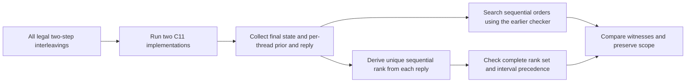

# Four-participant native counter histories and interval checking

**Date** 2026-11-25 · **Plan** §2 and §5.2 · **Issue** [#294](https://github.com/aivibeflow/LLMLang/issues/294)

Across all 2,520 schedules of four two-step invocations, a C11 atomic fetch-add supplies a valid sequential witness at three initial values and two optimization levels. A separate atomic load and store supplies a valid witness only for the 24 serial schedules at each value. An independent interval checker agrees with the original permutation-based checker on all 30,240 native histories.

## Workload and claims

The [earlier frame experiment](RT-07-DAFNY-CONCURRENT-FRAME-HISTORY-2026-11-25.md) checks Dafny's sequential and isolated-call contracts and measures two- and three-participant native histories. This study extends the native fixture to four participants by changing its admitted actor limit from three to four. It preserves the C source's sequence of atomic operations and controlled POSIX-thread scheduling. A mutex and condition variable enforce the supplied step order. Each invocation has a start step and a return step. The split implementation loads on start and stores its loaded value plus one on return. The fetch-add implementation updates on return. The inputs avoid unsigned overflow, including a boundary case that can finish at the exact maximum value.

A sequential specification increments the counter and returns the new value. A history is linearizable here if there is a sequential order explaining every reply and the final counter, and that order respects any completed-before-started invocation pair. If two intervals overlap, this observation permits either relative order. The native ledger additionally observes the prior value for each return.



## Why the rank criterion works in this scope

A legal sequential execution from base value `b` yields each return in the range `b+1` through `b+4` exactly once. A valid reply therefore fixes the invocation's position by subtracting `b+1`. A duplicate or missing rank cannot match the sequential specification. With all ranks present, sorting the invocations by rank is the only candidate witness. For every interval that finishes before another starts, the first rank must be smaller. Those precedence tests, correct per-call prior values and final state give a sufficient witness. This argument depends on complete calls, the increment-by-one contract and the no-wrap precondition. A general history with duplicate legitimate return values can need a different witness search.

## Results

| Native implementation | Histories per optimization | Linearizable | Wrong final count |
|---|---:|---:|---:|
| Atomic fetch-add | 7,560 | 7,560 | 0 |
| Separate atomic load and store | 7,560 | 72 | 7,488 |

The three initial values are 0, 1 and 4,294,967,291. Each contributes 2,520 schedules because each of four pairs must place its own start before its own return. Only the 24 arrangements of four nonoverlapping pairs are serial. The two optimization levels agree on every native row and witness. The split fixture's wrong final count already distinguishes every violated native history observed here. Three independently constructed controls preserve the correct final count. They exercise swapped nonoverlapping callers, duplicate return ranks and an inconsistent prior value. The interval checker refuses each for its specified observation contract.

This result supports a distinction between checking a declared sequential or isolated call and checking all admitted shared schedules. A final count and a sequential proof do not establish per-call return and precedence observations. The interval oracle is exact for the declared bounded model. The tests do not exercise weak-memory behavior, arbitrary operation protocols, unscripted fairness and progress, or general LLMLang-to-native correspondence. The original Dafny proofs and their assumption audits are separate inputs. This follow-up checks native histories and independent witnesses, with scoped implications for DEP-007, DEP-014, DEP-018 and DEP-019. [Dependency map](../../research-management/RESEARCH-DEPENDENCY-MAP.md)

## Reproduction

Use CPython 3.12.14 and GCC 14.2.0 on the stated Linux x86-64 scope. The evidence records the exact input Git blobs, generated C digest, compiler identity, host properties, native output digests, and full first refusal at each initial value. The harness fixes the native histories by construction. Two complete replays agree byte-for-byte.

```sh
fixture=research/formal-verification/RT-07/FOUR-COUNTER-HISTORIES-01
PYTHONDONTWRITEBYTECODE=1 python "$fixture/check.py" --out /tmp/llmlang-four-counter-histories.json
cmp "$fixture/evidence.json" /tmp/llmlang-four-counter-histories.json
```

[Compiler and history harness](FOUR-COUNTER-HISTORIES-01/check.py) · [Exact history and control ledger](FOUR-COUNTER-HISTORIES-01/evidence.json)
