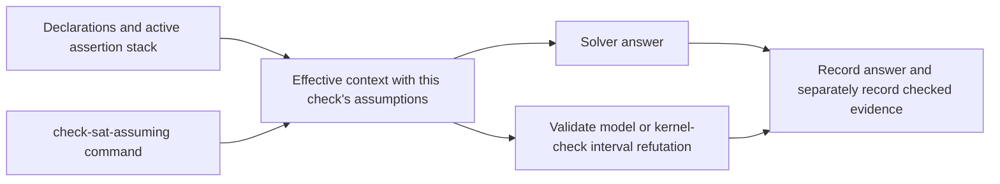

# Binding independently checked evidence to incremental solver contexts

## Model

A persistent SMT process can give different correct answers to identical `check-sat-assuming` text. The effective declarations, assertions and assumptions determine the query. This study keeps one integer and one Boolean guard. Each session asserts a minimum threshold activated by the guard. Nested `push` and `pop` change the lower and optional upper bound. The same check commands are sent with the guard true or false as a temporary assumption. The earlier one-shot worker study checks message and failure handling. This experiment checks exact evidence binding inside a successfully running session. [One-shot worker audit](../../research-management/RT-00/RT-00-C-SOLVER-WORKER-PROTOCOL-AUDIT-2026-11-25.md)



The runner retains raw answer and model transcripts by digest. Each SAT answer is compared with the interval reference and must supply an assignment that satisfies all active constraints and the temporary assumption. Each distinct UNSAT context gets a separate Lean theorem connecting lower and upper bounds with the guard threshold. The Lean proof does not consume either solver's result or generated certificate. The runner binds the theorem name to the SHA-256 digest of the emitted logic and declarations, ordered active assertions and exact assumption command. The same generator derives the Lean statement and the encoded query from a typed fixture row. Correspondence between the formula and general parsed SMT-LIB is outside this check.

## Results

Z3 4.13.3 and cvc5 1.4.2 each agree with the reference on all 192 incremental checks and all 160 fresh-process queries. The loop rechecks 32 restored contexts after `pop`; all agree with the matching fresh query. Each solver supplies 134 incremental SAT assignments that pass the independent arithmetic and Boolean check. Lean checks all 58 distinct refutations; the reported axiom set for each is `[propext]`. [Interval proof](INCREMENTAL-SOLVER-EVIDENCE-01/Interval.lean) · [Machine-readable evidence](INCREMENTAL-SOLVER-EVIDENCE-01/evidence.json) · [Table generator](INCREMENTAL-SOLVER-EVIDENCE-01/chart.py)

| Comparison | Count |
| --- | ---: |
| Same command text | 5568 |
| Exact context | 58 |
| Wrong context with a satisfying witness | 3836 |
| Wrong context also independently unsatisfiable | 1674 |
| Same session and command | 1392 |
| Wrong context with a witness in the same session | 938 |

The table compares each of the 58 checked UNSAT receipts against every occurrence of its command. The 938 same-session counterexamples show that adding a session identity still leaves the current assertion stack unbound. The 1,674 wrong-context comparisons that are also UNSAT need their own evidence or a checked relationship between contexts. Verdict agreement alone does not validate replay. The SAT control accepts `x = 0, p = false` in the interval `[0, 0]` and refuses that witness when the temporary assumption requires `p = true`.

This fixture therefore records solver answers, checked satisfiability witnesses and kernel-checked refutations separately. Its subject key is exact for the fixed grammar and declared semantics. General query parsing, verified lowering, concurrency, resource limits, solver timeouts and certificate admission for arbitrary theories retain their own evidence obligations.

## Reproduction

From repository root, use CPython 3.12.14, Lean 4.36.0 revision `611c117bfaf7b7ae1cfcf246ce6fba31e8f509e9`, Z3 4.13.3 and cvc5 1.4.2 revision `282d5e0`, with all four executables on PATH.

```sh
set -eu
fixture=research/formal-verification/RT-07/INCREMENTAL-SOLVER-EVIDENCE-01
out=$(mktemp)
trap 'rm -f "$out"' EXIT
python3 -B "$fixture/run.py" > "$out"
cmp "$fixture/evidence.json" "$out"
python3 -B "$fixture/chart.py"
```

[PLAN §2.2](../../../PLAN.md#22-proof-architecture-and-proof-boundary) · [Issue #294](https://github.com/aivibeflow/LLMLang/issues/294)
