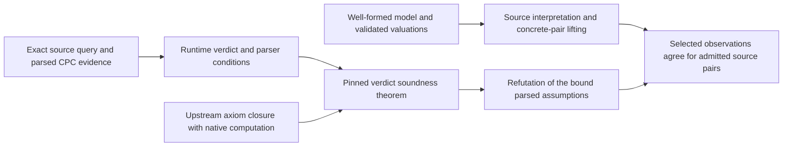

# RT-07 — Reconcile the Lean and Logos proof boundary

**Scope:** PLAN §2.3 and [#295](https://github.com/aivibeflow/LLMLang/issues/295). Source and proof archives pinned to `research/all` at `d816c26380dae97c9ade3252eb7438adacb1b4ae`.

LLMLang needs to know which conclusion it can record after an exact CPC (Cooperating Proof Calculus) proof file passes the runtime checker. Lean can check a theorem describing the runtime verdict and a different theorem connecting that verdict to source-level independence. Each theorem has its own predicates, dependency closure and toolchain. This audit records the scope of each layer and tests whether cheaper summaries preserve the actual upstream axiom identities.

## Checked, trusted and external layers

| Layer | What is checked | What must be supplied or justified |
| --- | --- | --- |
| [Runtime verdict characterization](RT-07-LOGOS-CHECKER-TRUST-BOUNDARY.md) | Lean 4.36 checks the exact conditions for the runtime `correct`, `incorrect` and `incomplete` verdicts and retains the ordinary parser result for a correct file. Four theorem transcripts reproduce byte for byte with the three standard axioms. | Correct verdict characterization describes acceptance, translation checks and parser output. The semantics of the accepted proof is a separate obligation. |
| [Source interpretation and concrete-pair lifting](RT-07-LOGOS-CONCRETE-PAIR-LIFTING-2026-11-24.md) | Lean checks the relation between exact admitted source pairs, wire-valuations and the parsed assumptions, using the precise typed query and successful validation. | The source-to-query theorem's admitted grammar, type and observation model apply. An arbitrary solver response or unsupported source falls outside those premises. |
| [Model extension and isolated model witness](RT-07-LOGOS-KERNEL-MODEL-WITNESS-2026-11-24.md) | The official archive checks a model extension from a well-formed base. Its unconditional existence uses one upstream native axiom. The isolated witness recheck removes that assumption for its model-existence theorem. | The isolated change supplies evidence for the witness only. The dependency set of the official verdict theorem remains a separate check. |
| [Source refutation with an explicit soundness premise](RT-07-LOGOS-SOURCE-REFUTATION-COMPOSITION-2026-11-24.md) | Lean checks the implication from exact certificate, validated binding and trusted verdict soundness to equal selected observations for the admitted paired executions. The archived theorem lists only the standard Lean axioms. | Verdict soundness appears as a theorem hypothesis. Its absence from the axiom list does not discharge it. The required base model and exact source/query relationships still apply. |
| [Pinned Logos verdict proof and source composition](RT-07-LOGOS-VERDICT-PROOF-2026-11-25.md) | The archived Lean 4.34 build proves the actual Logos checker implication and composes it with LLMLang. The upstream verdict and checker theorem, and the two source conclusions, all have the same axiom set. | Besides the three standard axioms, this set has 2,118 full names belonging to upstream native computation. Applying the result requires an explicit trust decision for that exact dependency closure or a separately checked replacement. |

The standard axioms in these reports are `propext`, `Classical.choice` and `Quot.sound`. A collected Lean axiom list reports transitive axiom declarations. It does not list hypotheses in the theorem statement. The table therefore tracks assumptions and collected axioms separately.



This diagram shows the source conclusion and its inputs. The runtime characterization stops at the first verdict layer. The formal composition includes the whole chain under its named premises. Production promotion requires those premises to hold for the exact subject and an accepted trust policy.

## What an axiom summary can preserve

The [audit ledger](LOGOS-BOUNDARY-RECHECK-01/evidence.json) reconstructs all five theorem dependency digests from the exact archived names. It confirms the original model witness's only native axiom is already a member of the official verdict set. Swapping only that witness for the isolated `rfl` alternative therefore leaves the official verdict's transitive native axiom set unchanged.

The 2,118 names identify private declarations in 194 defining modules. Of these, 1,634 names have a module under `Cpc.Proofs.Rules`. The largest module group is `Cpc.Proofs.Rules.Bool_not_ite_elim` with 601 names. This grouping works on exact proof dependency names. It measures neither how many computations ran at runtime nor how many native axioms a smaller restricted verifier would need. The general verdict theorem includes rules beyond the admitted QF_LIA input language, so restricting wire admission does not by itself shrink its compiled proof closure.

Only 606 final name components are distinct. The control changes an axiom's full namespace while retaining its final component and the total count. A count or shortened-name comparison is unchanged, while the full dependency set digest changes. This models why the record needs the exact proof subject, toolchain and complete qualifying names to apply an explicit allowlist. The test compares manifests and makes no decision to accept a native axiom.

## Reproduction and limits

Use CPython 3.12.14 and Lean 4.36 at `611c117bfaf7b7ae1cfcf246ce6fba31e8f509e9` with the built runtime library from a clean Logos checkout at `cf18742973861b3718d04c5f25775448098ff474`. The [audit script](LOGOS-BOUNDARY-RECHECK-01/audit.py) checks the checkout identity and recompiles the verdict characterization against the existing runtime `.olean` library. It records the exact binary digest and compares the four theorem axiom lines with the archive. A different binary build can change the binary digest. The expected theorem lines and archived dependency sets are separate fields.

```sh
fixture=research/formal-verification/RT-07/LOGOS-BOUNDARY-RECHECK-01
LC_ALL=C python3 -B "$fixture/audit.py" \
  --lean "$(command -v lean)" --logos-checkout "$LOGOS_CHECKOUT" \
  > /tmp/llmlang-logos-boundary.json
cmp "$fixture/evidence.json" /tmp/llmlang-logos-boundary.json
```

This audit reuses the historical full Lean 4.34 rule build and the earlier model-witness and interpretation transcripts. It freshly elaborates the four runtime theorems. Rebuilding the complete upstream verification project, reducing the transitive dependency closure, validating a broader LLMLang frontend, accepting the native trust policy and independent domain review remain separate work. Mermaid syntax was inspected directly. These are structural proof-dependency counts, with no timing measurements.
