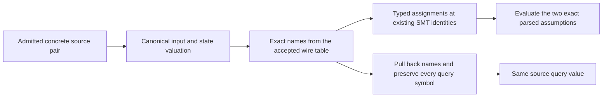

# Lift arbitrary concrete source pairs to exact Logos valuations

- **Date:** 2026-11-24
- **Research:** RT-07, RT-32, Scenario 34 (SCW-32)
- **Baseline:** `a396e2709c811ffb1810e2e62d93849c890d8ca6` on main
- **Evidence:** Lean kernel proof of valuation round trip, complete pair lifting under a validated binding shape, and replay of the finite program fixtures

Once the parser binding table has successfully built one scalar valuation, any admitted concrete source pair produces a corresponding valuation over the same SMT identifiers. The two exact parsed assumptions are both true precisely when the selected input and the observed result or state differ in that concrete pair.

## Comparison

The earlier [program proof](RT-07-LOGOS-PROGRAM-ASSUMPTIONS-2026-11-24.md) starts with a wire valuation and relates it to a concrete pair. This study starts with the pair and uses the compiler's canonical binding table to forward the values to their actual wire names. Only the selected factor receives separate left and right names. The existing checked source semantics handles the initial values for all shared inputs and state.



| Boundary | Verified result |
| --- | --- |
| Accepted wire declaration layout | Internal-to-wire-to-internal valuation recovery agrees on every symbol of the canonical query. |
| Revalue the parser's exact table | Successful construction is independent of the supplied scalar values. Changing them preserves the ordered SMT identifiers. |
| Start with any admitted concrete pair | Once the table shape has been validated, the exact assumptions characterize dependence in the supplied pair. |

The finite fixture also constructs each wire valuation from its concrete pair and compares every declared value to its independent, explicitly named assignment. All 96 pairs retain both previous assumption values, including the state-only Boolean-factor cases. The 1,536 expression results and archived example envelope bytes also remain identical.

## Reproduce

Use Lean 4.36.0 (`611c117bfaf7b7ae1cfcf246ce6fba31e8f509e9`) and Logos `cf18742973861b3718d04c5f25775448098ff474`. The [proof](../../PROTOTYPES/DEPENDENCY-GRAPH-01/logos_binding/LogosWireValuation.lean) is part of the package build. Its [axiom audit](../../PROTOTYPES/DEPENDENCY-GRAPH-01/logos_binding/evidence/logos-concrete-pair/axioms.txt) records only the standard Lean axioms.

```sh
cd research/PROTOTYPES/DEPENDENCY-GRAPH-01/logos_binding
lake update --keep-toolchain
lake build --fail-fast LLMLangLogosBinding
results=$(mktemp)
lake env lean -DwarningAsError=true LogosWireValuation.lean > "$results"
cmp evidence/logos-concrete-pair/axioms.txt "$results"
lake env lean -DwarningAsError=true --run LogosScalarDenotation.lean
```

The theorem concerns the checked Int/Bool fragment after the exact wire and CPC binding checks and a successful validation of the table shape. Applying it to a runtime `correct` verdict still requires the complete upstream soundness result and its trust disposition. [Model extension and trust audit](RT-07-LOGOS-MODEL-EXTENSION-2026-11-24.md)
