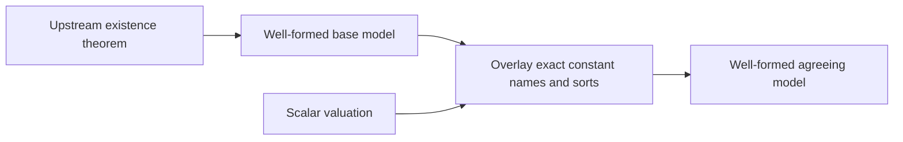

# Extend scalar valuations to well-formed Logos models

- **Date:** 2026-11-24
- **Research:** RT-07, RT-32, Scenario 34 (SCW-34)
- **Baseline:** `d5101f8bd7d616c590d910773af698e6c301deb0`
- **Evidence:** Lean proof of well-formed extension and an exact audit of the upstream model witness

A finite Int/Bool valuation extends to a well-formed agreeing Logos model. The overlay preserves the well-formedness of a supplied model using the standard Lean axioms. The unconditional existence theorem also uses the pinned Logos model-existence theorem. The axiom audit traces that extra dependency to a native computation for the canonicality of the empty regular language.

## Model construction

The [same-kernel program theorem](RT-07-LOGOS-SINGLE-KERNEL-PROGRAM-2026-11-24.md) assumes that an upstream model agrees at the resolved constants. The overlay starts with a total well-formed model and replaces only constant entries for a name and the exact scalar sort. Existing variable entries, other sorts, native functions and uninterpreted-sort domains retain their interpretation. Injecting an Int or Bool value preserves type and canonicity. The result agrees at every entry read by the finite valuation table.



| Candidate | Result |
| --- | --- |
| Override by exact constant name and sort | Preserves well-formedness and agrees with every resolved table entry. |
| Override by name alone | A single integer entry at a Boolean key contradicts the upstream type invariant. |
| Supply an already well-formed base model | The overlay proof uses only the standard Lean axioms. |
| Use the pinned upstream existence theorem for the base | Every scalar valuation has an agreeing well-formed model. The audit includes the upstream `native_decide` axiom. |

The pinned `model_wf_nonvacuous` proof reaches `native_re_canonical_none` through the canonical-inhabitant theorem for general SMT types. The latter is proved with `native_decide` in the upstream source. The fixture also kernel-checks the same empty-regular-language equality by definitional reduction. The unconditional theorem in this study still relies on the upstream dependency as published. [Pinned Logos proof](https://github.com/cvc5/logos/blob/cf18742973861b3718d04c5f25775448098ff474/Cpc/Proofs/TypePreservation/Common.lean#L26)

## Reproduce and scope

Use Lean 4.34.0 (`293d5d0c0c3f3dded4688b3ccd6a33939ac5102b`), Logos `cf18742973861b3718d04c5f25775448098ff474`, and Mathlib `5ed2965256430c3649e86755f9576b54eca72435`. The [fixture](../../PROTOTYPES/DEPENDENCY-GRAPH-01/logos_binding/upstream-model/LogosModelExtension.lean) and [exact axiom output](../../PROTOTYPES/DEPENDENCY-GRAPH-01/logos_binding/evidence/logos-model-extension/axioms.txt) are reproducible with:

```sh
fixture=research/PROTOTYPES/DEPENDENCY-GRAPH-01/logos_binding
results=$(mktemp)
python3 -B "$fixture/upstream-model/replay.py" --checkout /path/to/pinned/logos --model-extension > "$results"
cmp "$fixture/evidence/logos-model-extension/axioms.txt" "$results"
```

The exact pinned theorem establishes model existence and exposes its additional trusted computation. The project still needs a disposition for that trust dependency, concrete-pair lifting, and verification and integration of the full Logos checker proof. [Checker trust boundary](RT-07-LOGOS-CHECKER-TRUST-BOUNDARY.md)
