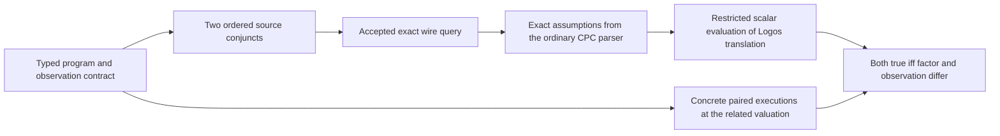

# Source program meaning of admitted Logos assumptions

- **Date:** 2026-11-24
- **Research:** RT-07, RT-32, Scenario 34 (SCW-32 and SCW-33)
- **Baseline:** `54fcaec9843ad10399c4bca4b8da446127920cfd`
- **Evidence:** Lean kernel theorem over the admitted typed program fragment and arbitrary valuations constructed by the adapter

For any admitted source-wire query, exactly bound CPC assumption list and successfully constructed valuation, the two received assumptions evaluate in order to Boolean values. Both are true exactly when the corresponding concrete source executions differ at the selected input and at an observation. The observation includes the return value and the selected state fields.

## Evidence composition

The query compiler gives the exact two source conjuncts that become the typed wire assumptions. The accepted CPC list contains the corresponding two rendered terms in the same order. Each term evaluates through the pinned Logos SMT translation using the [checked exact valuation](RT-07-LOGOS-VALUATION-BINDING-2026-11-24.md). The readiness conditions are the existing decoder and parser-binding checks plus successful valuation construction.



The source compiler theorem applies to the input pair constructed by pulling the wire valuation back to canonical source names. The new proof reuses this theorem and [scalar expression preservation](RT-07-LOGOS-SCALAR-PRESERVATION-2026-11-24.md). It covers the program-level result for every wire valuation that passes the stated construction, including variable assignments, branches and selected state allowed in the checked fragment. The two earlier program fixtures checked concrete examples of the same relationship. [Finite scalar denotation](RT-07-LOGOS-SCALAR-DENOTATION-2026-11-24.md)

| Boundary | Result |
| --- | --- |
| Exact source wire and parsed CPC assumptions | Both admitted assumptions have a checked rendering of the corresponding ordered source term. |
| Arbitrary successfully lifted wire valuation | The evaluated pair of Booleans agrees with dependence for the corresponding concrete source pair. |
| Complete Logos refutation | The existing checker tracks the same parsed assumption and command stream. The theorem here concerns assumption meaning in the restricted evaluator. |

The wire encoder now identifies the two conjuncts directly from the typed source query before lowering them. For the existing Int and Bool fixtures, the compact envelope bytes remain identical. The original valid, modified, and incomplete CPC fixtures still exercise the decoder and proof-binding behavior. Existing finite expression and program comparisons retain their outcomes. Swapping the factor and observation fields made Lean reject the ordered-components proof even though both fields have Boolean type.

## Scope and reproduction

The scalar evaluator is the LLMLang fixture interpreter over Logos-translated SMT syntax. This result proves soundness from accepted wire valuations to their concrete source pairs. Lifting every concrete pair into the wire environment, upstream model interpretation and a composition with the complete Logos rule proof remain separate. The proof starts with the checked typed AST rather than a general LLMLang parser. [Checker trust boundary](RT-07-LOGOS-CHECKER-TRUST-BOUNDARY.md)

The [proof](../../PROTOTYPES/DEPENDENCY-GRAPH-01/logos_binding/LogosProgramBridge.lean) and [axiom report](../../PROTOTYPES/DEPENDENCY-GRAPH-01/logos_binding/evidence/logos-program-bridge/axioms.txt) use Lean 4.36.0 commit `611c117bfaf7b7ae1cfcf246ce6fba31e8f509e9` and Logos commit `cf18742973861b3718d04c5f25775448098ff474`.

```sh
cd research/PROTOTYPES/DEPENDENCY-GRAPH-01/logos_binding
lake update --keep-toolchain
lake build --fail-fast LLMLangLogosBinding
results=$(mktemp)
lake env lean -DwarningAsError=true LogosProgramBridge.lean > "$results"
cmp evidence/logos-program-bridge/axioms.txt "$results"
wire=$(mktemp)
lake env lean -DwarningAsError=true --run SourceQueryEnvelopeTests.lean --emit > "$wire"
cmp evidence/typed-json/envelopes.jsonl "$wire"
lake env lean -DwarningAsError=true --run SourceWireRefutationTests.lean
```
