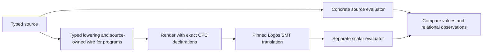

# Finite scalar denotation through Logos rendering

- **Date:** 2026-11-24
- **Research:** RT-07, RT-32, Scenario 34 (SCW-32)
- **Baseline:** `78047ac60d729ddfcf8ac048d8d2c32d1023cfcd` on main
- **Evidence:** Differential evaluation of the pinned Logos translation on typed expressions and decoded source-owned relational queries

The renderer and Logos' SMT translation agree with the source evaluator on 1,536 expression evaluations. Both rendered assumptions agree with 96 paired concrete source executions. Two changed inputs to the renderer preserve the reported sort but change the interpreted value. They distinguish sort preservation from preservation of the source calculation.

## Comparison

The existing [sort theorem](RT-07-LOGOS-RENDERED-SORTS.md) checks the result of Logos' own `__eo_typeof`. The new differential path checks a different property. It renders through the existing adapter, converts the resulting `Eo.Term` with `__eo_to_smt` from the pinned Logos dependency, then evaluates the resulting SMT syntax with a separate finite Int/Bool interpreter. The interpreter uses explicit values for the actual constant IDs emitted by the upstream translation of the parser declarations.



| Fixture | Compared | Result |
| --- | ---: | --- |
| 24 typed expressions over 64 valuations | 1,536 scalar evaluations | All agree |
| Int-factor program with branch, state write and return | 64 concrete pairs, two assumptions each | All agree, 48 pairs differ observably |
| Bool-factor program with a constant return and selected state | 32 concrete pairs, two assumptions each | All agree, 16 pairs differ through state |
| Reversed subtraction and exchanged same-sort bindings | Two semantic mutations | Same reported sort and different interpreted value |
| Missing constant interpretation, rational term, and a rational term in an inactive conditional branch | Three rejected inputs | All fail closed |

The expression inputs cover negative, zero and positive integers, both Boolean values, and every source expression constructor in the profile. The program cases encode and decode the source-owned wire envelope, check the declaration layout, resolve exact CPC constants, render the two assumptions, and compare them individually with concrete factor inequality and observation inequality. This preserves the distinction between input change and change in the declared observation. The existing [source-wire refutation controls](RT-07-SOURCE-WIRE-LOGOS-ACCEPTANCE.md) separately exercise the actual CPC proof binding and complete runtime verdict.

## Scope

The sampled evaluations supply denotation evidence through the actual renderer and Logos SMT translation. The evaluator here is an executable Int/Bool fixture with finite valuations. The upstream verification project's model interpreter, model well-formedness and complete checker rule proofs remain separate dependencies. A universal denotation theorem and a checked composition with the upstream soundness result remain open. [SCW-34 checker trust boundary](RT-07-LOGOS-CHECKER-TRUST-BOUNDARY.md)

## Reproduce

Use Lean 4.36.0 commit `611c117bfaf7b7ae1cfcf246ce6fba31e8f509e9` and Logos commit `cf18742973861b3718d04c5f25775448098ff474`. The [Lean fixture](../../PROTOTYPES/DEPENDENCY-GRAPH-01/logos_binding/LogosScalarDenotation.lean) and [recorded output](../../PROTOTYPES/DEPENDENCY-GRAPH-01/logos_binding/evidence/logos-denotation/observations.txt) are checked by the repository's Logos workflow.

```sh
cd research/PROTOTYPES/DEPENDENCY-GRAPH-01/logos_binding
lake update --keep-toolchain
lake build --fail-fast LLMLangLogosBinding
results=$(mktemp)
lake env lean -DwarningAsError=true --run LogosScalarDenotation.lean > "$results"
cmp evidence/logos-denotation/observations.txt "$results"
lake env lean -DwarningAsError=true --run SourceWireRefutationTests.lean
```
