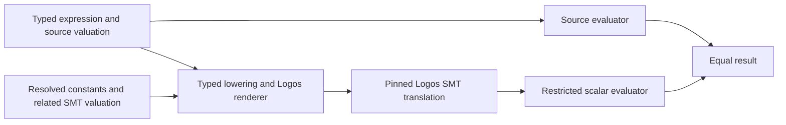

# Scalar source expression preservation through Logos

- **Date:** 2026-11-24
- **Research:** RT-07, RT-32, Scenario 34 (SCW-32)
- **Baseline:** `07cfa1e9ef24e01eb169d454909076cbd1669ee5` on main
- **Evidence:** Lean kernel theorem for typed Int/Bool source expressions

`expression_preservation` proves that, when rendering succeeds, evaluating the actual Logos SMT translation of a typed source expression yields the source expression's value in the restricted evaluator. The theorem covers all expressions in the existing typed Int/Bool AST and arbitrary valuations that agree on the exact resolved constants.

## Checked boundary

The input is the existing source `Expr` with its result sort and a source valuation. The existing prototype lowers through the typed query AST, renders with exact CPC constant terms, then applies the pinned Logos `__eo_to_smt` translation. The theorem relates the resulting SMT syntax to the source using the scalar evaluator from the [finite comparison](RT-07-LOGOS-SCALAR-DENOTATION-2026-11-24.md).



| Evidence | Property |
| --- | --- |
| Existing sort theorem | Successful rendering produces the required Logos sort. |
| Finite expression and program comparisons | Actual parser declarations and sampled source valuations produce the observed scalar results and relational assumption values. |
| New kernel theorem | All typed source expressions preserve their values through successful rendering and translation under the stated constant relation. |

The proof uses induction over the source expression and the exact renderer shape for each constructor. It checks the right-associated identities used for addition, literal multiplication, conjunction and disjunction. It covers comparisons, equality, unary operators and both conditional result sorts. The constant relation requires each successfully resolved parser term to evaluate to the source value associated with its name and sort. Establishing that relation for a specific parser environment remains an obligation when applying the theorem.

Replacing binary subtraction with addition in the restricted SMT evaluator made Lean reject the unchanged proof, without executing the finite cases.

## Reproduction and remaining dependencies

Use Lean 4.36.0 (`611c117bfaf7b7ae1cfcf246ce6fba31e8f509e9`) and Logos `cf18742973861b3718d04c5f25775448098ff474`. The [axiom audit](../../PROTOTYPES/DEPENDENCY-GRAPH-01/logos_binding/evidence/logos-preservation/axioms.txt) records `propext`, `Classical.choice`, and `Quot.sound`. The [proof](../../PROTOTYPES/DEPENDENCY-GRAPH-01/logos_binding/LogosScalarPreservation.lean) is included in the pinned Lake build.

```sh
cd research/PROTOTYPES/DEPENDENCY-GRAPH-01/logos_binding
lake update --keep-toolchain
lake build --fail-fast LLMLangLogosBinding
results=$(mktemp)
lake env lean -DwarningAsError=true LogosScalarPreservation.lean > "$results"
cmp evidence/logos-preservation/axioms.txt "$results"
```

This proves expression preservation into the restricted evaluator. A checked application to arbitrary source-derived program assumptions still needs the valuation relation for parser and wire bindings and the connection to upstream model semantics. The complete Logos soundness theorem and the cross-toolchain composition are tracked at SCW-34. [Logos checker trust boundary](RT-07-LOGOS-CHECKER-TRUST-BOUNDARY.md)
