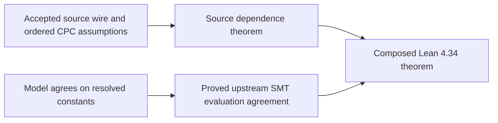

# Source program assumptions in the Logos verification kernel

- **Date:** 2026-11-24
- **Research:** RT-07, RT-32, Scenario 34 (SCW-34)
- **Baseline:** `570f9544e7b20697364a9c4f4c32c61f51f00d8f` on main
- **Evidence:** A single Lean 4.34 kernel checks source-program and upstream-model composition

The pinned Logos verification kernel can check the source program theorem and upstream model agreement together. The new theorem interprets the exact ordinary-parser CPC assumptions in `Cpc.SmtModel`. For each successfully lifted wire valuation and related upstream model, both interpreted assumptions are true exactly when the corresponding source pair has different selected inputs and different observations.

## Toolchain comparison

| Run | Observed result |
| --- | --- |
| Existing LLMLang proof package on Lean 4.36 | Builds and preserves the standard source-bound certificate path. |
| Existing package source on Lean 4.34 | One build failure in the symbolic certificate's recursive search through S-expressions. The source-program theorem itself builds. |
| Package with explicit recursion through expressions and lists on Lean 4.34 | Builds, retains the source-wire and finite comparison results, and checks the new composed theorem alongside `Cpc.SmtModel`. |

The search still traverses every nested expression and checks the same two spellings of the omitted input. On the Lean 4.36 path both archived source-bound CPC certificates remain accepted, and the quoted omitted-input control fails at the declaration check. The alternate kernel build lives in a temporary copy of the package and uses the pinned local Logos checkout. The repository's usual Lean 4.36 build continues to use the unchanged dependency revision.



## Reproduce and scope

With the pinned Lean 4.34.0 (`293d5d0c0c3f3dded4688b3ccd6a33939ac5102b`), Logos `cf18742973861b3718d04c5f25775448098ff474`, and Mathlib `5ed2965256430c3649e86755f9576b54eca72435`, run from the LLMLang root:

```sh
fixture=research/PROTOTYPES/DEPENDENCY-GRAPH-01/logos_binding
results=$(mktemp)
python3 -B "$fixture/upstream-model/replay.py" --checkout /path/to/pinned/logos --program > "$results"
cmp "$fixture/evidence/logos-upstream-program/axioms.txt" "$results"
```

The [composed theorem](../../PROTOTYPES/DEPENDENCY-GRAPH-01/logos_binding/upstream-model/LogosUpstreamProgram.lean) uses `propext`, `Classical.choice`, and `Quot.sound`. Its premise is agreement of the upstream model at the looked-up typed constants. Well-formed model extension, the lift from an arbitrary concrete source pair, and application of the full checker soundness theorem remain distinct obligations. [Upstream model proof](RT-07-LOGOS-UPSTREAM-SCALAR-MODEL-2026-11-24.md) · [Checker trust boundary](RT-07-LOGOS-CHECKER-TRUST-BOUNDARY.md)
