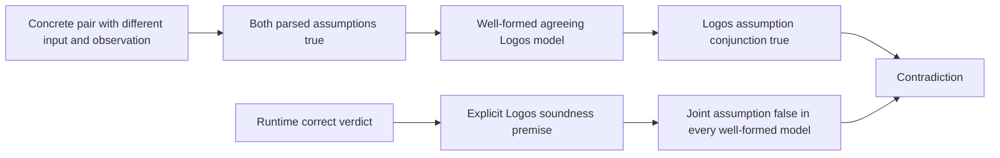

# Compose a sound Logos verdict with source nondependence

- **Date:** 2026-11-24
- **Research:** RT-07, RT-32, Scenario 34 (SCW-34)
- **Baseline:** `7dd68a30fd720c750f052ab745e4478d42bd76f0`
- **Evidence:** Lean kernel theorem in the pinned upstream verification toolchain with explicit checker and model premises

The theorem connects a checked runtime certificate to nondependence of the admitted typed source program. Given a validated scalar binding table, a well-formed base model, and the Logos verdict soundness theorem as a premise, any concrete source pair with different selected inputs has equal observations. The observation includes the return and selected state fields.

## Argument and comparison

The reverse [concrete-pair lifting theorem](RT-07-LOGOS-CONCRETE-PAIR-LIFTING-2026-11-24.md) produces a scalar valuation for the exact parsed CPC assumptions. If the concrete pair differed in its observation, both assumptions would evaluate to true. The [model overlay](RT-07-LOGOS-MODEL-EXTENSION-2026-11-24.md) constructs a well-formed agreeing upstream model from the supplied base. The pinned `logos_assumption_term` implementation then evaluates the joint assumption to true in that model. This contradicts the supplied verdict soundness theorem, which makes the joint assumption false in every well-formed model.



| Evidence used | Supported result |
| --- | --- |
| Runtime `correct` and exact source-wire binding | The checker accepted the derivation for the exact parsed assumptions. |
| Those facts, a validated table shape, and the two semantic premises | The theorem rules out different observations when only the selected input differs. |
| Pinned upstream theorem and base model witness supplied directly | The relevant proof-artifact audit and extra upstream trust disposition are required. |

The checker premise has the type of the pinned `correct___logos_verdict` theorem. The running checker provides the exact verdict and assumptions from the ordinary parser. The proof imports the upstream satisfiability definition and evaluates the checker’s actual conjunction construction. The full `Cpc.ApiCorrect` proof build remains a separate gate. [Pinned upstream theorem statement](https://github.com/cvc5/logos/blob/cf18742973861b3718d04c5f25775448098ff474/Cpc/ApiCorrect.lean#L54)

## Reproduce and scope

Use Lean 4.34.0 (`293d5d0c0c3f3dded4688b3ccd6a33939ac5102b`), Logos `cf18742973861b3718d04c5f25775448098ff474`, and Mathlib `5ed2965256430c3649e86755f9576b54eca72435`.

```sh
fixture=research/PROTOTYPES/DEPENDENCY-GRAPH-01/logos_binding
results=$(mktemp)
python3 -B "$fixture/upstream-model/replay.py" --checkout /path/to/pinned/logos --source-refutation > "$results"
cmp "$fixture/evidence/logos-source-refutation/axioms.txt" "$results"
```

The [composition proof](../../PROTOTYPES/DEPENDENCY-GRAPH-01/logos_binding/upstream-model/LogosSourceRefutation.lean) uses `propext`, `Classical.choice`, and `Quot.sound` under its stated premises. Applying the theorem on a release path requires checking the upstream rule proof, its axiom audit, and the provenance of a well-formed base model. [Checker trust boundary](RT-07-LOGOS-CHECKER-TRUST-BOUNDARY.md)
