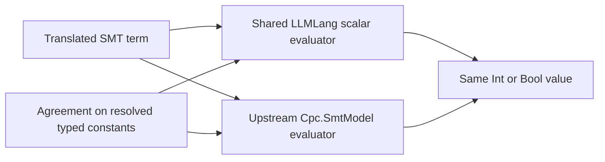

# Agreement with the verified Logos scalar model

- **Date:** 2026-11-24
- **Research:** RT-07, RT-32, Scenario 34 (SCW-32 and SCW-34)
- **Baseline:** `74a71889bb9c9545a7c3a97997b854ef3cbbbace` on main
- **Evidence:** Lean kernel theorem over every successfully evaluated term of the restricted Int/Bool model

The upstream model evaluator agrees with the LLMLang scalar evaluator for each successful evaluation when the two models agree at the looked-up constants. The proof uses the actual `Cpc.SmtModel` implementation in the pinned Logos verification project and the same evaluator source used by LLMLang's program-assumption proof.

## Comparison



| Boundary | Verified property |
| --- | --- |
| Restricted evaluator | Accepts Int and Bool literals and constants, arithmetic and comparisons, Boolean connectives, and typed conditionals. |
| Upstream model semantics | Every successful evaluation of a supported term gives the same scalar value in any upstream model agreeing at the looked-up typed constants. |
| Source and parser path | The earlier Lean 4.36 program proof continues to evaluate its exact parsed terms with the shared evaluator. |

The kernel proof descends through the concrete `SmtTerm`. It uses the upstream definitions for integer subtraction, signed operations, Boolean equality and order, and conditional selection. The result concerns successful evaluation. The restricted evaluator also rejects unsupported constructors and values of the wrong scalar sort. Replacing subtraction with addition in the shared evaluator causes the upstream correspondence proof to fail.

## Toolchains and reproduction

The LLMLang proof builds with Lean 4.36.0 (`611c117bfaf7b7ae1cfcf246ce6fba31e8f509e9`). The upstream model proof builds with Lean 4.34.0 (`293d5d0c0c3f3dded4688b3ccd6a33939ac5102b`), Logos `cf18742973861b3718d04c5f25775448098ff474`, and Mathlib `5ed2965256430c3649e86755f9576b54eca72435`. Each kernel compiles the [same scalar evaluator source](../../PROTOTYPES/DEPENDENCY-GRAPH-01/logos_binding/LogosScalarEvaluation.lean). The [upstream proof](../../PROTOTYPES/DEPENDENCY-GRAPH-01/logos_binding/upstream-model/LogosUpstreamScalarModel.lean) uses `propext`, `Classical.choice`, and `Quot.sound`. [Axiom report](../../PROTOTYPES/DEPENDENCY-GRAPH-01/logos_binding/evidence/logos-upstream-model/axioms.txt)

With the pinned tools and a clean checkout of the exact Logos revision, run from the LLMLang repository root:

```sh
fixture=research/PROTOTYPES/DEPENDENCY-GRAPH-01/logos_binding
results=$(mktemp)
python3 -B "$fixture/upstream-model/replay.py" --checkout /path/to/pinned/logos > "$results"
cmp "$fixture/evidence/logos-upstream-model/axioms.txt" "$results"
```

The replay builds `Cpc.SmtModel` in the upstream verification project. The full build of every checker rule is independent of this model proof. The remaining proof obligations are to extend an accepted scalar valuation to a well-formed upstream model, lift arbitrary concrete source pairs into the wire valuation, and compose both sides with the complete checker soundness theorem in a compatible kernel. [Source program assumptions](RT-07-LOGOS-PROGRAM-ASSUMPTIONS-2026-11-24.md) · [Checker trust boundary](RT-07-LOGOS-CHECKER-TRUST-BOUNDARY.md)
