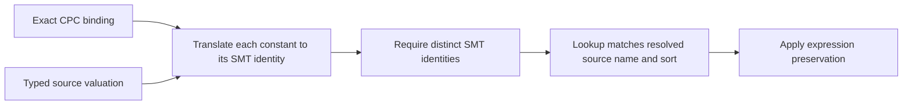

# Exact parser constant interpretation in the Logos scalar evaluator

- **Date:** 2026-11-24
- **Research:** RT-07, RT-32, Scenario 34 (SCW-32)
- **Baseline:** `1531d5c18d598fd84c037d27c21c499b675ae2ae`
- **Evidence:** Lean kernel proof of valuation correspondence and composition with scalar expression preservation

The expression theorem needs each resolved constant to denote the value assigned to its source name and sort. The new theorem proves that a successfully constructed valuation table has this property. The composed result applies expression preservation directly to the table built by the existing adapter.

## Binding and evaluation

The CPC resolver returns a constant only when exactly one entry has the requested name and its term has the requested sort. The table constructor translates each constant with Logos to obtain its actual SMT identifier. It records the source valuation's value at that name and sort, then checks that the resulting identifiers are distinct. The proof connects successful resolution to membership in the original binding list, preserves membership through conversion, then uses unique identifiers to show that evaluation retrieves the exact intended row.



| Situation | Result |
| --- | --- |
| Successful valuation construction and successful symbol resolution | The resolved term evaluates to the intended typed value. |
| Distinct source names map to the same SMT identity | The valuation constructor rejects the ambiguity. |
| Symbol name missing, repeated, or declared at a different sort | The resolver returns an error. |
| Successful expression rendering with the constructed valuation | The rendered SMT term preserves the source expression value. |

The proof uses the same resolver and evaluator as the [finite denotation fixture](RT-07-LOGOS-SCALAR-DENOTATION-2026-11-24.md). The negative control assigns the same exact parsed constant to two names and observes rejection during table construction. The constructor expresses the runtime check as a decidable `Nodup` predicate, so the proof consumes the same successful check that the runner executes.

## Reproduce and scope

Use Lean 4.36.0 (`611c117bfaf7b7ae1cfcf246ce6fba31e8f509e9`) and the Logos revision `cf18742973861b3718d04c5f25775448098ff474`. The pinned workflow builds the [proof](../../PROTOTYPES/DEPENDENCY-GRAPH-01/logos_binding/LogosValuationBinding.lean) and checks its [axiom output](../../PROTOTYPES/DEPENDENCY-GRAPH-01/logos_binding/evidence/logos-valuation/axioms.txt). Both the valuation theorem and composed expression theorem use the standard Lean axioms `propext`, `Classical.choice`, and `Quot.sound`.

```sh
cd research/PROTOTYPES/DEPENDENCY-GRAPH-01/logos_binding
lake update --keep-toolchain
lake build --fail-fast LLMLangLogosBinding
results=$(mktemp)
lake env lean -DwarningAsError=true LogosValuationBinding.lean > "$results"
cmp evidence/logos-valuation/axioms.txt "$results"
lake env lean -DwarningAsError=true --run LogosScalarDenotation.lean
```

The conclusion is conditional on successful construction and rendering. The proof establishes neither acceptance of every source-wire input nor the identifier-renaming relation between arbitrary concrete program pairs and the wire envelope. Interpretation against the upstream verified model and the source-to-CPC soundness composition remain open. [Scalar preservation](RT-07-LOGOS-SCALAR-PRESERVATION-2026-11-24.md) · [Checker trust boundary](RT-07-LOGOS-CHECKER-TRUST-BOUNDARY.md)
