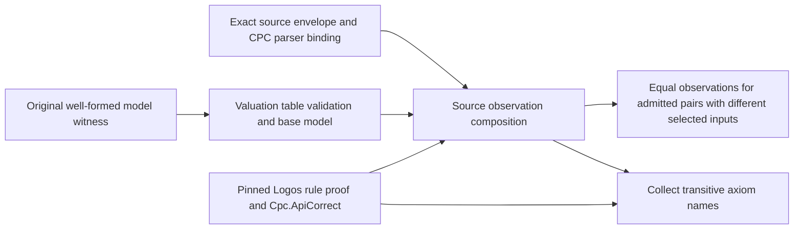

# RT-07 — Compose and audit the pinned Logos verdict proof

All 614 batches of the pinned Logos rule build complete, and Lean checks the upstream verdict theorem composed with the LLMLang source theorem. The compiled source-level claims inherit the upstream native computation axioms. A build and successful composition identify that trust boundary.

## Question and exact boundary

The [previous source composition](RT-07-LOGOS-SOURCE-REFUTATION-COMPOSITION-2026-11-24.md) assumes the semantic soundness of the Logos verdict for the actual parsed assumptions. This study supplies that premise using the real `correct___logos_verdict` theorem from the unchanged upstream checkout. It builds both proof layers in Lean 4.34.0. It checks one variant given a well-formed base model and another that uses the original upstream `model_wf_nonvacuous` to obtain a base model.

Both source conclusions require successful compilation of the supported relational query, a source-bound checked certificate for the exact decoded envelope, and successful valuation construction from the parser table. Under these premises, any admitted concrete input pair yields observations, and different selected input values imply equal observations. The claim is restricted to the existing typed source fragment, binding check and observation contract. It uses the actual pinned evaluator and verifier proof. It does not establish that an arbitrary solver answer establishes source independence.



## Build and results

The replay uses Logos `cf18742973861b3718d04c5f25775448098ff474`, Mathlib `5ed2965256430c3649e86755f9576b54eca72435` and Lean `293d5d0c0c3f3dded4688b3ccd6a33939ac5102b`. The initial two-worker rule build hit the execution cgroup's memory limit. The completed run uses single-rule batches and one Lean worker. The original build record identifies the logs and built proof artifact by digest. Runtime compilation and proof checking use the original dependency source. [Upstream pinned API proof](https://github.com/cvc5/logos/blob/cf18742973861b3718d04c5f25775448098ff474/Cpc/ApiCorrect.lean) · [Build record](LOGOS-VERDICT-PROOF-01/build-provenance.json)

| Lean theorem | Standard axioms | Native computation axioms | Total |
| --- | ---: | ---: | ---: |
| `correct___logos_verdict` | 3 | 2,118 | 2,121 |
| `correct___logos_check_proof` | 3 | 2,118 | 2,121 |
| `Smtm.model_wf_nonvacuous` | 3 | 1 | 4 |
| `pinnedVerdict_noDependence_withBase` | 3 | 2,118 | 2,121 |
| `pinnedVerdict_noDependence` | 3 | 2,118 | 2,121 |

The names come from `Lean.collectAxioms` as complete constant names. This matters because Lean's display can shorten differently scoped private constants to the same string. Each number counts distinct transitive axiom constants per theorem, and the standard three are `propext`, `Classical.choice`, and `Quot.sound`. All other collected names are pinned `native_decide` declarations. No `sorryAx` is present. The upstream verdict, upstream proof checker, and both LLMLang statements have identical axiom sets. The original model witness's single native axiom is already present in the upstream verdict set.

## Implications for the implementation choice

There are two distinct evidence boundaries. Runtime checking rejects wrong certificates and binds checked certificates to the exact source query. The formal implication uses the Logos proof relative to its transitive axioms. Lean verifies terms relative to those assumptions. Accepting this verifier requires a documented trust decision for the upstream native computation path or a proof revision whose dependencies satisfy the chosen policy.

The [isolated `rfl` model witness](RT-07-LOGOS-KERNEL-MODEL-WITNESS-2026-11-24.md) independently removes a native assumption from model existence. Replacing only the LLMLang composition's witness leaves the clean pinned verdict's identical 2,118 native axioms in scope. Reducing that larger boundary needs a separate upstream rebuild or a checked proof restricted to the admitted rules. This study does not select a policy, characterize every axiom's computation, or cover a wider source grammar, arbitrary proof encodings or independent review.

## Reproduce

Use CPython 3.12.14 and Lean 4.34.0, with a clean local checkout of the pinned Logos revision. Supply `--complete-build` for a fresh upstream proof build. The default mode reuses its exact Lake build and reruns the source composition and audit. The ledger stores every exact native axiom name and a digest for each theorem's full set.

```sh
fixture=research/formal-verification/RT-07/LOGOS-VERDICT-PROOF-01
raw=$(mktemp)
normalized=$(mktemp)
python3 -B "$fixture/replay.py" --checkout /path/to/logos > "$raw"
python3 "$fixture/audit.py" "$raw" > "$normalized"
cmp "$fixture/evidence.json" "$normalized"
python3 "$fixture/chart.py"
```

[Lean proof and axiom command](LOGOS-VERDICT-PROOF-01/CheckedVerdict.lean) · [Replay](LOGOS-VERDICT-PROOF-01/replay.py) · [Exact axiom ledger](LOGOS-VERDICT-PROOF-01/evidence.json)
