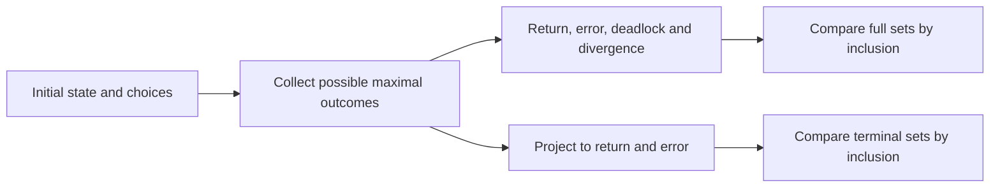

# RT-07 — Nondeterministic refinement with explicit nontermination

## Question and model

How should refinement treat a replacement that may deadlock or diverge, even when each of its returning outcomes satisfies the original postcondition? The [deterministic observation proof](RT-07-STATE-RESULT-OBSERVATIONAL-EQUIVALENCE-2026-11-25.md) equates preservation of all postconditions with equality of a single complete observation. The [finite contract relation comparison](../../language-design/RT-04/RT-04-CONTRACT-RELATIONS-FINITE-COMPARISON-2026-11-25.md) uses allowed outcome inclusion. This study examines that inclusion for explicitly nondeterministic termination. [PLAN §2.1](../../../PLAN.md#21-formal-semantics-of-the-language) · [#293](https://github.com/aivibeflow/LLMLang/issues/293)

An observation is one of return, error, deadlock or divergence. The last two are distinct: deadlock ends in a transient state without a successor, and divergence is possible when an infinite path exists. Each initial state gives a set of possible observations over all maximal paths, without a fairness restriction. The model abstracts concrete results and effects to these four tags. A replacement refines the original when its possible observations form a subset of the original set. Equality of sets gives equivalence at this observation boundary.



## Checked proof and finite comparison

[Lean](NONDETERMINISTIC-REFINEMENT-01/Refinement.lean) proves two general facts about predicates over possibly many observations. Inclusion preserves all universal postconditions from the original to the replacement. Equivalently, every existential observation property possible in the replacement is possible in the original. The two directions choose the original set itself as a universal predicate or a singleton as an existential witness. Lean also proves a loop-only replacement refines a return-only original under terminal projection and fails refinement when divergence is included. All four theorems have empty axiom lists. [Axiom output](NONDETERMINISTIC-REFINEMENT-01/axioms.txt)

The executable comparison enumerates every directed edge subset from two transient states to either transient state, return or error. A path traversal and independent transitive-closure calculation agree on the maximal outcome sets for all 512 initial cases across 256 graphs. In a finite graph any infinite path repeats a transient state. Conversely a reachable cycle gives an infinite path under this unrestricted scheduling model. The comparison evaluates all 262,144 ordered original/replacement pairs.

| Comparison | Ordered pairs |
| --- | ---: |
| Explicit maximal outcomes admit | 108,276 |
| Terminal-only projection admits | 155,904 |
| Terminal-only admission rejected by explicit outcomes | 47,628 |
| Of those, replacement has no terminal outcome | 23,824 |

A state that can either return or repeat its self-loop has a returning execution and a divergent execution. It satisfies a may-return query. It does not satisfy must-return. Terminal-only inclusion admits it against a return-only reference, as well as admitting a pure deadlock or loop whose projected result set is empty. The ledger gives exact witnesses for both missing-terminal outcomes.

## Implications and limits

Smaller sets refine larger sets for this demonic observation relation, so nondeterminism can be reduced where doing so introduces no new maximal observation. A postcondition on returned and raised outcomes expresses partial correctness. A promise of progress needs an explicit nontermination boundary or a separate proof. This model leaves general traces, fair scheduling, time, probabilistic choices, resources, and verified translation open. No LLMLang equivalence or scheduler policy is selected.

## Reproduce

The baseline was `066dc439fd5c117a8e52bf048ef6ada465f42f68` on `research/all`. Use CPython 3.12.14 and Lean 4.36.0 at `611c117bfaf7b7ae1cfcf246ce6fba31e8f509e9`, as checked on Debian 13 Linux 6.18.57 x86-64:

```sh
fixture=research/formal-verification/RT-07/NONDETERMINISTIC-REFINEMENT-01
out=$(mktemp)
axioms=$(mktemp)
lean -DwarningAsError=true "$fixture/Refinement.lean" > "$axioms" &&
  cmp "$fixture/axioms.txt" "$axioms" &&
  python3 -B "$fixture/run.py" > "$out" &&
  cmp "$fixture/evidence.json" "$out" &&
  python3 -B "$fixture/chart.py"
```

The [ledger](NONDETERMINISTIC-REFINEMENT-01/evidence.json) preserves exact sources, all finite observation sets, counted comparisons and counterexample states. The [table generator](NONDETERMINISTIC-REFINEMENT-01/chart.py) renders the categorical results. [Runner](NONDETERMINISTIC-REFINEMENT-01/run.py)
