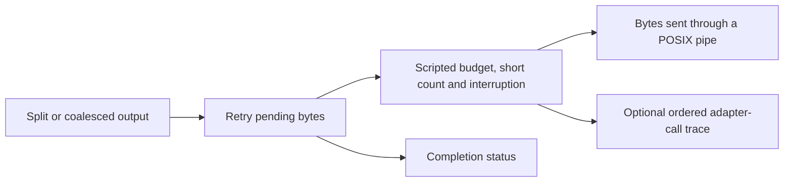

# Output coalescing with short writes and partial failure

## Observation boundary

A compiler may combine adjacent output chunks. This changes the first requested write size even if the receiver sees the same byte stream. The bounded model compares two declared observations, the accepted bytes with the final status, and the same pair with an ordered trace of adapter calls. Each trace entry includes the requested byte count and the result. The sink accepts bytes in order up to a fixed budget, then returns a failure on the next non-empty request. An adapter may return a positive short count or one initial interruption. All input chunks have already been computed. A correct writer retries an interruption and advances by the accepted count until that chunk is complete or a permanent failure occurs.



Lean proves for any list of chunks and natural byte budget that the abstract sink delivers the corresponding prefix of the flattened stream. It proves equal accepted-prefix and failure observations after coalescing. Both proofs depend on `propext` and `Quot.sound`. This abstract model covers retry to completion given the stated finite interruption and positive progress. The complete adapter trace is measured by the native probe. [Lean source](PARTIAL-OUTPUT-01/Prefix.lean) · [Axiom ledger](PARTIAL-OUTPUT-01/axioms.txt)

## Evidence

The C probe uses an actual POSIX pipe and simulates short results, the initial `EINTR` and budget-triggered `EIO` at the calling adapter. It measures accepted bytes by draining the pipe. GCC `-O0` and `-O2` each match all 2,316 reference rows. The experiment crosses every partition of each prefix of a five-byte input, budgets through one beyond the input length, maximum accepted write sizes from one through three, optional initial interruption and two write loops. [Machine-readable evidence](PARTIAL-OUTPUT-01/evidence.json) · [Table generator](PARTIAL-OUTPUT-01/chart.py)

| Comparison | Cases | Different |
| --- | ---: | ---: |
| Coalesced vs. split, bytes and status | 996 | 0 |
| Coalesced vs. split, with attempt trace | 996 | 996 |
| Retry vs. drop, bytes and status | 1158 | 400 |
| Drop reports success with missing bytes | 1158 | 384 |

With a two-byte message, a one-byte budget and a one-byte limit, retry delivers the first byte and returns `EIO`. The short-write control delivers that byte and returns success because it advances past the unwritten suffix. With a zero-byte budget, split one-byte chunks and a coalesced two-byte chunk deliver no bytes and both return `EIO`. Their trace records a request for one byte and two bytes respectively.

The prefix result can apply when the contract exposes accepted bytes and terminal status, and the implementation establishes the sink assumptions. Observable call sizes, per-call errors, interleaving with other writers, timing, reader framing, and externally visible resource use need their own obligations. The experiment does not establish those obligations or a lowering from production LLMLang.

## Reproduction

From repository root, use Python 3.12.14, GCC Debian 14.2.0-19 on x86-64 Linux, and Lean 4.36.0 revision `611c117bfaf7b7ae1cfcf246ce6fba31e8f509e9`.

```sh
set -eu
fixture=research/formal-verification/RT-07/PARTIAL-OUTPUT-01
out=$(mktemp -d)
trap 'rm -rf "$out"' EXIT
lean -DwarningAsError=true "$fixture/Prefix.lean" > "$out/axioms.txt"
cmp "$fixture/axioms.txt" "$out/axioms.txt"
python3 -B "$fixture/run.py" > "$out/evidence.json"
cmp "$fixture/evidence.json" "$out/evidence.json"
python3 -B "$fixture/chart.py"
```

[PLAN §2.1](../../../PLAN.md#21-formal-semantics-of-the-language) · [Issue #293](https://github.com/aivibeflow/LLMLang/issues/293)
