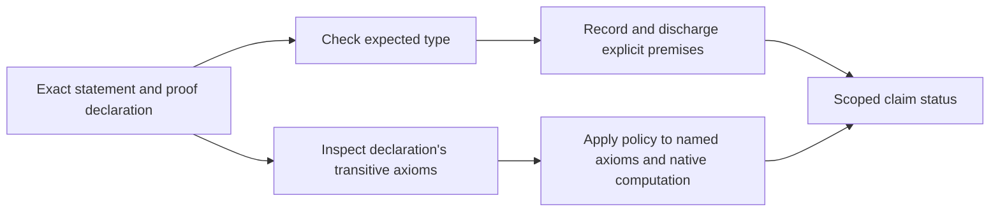

# Trusted assumptions for an exact Lean claim

## Scope

Several Lean declarations can have the same checked proposition and depend on different evidence. This experiment uses one closed arithmetic proposition, `observedInput * 7 = 63`, and compiles three local modules. The final module wraps the direct reduction, an imported axiom and native evaluation under different theorem names. It also discharges an explicit premise by reduction. A separate request deliberately tries to use the still-conditional theorem as a closed proof. The existing RT-32 compiled admission study checks an authenticated SPG claim and exact imported context. Here the focus is which dependencies belong to each checked proposition and which acceptance settings change the resulting trust boundary. [RT-32 compiled claim admission](../RT-32/RT-32-COMPILED-CLAIM-ADMISSION-2026-11-24.md)



The common replay base is the pinned Lean executable and the modules it loads. The ledger records the executable digest, six input source digests, three local compiled-module digests, and the exact output of the theorem type and axiom inspection. The declarations are inspected after compiling the dependencies and reopening them in fresh processes. Rechecking imports with Lean's `-t 0` option produces the same type and axiom transcript. Lean still reports both the foreign and native assumptions in scope.

## Results

Four declarations pass the annotation against the exact closed arithmetic proposition. The first and the discharged variant depend on no axioms. The wrapped foreign route depends on the imported `inputIsNine` axiom through a helper theorem. The wrapped native route depends on the generated `native_decide` axiom. An unrelated imported axiom is present in the same environment and absent from the transitive dependency of every other inspected declaration. [Source and transcripts](PER-CLAIM-TRUST-01/evidence.json) · [Table generator](PER-CLAIM-TRUST-01/chart.py)

| Declaration | Kernel only | Reviewed imported premise | Native evaluation allowed |
| --- | --- | --- | --- |
| `wrappedKernel` | closed-kernel-only | closed-kernel-only | closed-kernel-only |
| `wrappedForeign` | unadmitted-axioms | conditional-imported-premise | unadmitted-axioms |
| `wrappedNative` | unadmitted-axioms | unadmitted-axioms | closed-with-native-trust |
| `openPremise` | conditional-explicit-premise | conditional-explicit-premise | conditional-explicit-premise |
| `premiseDischarged` | closed-kernel-only | closed-kernel-only | closed-kernel-only |
| `placeholder` | forbidden-placeholder | forbidden-placeholder | forbidden-placeholder |

The conditional theorem has an empty axiom list and an explicit premise in its type. When the checker requests the closed proposition, Lean rejects that theorem. The placeholder has the closed type and exposes `sorryAx`. Lean reports the placeholder as a warning with warnings-as-errors disabled and refuses it when enabled. The candidate policies forbid the placeholder in both runs. The exact list therefore distinguishes transitive implicit assumptions from explicit premises in the statement.

These policies illustrate a claim-level receipt that names the exact requested proposition, the loaded proof artifacts, the checking mode and toolchain, the reported transitive axioms, explicit open premises and the treatment of native evaluation. An allowlisted imported axiom leaves the result conditional until discharged. Trusting the selected Lean native evaluation extends the base beyond kernel reduction. General import isolation, authenticated provenance, platform dependencies and correspondence with LLMLang source remain open. The study makes no project-wide axiom policy decision.

## Reproduction

Use CPython 3.12.14 and the x86-64 Linux Lean 4.36.0 release at revision `611c117bfaf7b7ae1cfcf246ce6fba31e8f509e9` from the repository root.

```sh
set -eu
fixture=research/formal-verification/RT-07/PER-CLAIM-TRUST-01
out=$(mktemp)
trap 'rm -f "$out"' EXIT
python3 -B "$fixture/run.py" > "$out"
cmp "$fixture/evidence.json" "$out"
python3 -B "$fixture/chart.py"
```

[PLAN §2.2](../../../PLAN.md#22-proof-architecture-and-proof-boundary) · [Issue #294](https://github.com/aivibeflow/LLMLang/issues/294)
