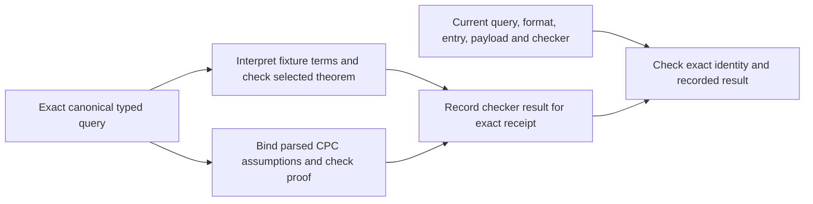

# Proof receipts for Lean source and CPC artifacts

## Common claims and format-specific checking

The experiment compares two ways to establish impossibility of differing observations for a constant-return program. One typed source returns 7 and the other returns 8. Both yield a relational QF_LIA query with two ordered terms. The fixture first generates canonical wire bytes through the existing exact source gate. The Lean route interprets the admitted wire terms used by the fixture as an expected theorem type and checks the selected declaration. The CPC route checks exact declarations, assumption terms and the ordinary Logos verdict. The routes share a query identity while keeping their proof payload and checker context separate. [Source and CPC binding](RT-07-SOURCE-CPC-PROOF-REBINDING-2026-11-25.md)



The versioned experimental receipt binds the query digest, format, entry, artifact digest and checker-context digest. For Lean source, the entry selects a declaration in the common source file, and the checker context names the Lean executable and exact small wire interpreter. For CPC text, the entry selects the complete proof, and the provenance includes the exact Logos revision, runtime API module, Lean executable, source gate and fixture driver. The observed checker result is stored separately by the receipt key. Supplied receipt bytes without an observed result cannot authorize reuse.

## Results

The original proof and theorem for each query pass their respective check. Swapping the artifacts across the two queries causes a type mismatch in Lean and assumption mismatch in Logos. Both Lean declarations have empty axiom lists. The two Lean receipts have the same proof source digest and different query and entry fields. The CPC result records gate and runtime acceptance, with the separate Logos soundness and native computation basis still in scope. [Lean proofs](PROOF-FORMAT-RECEIPTS-01/LeanProofs.lean) · [CPC controls](PROOF-FORMAT-RECEIPTS-01/CpcFixtures.lean) · [Logos verdict proof](RT-07-LOGOS-VERDICT-PROOF-2026-11-25.md)

| Query | Artifact | Lean source | CPC text |
| ---: | ---: | --- | --- |
| 7 | 7 | kernel-type-checked | runtime-cpc-accepted |
| 7 | 8 | obligation-type-mismatch | assumptions |
| 8 | 7 | obligation-type-mismatch | assumptions |
| 8 | 8 | kernel-type-checked | runtime-cpc-accepted |

Both exact reuse controls retain their original result kinds. Eight negative controls withhold reuse. They cover mismatch of query, format, declaration, payload or checker, a missing schema field and a candidate receipt with no recorded check. All four valid receipts have distinct keys. [Evidence ledger](PROOF-FORMAT-RECEIPTS-01/evidence.json) · [Table generator](PROOF-FORMAT-RECEIPTS-01/chart.py)

The fixture's wire-to-Lean interpretation covers the two exact typed query shapes tested. Its Python translation is part of the checking basis. General proof term serialization, binary Lean artifacts, a portable canonical encoding, authorization or signatures for stored results, full runtime inventory and production trust policy require separate evidence. The receipt schema remains an experimental format.

## Reproduction

Use CPython 3.12.14 and x86-64 Linux Lean 4.36.0 revision `611c117bfaf7b7ae1cfcf246ce6fba31e8f509e9`. Set `LOGOS_CHECKOUT` to a clean checkout at `cf18742973861b3718d04c5f25775448098ff474` with the runtime Cpc library built on the same Lean version. Run from repository root with the archived baseline recorded in the ledger available.

```sh
set -eu
fixture=research/formal-verification/RT-07/PROOF-FORMAT-RECEIPTS-01
out=$(mktemp)
trap 'rm -f "$out"' EXIT
python3 -B "$fixture/run.py" --logos "$LOGOS_CHECKOUT" > "$out"
cmp "$fixture/evidence.json" "$out"
python3 -B "$fixture/chart.py"
```

[PLAN §2.2](../../../PLAN.md#22-proof-architecture-and-proof-boundary) · [Issue #294](https://github.com/aivibeflow/LLMLang/issues/294)
