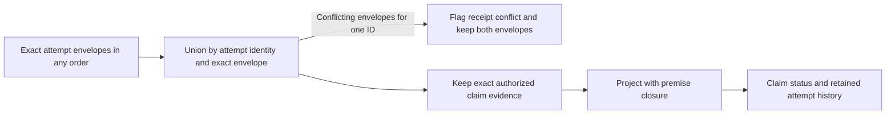

# Proof status from exact receipt history

## Model

Concurrent attempts to verify a claim can finish in any order. A later timeout reports its own attempt, while a previously checked theorem remains in scope. This experiment compares a single latest eligible verdict with a history that retains exact envelopes. The request fixes one claim revision, an authorization filter and whether its proof premise is discharged. Each observed receipt carries an attempt identity, an exact claim revision, an authorization disposition and a verdict. The earlier RT-00 experiment found that a set of verdict labels collapses distinct attempts. This experiment retains them and compares all tested delivery orders. [RT-00 proof receipt status audit](../../research-management/RT-00/RT-00-C-PROOF-RECEIPT-STATUS-2026-11-25.md) · [RT-36 candidate status dimensions](../RT-36/RT-36-FORMAL-VERIFICATION-ASSUMPTIONS-AND-TRUST.md#4-candidate-status-dimensions)



A claim stays a candidate while eligible attempts have reported no proof, counterexample or incomplete result. Unknown covers an incomplete attempt or an evidence rejection without a checked proof or counterexample. Rejected stays attached to its receipt. Checked means a theorem has a required premise still open. Proven means a checked proof with its required premise discharged under the fixture's fixed trust policy. An independently checked counterexample gives refuted, except when the same exact claim also has a closed proof. That pair yields a conflict for review. An open conditional theorem can coexist with the counterexample. A receipt identity with multiple distinct payloads yields a separate receipt conflict and retains both payloads.

## Results

Lean proves that merging the three evidence flags is commutative, associative and idempotent. Those lemmas use `propext`. Three other lemmas use no axioms. They show that an open premise prevents proven status, a rejected receipt alone yields unknown, and an incomplete attempt leaves a checked or proven result unchanged. The Python fixture separately checks envelope identity, authorization and subject eligibility. [Lean model](PROOF-STATUS-HISTORY-01/Status.lean) · [Axiom ledger](PROOF-STATUS-HISTORY-01/axioms.txt)

The replay uses eight receipt templates, all subsets up to size four, both premise states and all arrival orders. The history-based result equals an independent set oracle in every ordered profile. An exact retransmission keeps one receipt, conflicting payloads for the same identifier are withheld in either order, and two unknown receipts with distinct identifiers stay visible even though they yield one unknown claim status. [Machine-readable evidence](PROOF-STATUS-HISTORY-01/evidence.json) · [Table generator](PROOF-STATUS-HISTORY-01/chart.py)

| Comparison | Count |
| --- | ---: |
| Receipt subsets and premise states | 326 |
| Arrival orders and premise states | 4162 |
| Latest verdict disagrees with full history | 2359 |
| Latest verdict hides a closed proof | 364 |
| Subset/premise pairs sensitive to arrival order | 240 |

The latest-receipt baseline excludes wrong-revision and unauthorized receipts and still loses valid prior evidence. The tested history grows monotonically at fixed receipt identity. The projected status can change when additional eligible evidence arrives, for example from proven to conflict. Trust-policy changes, durable atomic append, authenticated delivery, semantic correctness of the checkers and production proof-graph closure require separate validation.

## Reproduction

Use CPython 3.12.14 and Lean 4.36.0 revision `611c117bfaf7b7ae1cfcf246ce6fba31e8f509e9` from repository root.

```sh
set -eu
fixture=research/formal-verification/RT-07/PROOF-STATUS-HISTORY-01
out=$(mktemp -d)
trap 'rm -rf "$out"' EXIT
lean -DwarningAsError=true "$fixture/Status.lean" > "$out/axioms.txt"
cmp "$fixture/axioms.txt" "$out/axioms.txt"
python3 -B "$fixture/run.py" > "$out/evidence.json"
cmp "$fixture/evidence.json" "$out/evidence.json"
python3 -B "$fixture/chart.py"
```

[PLAN §2.2](../../../PLAN.md#22-proof-architecture-and-proof-boundary) · [Issue #294](https://github.com/aivibeflow/LLMLang/issues/294)
