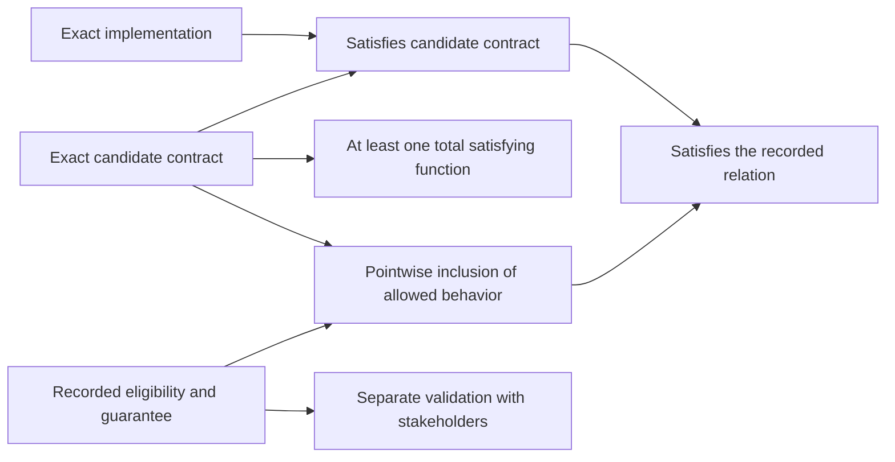

# Proof validity and adequacy relative to recorded intent

## Model and obligations

A contract over total deterministic functions has an eligibility predicate and a relation on input and output. An implementation satisfies the contract when every eligible input yields a permitted output. A separate intent record uses the same two fields. This model treats both artifacts as fixed mathematical inputs. It does not infer what stakeholders want or certify how the intent record was obtained. [RT-02 controlled review protocol](../../language-design/RT-02/RT-02-CONTROLLED-REVIEW-PROTOCOL-2026-11-25.md)



For an ineligible input the functional contract allows any output of the total implementation. Lean checks that inclusion of allowed behaviors implies proof transfer to the recorded relation. For a feasible candidate and decidable input equality, the condition is also necessary for transfer across all total implementations. The proof starts with a satisfying implementation and changes its output at one input. This exposes any output admitted by the candidate and forbidden by the recorded relation.

If observed behavior includes whether a call is eligible, check eligibility coverage separately. Lean proves that coverage combined with preservation of the recorded guarantee implies functional transfer. A candidate may omit an input whose outputs the intent relation leaves unconstrained and still satisfy functional transfer. The caller and service may then disagree on whether the call is admitted.

## Controls and results

Lean proves the transfer and coverage rules. Of the seven declarations in the ledger, only the exact transfer theorem requires `propext`. It also checks proofs that a constant-false implementation satisfies a weak contract or one restricted to false inputs, and rejects that implementation against an identity requirement over both Booleans. A separate theorem shows that a contract forbidding all outputs on eligible inputs has no implementation. [Lean source](PROOF-ADEQUACY-01/Adequacy.lean) · [Axiom ledger](PROOF-ADEQUACY-01/axioms.txt)

The complete finite comparison crosses 64 Boolean contracts with 64 intent records and checks all four total functions for each pair. All 3,136 feasible pairs agree with the exact inclusion theorem. In 4,032 of 9,216 candidate-valid triples, the same implementation fails the recorded intent. [Machine-readable evidence](PROOF-ADEQUACY-01/evidence.json) · [Table generator](PROOF-ADEQUACY-01/chart.py)

| Decision | Count |
| --- | ---: |
| Pairs with a feasible candidate | 3136 |
| Feasible pairs that fail transfer | 1767 |
| Failed transfer despite eligibility coverage | 511 |
| Functional transfer without eligibility coverage | 280 |
| Pairs with infeasible candidate and vacuous implication | 960 |
| Infeasible pairs where pointwise inclusion fails | 304 |

An empty eligibility predicate makes every implementation satisfy the candidate; an impossible guarantee on an eligible input makes every implication from candidate validity vacuous. These controls distinguish weak guarantees, loss of eligible cases and inconsistency. The model assumes total deterministic behavior and relations over the same input/output domain. Stateful or nondeterministic contracts, foreign assumption discharge, and validation of recorded intent with people retain their own evidence obligations.

## Reproduction

From repository root, run CPython 3.12.14 and Lean 4.36.0 revision `611c117bfaf7b7ae1cfcf246ce6fba31e8f509e9`.

```sh
set -eu
fixture=research/formal-verification/RT-07/PROOF-ADEQUACY-01
out=$(mktemp -d)
trap 'rm -rf "$out"' EXIT
lean -DwarningAsError=true "$fixture/Adequacy.lean" > "$out/axioms.txt"
cmp "$fixture/axioms.txt" "$out/axioms.txt"
python3 -B "$fixture/run.py" > "$out/evidence.json"
cmp "$fixture/evidence.json" "$out/evidence.json"
python3 -B "$fixture/chart.py"
```

[PLAN §2.2](../../../PLAN.md#22-proof-architecture-and-proof-boundary) · [Issue #294](https://github.com/aivibeflow/LLMLang/issues/294)
