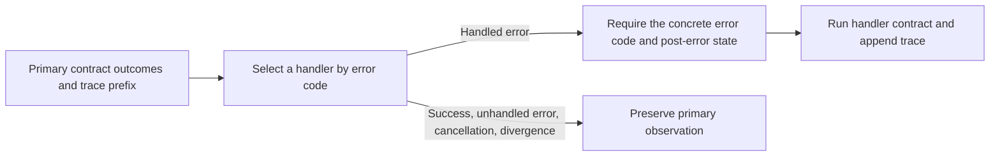

# Contract composition for tagged error recovery

## Model and handoff

A recovery handler runs for a selected error code. Its precondition applies to the code and state at that error, while its effects follow the primary computation's recorded effects. This extends the successful-state handoff from the earlier sequential composition model. The bounded recovery relation distinguishes a successful result, a tagged error, cancellation and divergence with a finite observed prefix. Cancellation and divergence pass through the recovery boundary. A handler can itself produce an outcome with a different terminal tag. [Sequential composition](RT-07-SEQUENTIAL-CONTRACT-COMPOSITION-2026-11-25.md) · [Typed recovery effects](../../language-design/RT-04/RT-04-RECOVERY-EFFECTS-AND-CAPABILITIES-2026-11-25.md)



Lean proves that the universal condition over primary observations is equivalent to requiring the handler precondition for every possible invocation. It also proves that including more possible primary and handler observations includes every prior composite observation under the same selection, and that a primary cancellation passes through with its state and trace. The three theorems use no axioms. [Lean source](RECOVERY-CONTRACTS-01/Recovery.lean) · [Axiom ledger](RECOVERY-CONTRACTS-01/axioms.txt)

## Results

The finite model uses two states, two error codes and nine primary outcome variants per initial state. It crosses every subset of primary outcomes with all four handler-selection masks and all sixteen precondition masks. A direct relation agrees with the branch-based implementation on all 4,096 composition profiles. An independent bit-mask reference agrees on all 65,536 handoff admission profiles. All 157,464 inclusion checks preserve the complete outcome and ordered trace. [Machine-readable evidence](RECOVERY-CONTRACTS-01/evidence.json) · [Table generator](RECOVERY-CONTRACTS-01/chart.py)

| Control | Profiles | Disagreed |
| --- | ---: | ---: |
| Existential handoff | 65536 | 11136 |
| Use initial state at handler entry | 4096 | 1792 |
| Treat cancellation as retry | 4096 | 1536 |
| Erase the primary trace prefix | 4096 | 2496 |

One primary contract can raise `retry` in either state. A handler that admits only `retry` at state zero passes a test looking for one suitable outcome, while the state-one invocation still violates its precondition. In another control, the handler receives the initial zero instead of the post-error one and diverges instead of reporting the fatal error possible at state one. Preserving only the handler's own trace also hides an earlier primary effect, even when the composed terminal tag stays the same.

The experiment models explicit selection of known errors and a finite prefix for divergence. It leaves resource unwinding, rollback semantics, infinite traces, fairness, asynchronous cancellation and correspondence to source programs outside this result.

## Reproduction

Use CPython 3.12.14 and Lean 4.36.0 at `611c117bfaf7b7ae1cfcf246ce6fba31e8f509e9` from the repository root.

```sh
set -eu
fixture=research/formal-verification/RT-07/RECOVERY-CONTRACTS-01
out=$(mktemp -d)
trap 'rm -rf "$out"' EXIT
lean -DwarningAsError=true "$fixture/Recovery.lean" > "$out/axioms.txt"
cmp "$fixture/axioms.txt" "$out/axioms.txt"
python3 -B "$fixture/run.py" > "$out/evidence.json"
cmp "$fixture/evidence.json" "$out/evidence.json"
python3 -B "$fixture/chart.py"
```

[PLAN §2.1](../../../PLAN.md#21-formal-semantics-of-the-language) · [Issue #293](https://github.com/aivibeflow/LLMLang/issues/293)
