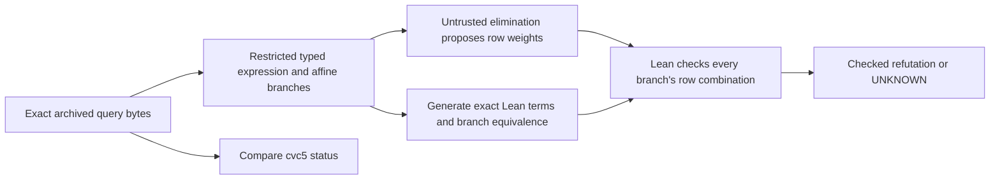

# RT-07 — Check restricted affine certificates without the CPC verifier

A small Lean checker refutes two exact archived QF_LIA queries and a weighted control. Its checked statements use only standard Lean axioms. It returns UNKNOWN when a branch has a model or when an integer contradiction requires more than a nonnegative combination of linear inequalities.

## Question and scope

The [existing CPC route](../PROOF-OBLIGATION-BENCHMARK/SYMBOLIC-CPC-CERTIFICATES.md) checks actual cvc5 certificates and binds them to the exact query. This experiment compares a separate arithmetic certificate route on the same absolute-value and final-register queries. It preserves the archived bytes and exact declaration order. It does not parse or certify CPC commands.

The admitted profile has two declared integers, one assertion, affine addition and subtraction, integer equality or order, Boolean connectives, and integer conditional terms. The normalizer expands guards and turns each branch into rows of the form `a*x + b*y + c ≤ 0`. The complement of an integer inequality uses a unit offset. Nonlinear products and a changed declaration set are rejected.

## Method

A Python producer uses Fourier–Motzkin elimination to find each branch's weight vector. It records the nonnegative integer weights of the original rows throughout elimination. A candidate closes a branch when the weighted sum cancels both variable coefficients and leaves a positive offset.



The generic Lean theorem proves that the weighted sum is nonpositive under every valuation that satisfies the rows. A positive constant sum contradicts that property. The whole-query checker needs a certificate for every normalized branch. Separately generated Lean proofs check equivalence of each translated assertion and its merged branch set for all integer valuations, including the satisfiable control. These proofs use case splits and Lean's `omega` tactic. A direct `omega` proof against the translated formula also checks each cvc5-unsatisfiable case without consuming an affine certificate. Solver status supplies a comparison and is outside the logical inference.

## Results

| Query | cvc5 status | Branches with a certificate | Restricted result |
| --- | --- | ---: | --- |
| absolute | unsat | 9/9 | Checked refutation |
| zeroFinal | unsat | 3/3 | Checked refutation |
| weighted | unsat | 1/1 | Checked refutation |
| oneFeasibleBranch | sat | 1/2 | UNKNOWN |
| integerOnly | unsat | 0/1 | UNKNOWN |

The weighted control uses two inconsistent inequalities with coefficient magnitudes one and two. The positive constant certificate uses weights one and two. The satisfiable control has a closed branch and an admissible branch at `x=y=0`. Lean proves that checking just the closed branch succeeds, and separately proves that the omission changes the original assertion's coverage. Retaining both branches and providing only one weight vector fails the checker. The integer-only control `2*x = 1` has a rational solution and no integer solution. It has no affine combination certificate here, while the integer tactic proves the translated contradiction.

Lean checked 18 statements. Across them, the observed axiom names are `propext`, `Classical.choice`, and `Quot.sound`. The restricted proof introduces no native computation axiom. A compiled proof term checks each arithmetic verdict relative to the exact translated goal and the proved equivalence.

## Implementation trade-offs

The flat certificate checker has an explicit arithmetic contract and can replay an untrusted producer's results. It requires checked complete branch coverage, can abstain on integer-only contradictions and has an exponential normalization risk on larger expressions. Direct Lean tactics resolve the tested integer-only case but use a different, tactic-driven contract and proof generation path. A CPC verifier supports a wider rule vocabulary and checks actual solver proof commands. These remain different routes for selecting backend coverage and trust policy.

The Lean correspondence theorem starts at a generated Lean assertion. It does not prove that the experiment's SMT-LIB reader agrees with every external parser. The exact input hashes and cvc5 comparison constrain the two archived claims. General wire semantics, unsupported theories, certificate coverage, normalization cost, exact proof routing policy and independent review remain open.

## Reproduce

Use CPython 3.12.14, cvc5 1.4.2 at revision `282d5e0`, and Lean 4.36.0 at revision `611c117bfaf7b7ae1cfcf246ce6fba31e8f509e9`. The replay verifies the archived hashes, generates fresh Lean files, and compares the solver status. It retains each normalized branch and weight vector.

```sh
fixture=research/formal-verification/RT-07/AFFINE-CERTIFICATES-01
out=$(mktemp)
python3 -B "$fixture/run.py" --lean "$(command -v lean)" --cvc5 "$(command -v cvc5)" > "$out"
cmp "$fixture/evidence.json" "$out"
python3 "$fixture/chart.py"
```

[Lean arithmetic checker](AFFINE-CERTIFICATES-01/Affine.lean) · [Normalizer](AFFINE-CERTIFICATES-01/normalize.py) · [Replay and proof generator](AFFINE-CERTIFICATES-01/run.py) · [Evidence ledger](AFFINE-CERTIFICATES-01/evidence.json)
