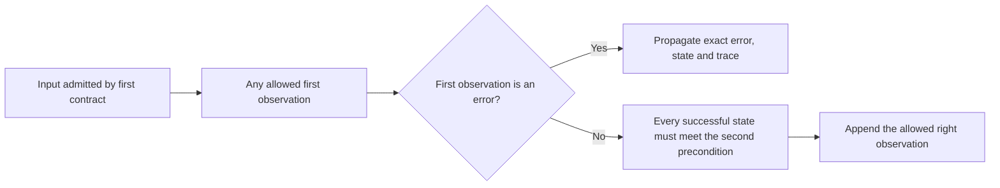

# RT-07 — Sequential contract composition over nondeterministic outcomes

## Question and model

What condition lets the contract of one command feed the contract of a second when the first can return different states or fail after an observable effect? The [deterministic state/Result comparison](RT-07-THREE-SEMANTICS-STATE-RESULT-2026-11-25.md) checks a designated sequencing rule. The [nondeterministic refinement study](RT-07-NONDETERMINISTIC-REFINEMENT-2026-11-25.md) checks set inclusion. This fixture checks their composition at a contract boundary and contrasts a universal handoff with weaker or more conservative rules. [PLAN §2.1](../../../PLAN.md#21-formal-semantics-of-the-language) · [#293](https://github.com/aivibeflow/LLMLang/issues/293)

A contract supplies an input predicate and an allowed observation relation. An observation includes a success or error tag, final state and an ordered trace. A program satisfies its contract when every concrete result for an admitted input belongs to the allowed relation. A sequence carries a prefix error through unchanged. On prefix success, the right action receives the post-left state. The sequence keeps the right result and final state and appends its trace after the prefix.



The universal side condition applies to every successful intermediate state allowed by the first contract for each admitted initial input. It can be conservative when an exact implementation proof establishes a smaller reachable relation. A proof from only the declared contracts must cover all of their allowed successes.

## Proof and finite results

[Lean](SEQUENTIAL-CONTRACTS-01/Sequence.lean) proves that individual contract satisfaction plus the universal handoff yields satisfaction of the composed allowed relation. The core composition theorem and an explicit counterexample to accepting just one suitable success have empty axiom lists. A separate theorem checks that a prefix error gives the same exact sequence observation and depends on `propext`. [Axiom output](SEQUENTIAL-CONTRACTS-01/axioms.txt)

The finite comparison enumerates all 15 nonempty subsets of four first outcomes and all four possible second precondition sets over two states. A prefix can succeed or fail in either state, with an exact history attached. The second action can return after reading the state or write another state and then fail. An independent execution oracle compares the applicable handoff rules on all 60 contract pairs.

| Handoff rule | Admitted | False admissions | False refusals |
| --- | ---: | ---: | ---: |
| Require all successful intermediate states | 32 | 0 | 0 |
| Accept one suitable success | 28 | 8 | 12 |
| Require all states including errors | 21 | 0 | 11 |
| Skip handoff check | 60 | 28 | 0 |

The existential rule admits a left contract that can succeed in either state when the right contract admits only one of them. It also refuses all-error cases even when propagating the error requires no right-side precondition. Checking all final states including error states causes 11 unnecessary refusals. A check of neither intermediate state admits all 28 cases with a possible out-of-domain continuation.

The admitted pairs yield 972 concrete refinement cases by varying nonempty first and second outcome subsets. The independent path calculation agrees with the composed evaluator for all 1,728 distinct outcomes counted per case. Every exact concrete outcome belongs to its composed contract. The retained trace includes the prefix effects even when the sequence fails.

## Reproduce and limits

The baseline was `26170df90923f5f639f695ff37339d7a4eaad7e8` on `research/all`. Replay used CPython 3.12.14 and Lean 4.36.0 at `611c117bfaf7b7ae1cfcf246ce6fba31e8f509e9` on Debian 13 Linux 6.18.57 x86-64:

```sh
fixture=research/formal-verification/RT-07/SEQUENTIAL-CONTRACTS-01
out=$(mktemp)
axioms=$(mktemp)
lean -DwarningAsError=true "$fixture/Sequence.lean" > "$axioms" &&
  cmp "$fixture/axioms.txt" "$axioms" &&
  python3 -B "$fixture/run.py" > "$out" &&
  cmp "$fixture/evidence.json" "$out" &&
  python3 -B "$fixture/chart.py"
```

The [ledger](SEQUENTIAL-CONTRACTS-01/evidence.json) preserves each contract pair, its outcome obligations and all comparison counts. The [table generator](SEQUENTIAL-CONTRACTS-01/chart.py) renders categorical results. This study covers left-to-right finite sequential outcomes with explicit error propagation. It leaves termination and divergence, error recovery, state abstraction, concurrency, compiler correspondence and canonical contract syntax open. [Runner](SEQUENTIAL-CONTRACTS-01/run.py)
