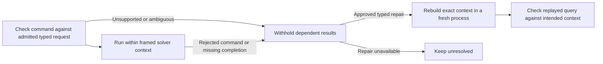

# Fail-closed recovery from incremental solver command failures

## Policy and model

An incremental solver can leave a rejected mutation unapplied and then continue answering queries from the old context. It can also accept a construct that the application requires its narrower profile to refuse. This study compares continuing the process, withholding results after a scope failure, and starting a fresh process with an explicitly supplied typed repair. The experiment uses an integer `x` in `[0, 2]` and admits exact integer equalities and one-level scope changes. A three-element set oracle computes the intended query result independently of solver messages. The runner deliberately dispatches raw negative controls to measure backend behavior. Its admission check compares the control's command with the exact rendering of the typed fixture input. [Earlier scope-evidence study](RT-07-INCREMENTAL-SOLVER-EVIDENCE-2026-11-25.md) · [Strict QF_LIA admission study](RT-07-STRICT-QFLIA-ADMISSION-2026-11-25.md)



Each case frames the known prefix, command under test and following query with distinct echoes. A reply following an invalid context mutation is allowed into the raw transcript and excluded from evidence for the intended query. The prefix response remains available as historical solver output. The fresh run replays the admitted prefix, performs only the supplied typed repair, and executes the originally requested tail.

## Results

Both backends match the independent bounded oracle on the two admitted controls and six repaired contexts. The seven negative cases per solver cover a mixed Boolean and integer equality, a string operand, an undeclared symbol, an unsupported command, stack underflow, a model request after UNSAT and a missing repair. [Machine-readable evidence and transcripts](SOLVER-SESSION-RECOVERY-01/evidence.json) · [Table generator](SOLVER-SESSION-RECOVERY-01/chart.py)

| Solver | Faults withheld | Silent profile violations | Blind tail answers | Disagree with approved fresh replay | Recoverable |
| --- | ---: | ---: | ---: | ---: | ---: |
| cvc5 | 7 | 0 | 1 | 0 | 6 |
| z3 | 7 | 1 | 7 | 4 | 6 |

After `pop 2` with only one pushed frame, Z3 reports an error and later answers UNSAT because the old equality is still active in the observed context. A fresh replay with the approved `pop 1` answers SAT. An unsupported command in Z3 produces a complete process exit of zero and a trailing SAT where the approved repair yields UNSAT. cvc5 exits before the following query on six negative cases. It gives a trailing answer after the rejected model request. Both backends have a repaired tail for that case, but the failed model response remains unusable.

The mixed-sort control reports a successful process exit and no diagnostic in Z3. In six extra checks, Z3 satisfies `(= x false)` only at zero and `(= x true)` only at one. cvc5 rejects all six commands. Admission to the fixture's integer-equality profile therefore needs an explicit input check even when the solver replies cleanly. The ninth session case supplies no approved repair and remains unresolved under either backend.

These outcomes apply to the two pinned solvers and the fixed scope protocol. The experiment validates a conditional recovery decision from known inputs under the stated oracle. It leaves arbitrary command parsing, persistent production workers, malformed framing, transport retries, concurrent clients and independent refutations outside its scope.

## Reproduction

Use CPython 3.12.14, cvc5 1.4.2 revision `282d5e0` and Z3 4.13.3 with both solvers on PATH. Run from repository root.

```sh
set -eu
fixture=research/formal-verification/RT-07/SOLVER-SESSION-RECOVERY-01
out=$(mktemp)
trap 'rm -f "$out"' EXIT
python3 -B "$fixture/run.py" > "$out"
cmp "$fixture/evidence.json" "$out"
python3 -B "$fixture/chart.py"
```

[PLAN §2.2](../../../PLAN.md#22-proof-architecture-and-proof-boundary) · [Issue #294](https://github.com/aivibeflow/LLMLang/issues/294)
